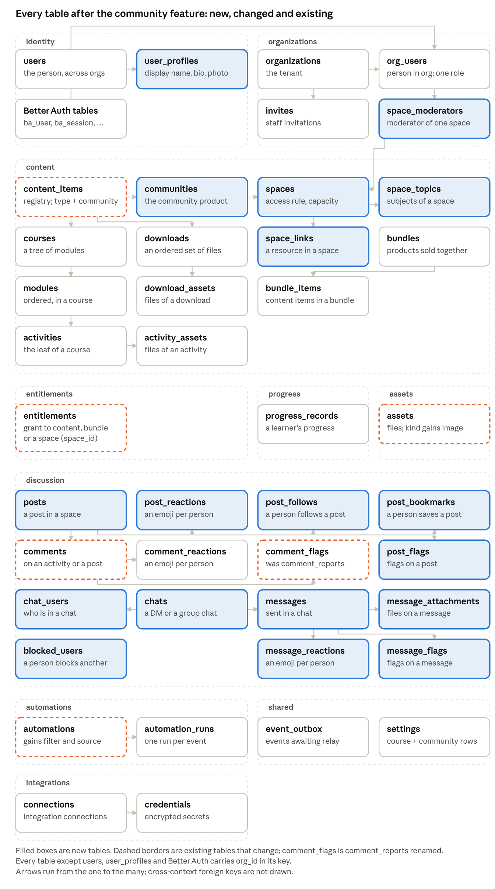
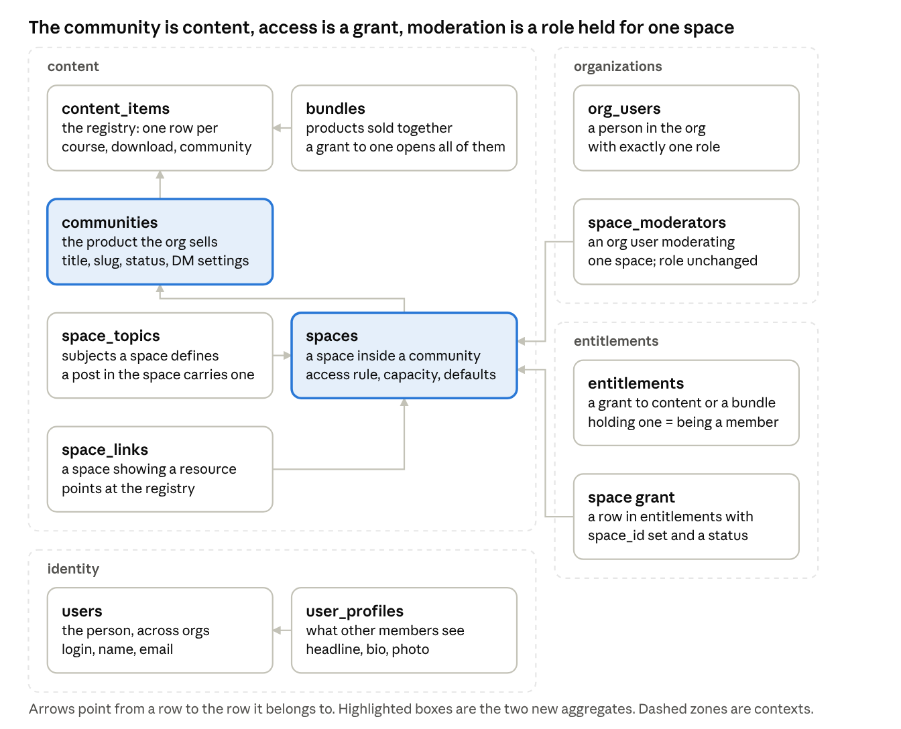
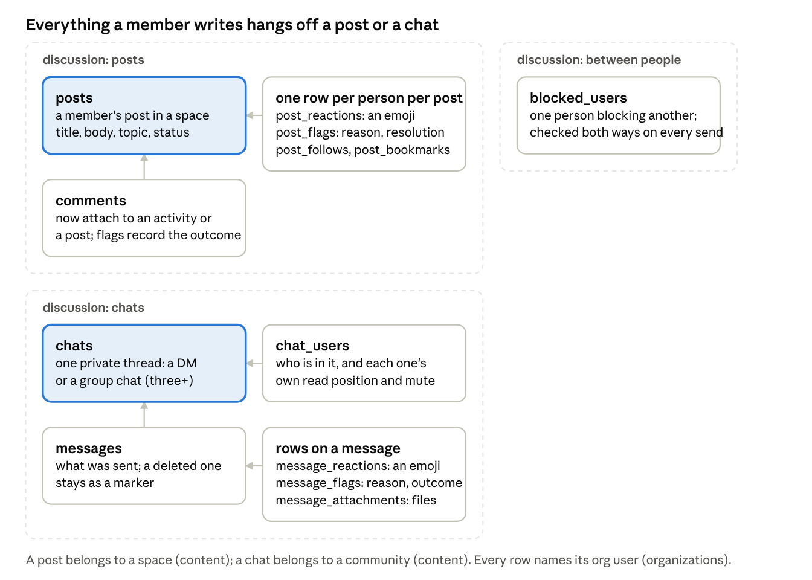
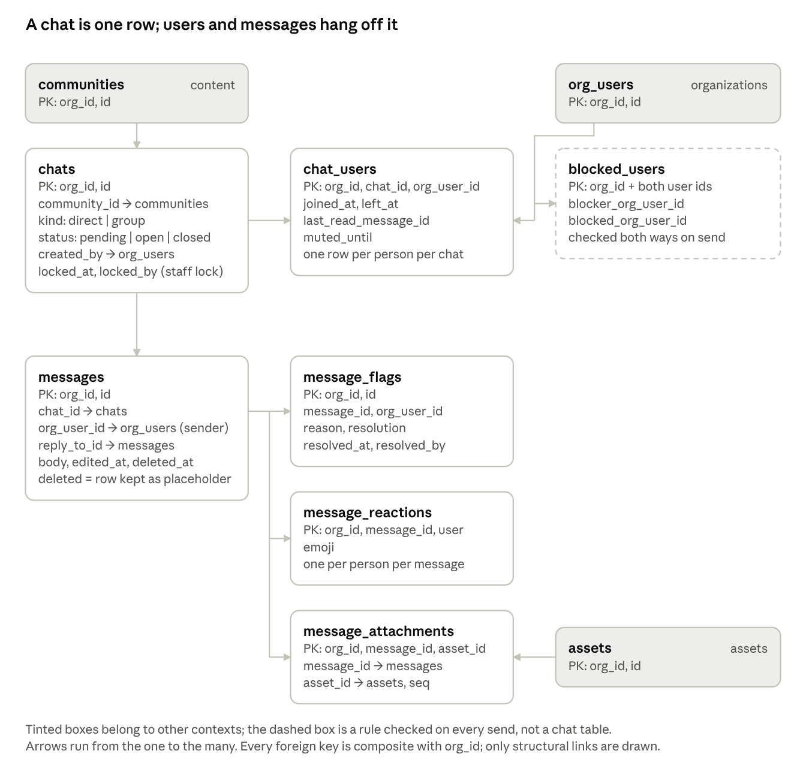
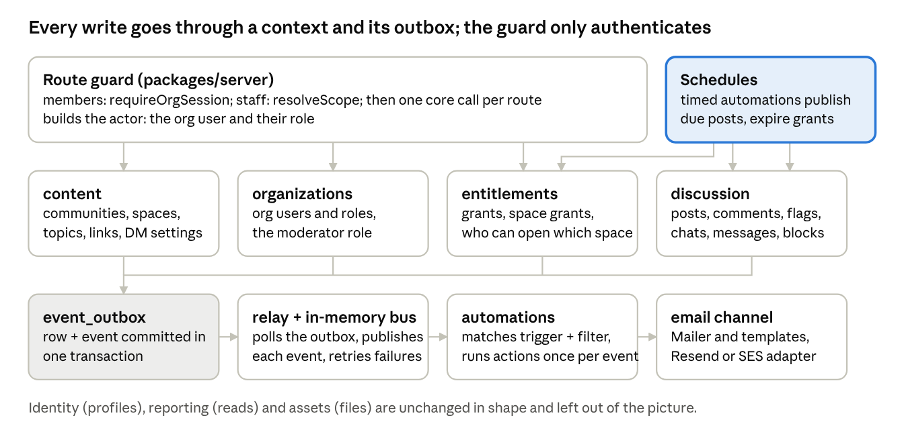
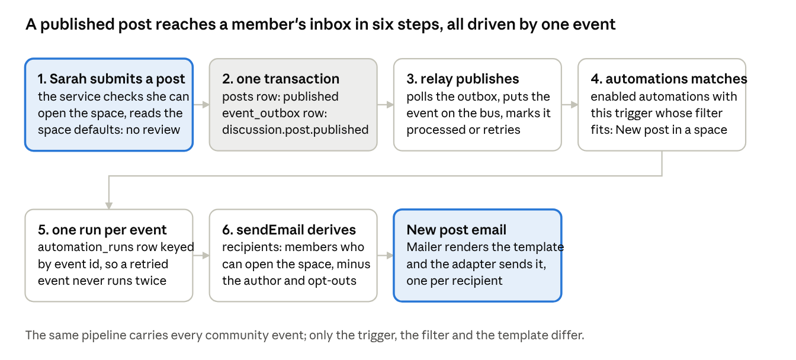

# Community: technical spec

Oct 21, 2026 · @Meiring

## Purpose and scope

This document is the technical specification for the community feature of Headless LMS. It defines the database tables, the ports and adapters, the domain events, the automations, the emails, and the authentication and authorization rules required to build the feature. It is written for the engineers who will implement the feature and for review before implementation starts.

The feature is described at the product level in the community exploration document. That document defines the use cases, the vocabulary, and which bounded context owns each concept. This document does not repeat those decisions except where a technical detail depends on them, and it does not change them.

The feature adds no new bounded context and no new kind of port. All tables, events and ports defined here belong to contexts that exist today: organizations, identity, content, entitlements, discussion, progress, automations, reporting and assets. Events (the content type) appear in the use cases as examples of a future content type. They are not a content type, `space_links` does not target them, and this feature adds no table, column, or task for them.

The document has the following sections: use cases; model and ownership; data model; ports and adapters; domain events; automations; emails; security and authorization.

## Use cases

This section lists the use cases the design must support. They are taken from the community exploration document. Each use case gives the organization, the products it sells, the spaces of its community with their access rules, and the DM settings. The names in the trees are the names used for tables and columns in the data model section.

**A course cohort.** Spanish in 90 Days sells a 12-week course. The community is sold with it in a bundle, so every student is a member for the length of the cohort. Spaces follow the course: announcements, one per skill, one to ask the tutor, and a small opt-in space to find a speaking partner.

```
Org: Spanish in 90 Days
├─ Course: Spanish in 90 Days
├─ Community: Spring cohort
│    ├─ Space: Announcements        all members, posts reviewed before publishing
│    ├─ Space: Practice             all members                    topics: Speaking, Writing, Listening
│    ├─ Space: Ask the tutor        all members                    links: Spanish in 90 Days
│    └─ Space: Speaking partners    by request, at most 10 people
└─ Bundle: Spring cohort   (the course and the community)
DMs: on, members may message members, a first message is a request
```

**A free community around a creator.** Maker's Lounge is free. An automation grants the community to everyone who joins the org, so signing up makes a person a member. Spaces are organized by what people come to do.

```
Org: Maker's Lounge
├─ Event: Monthly meetup                  (future content type, not designed here)
├─ Community: Maker's Lounge
│    ├─ Space: Show your work       all members
│    ├─ Space: Feedback             all members                    topics: Landing page, Pricing, Product
│    ├─ Space: Jobs                 by invite
│    └─ Space: Meetups              all members                    links: Monthly meetup
└─ Automation: grant Maker's Lounge when a person joins the org
DMs: on, members may message members, no request step, group chats allowed
```

**A coaching program.** Leadership Circle sells a six-month program: a community, a monthly group call and pods of six. Each pod is its own by-invite space, capped at six.

```
Org: Leadership Circle
├─ Event: Monthly group call, Pod Red call, Pod Blue call   (future content type)
├─ Community: Leadership Circle
│    ├─ Space: General              all members                    links: Monthly group call
│    ├─ Space: Pod Red              by invite, at most 6 people    links: Pod Red call
│    └─ Space: Pod Blue             by invite, at most 6 people    links: Pod Blue call
└─ Bundle: Leadership Circle   (the community and the monthly group call)
DMs: on, members may message staff only, group chats off
```

**Founder Collab.** This is the reference use case. The exploration document walks through it in eighteen steps: Rachel is the owner, Emma is an instructor, Sarah and James are members, James holds the moderator role, and Tom holds only the course. The tables, events and emails in this document are checked against those steps.

```
Org: Founder Collab                    staff: Rachel (owner), Emma (instructor); moderator: James
├─ Course: Fundraising 101
├─ Event: Monthly founders call       (future content type)
├─ Community: Founder Collab Community
│    ├─ Space: Announcements    all members      posts reviewed before publishing, comments off
│    ├─ Space: Introductions    all members
│    ├─ Space: General          all members      topics: Growth, Fundraising, Other
│    │                                           links: Fundraising 101, Monthly founders call
│    ├─ Space: Wins             all members      comments on, reactions on
│    ├─ Space: SaaS founders    by request, at most 12 people     topics: Growth, Pricing, Other
│    └─ Space: Hiring           by invite
│    DM settings: on; members may message members; first message is a request; group chats on, up to 8
├─ Bundle: Founder Collab Membership   (the community, Fundraising 101 and the monthly founders call)
└─ Automations
     ├─ when a person is granted the community → send the welcome email
     ├─ when a post is published in SaaS founders → email its space members
     └─ when a post is published in Announcements → email every member
```

The Announcements and SaaS founders rows are the seeded new-post automation, not a second email. Announcements reaches every member because every member can open that space. SaaS founders reaches its space members. The event links in this tree and in the trees above are examples. Nothing in this feature stores them.

## Model and ownership

This section lists every term used in this document with the context that owns it. The ownership follows the exploration document. A context reads another context's data only through that context's public interface. No data is copied between contexts. Private messaging uses three terms throughout this document. A chat is a private thread between members of one community. A DM is a chat between two people; a group chat is a chat between three or more. A message is one message sent in a chat.

| Term | Owner | Definition |
| --- | --- | --- |
| Community | content | A content type beside course and download; a product the org sells or gives away |
| Space | content | Part of the community's structure: name, order, access rule, capacity, topics, links, post defaults |
| Topic | content | A subject defined on a space; a post in that space carries one |
| Link | content | A space pointing at a course, a download, or a community; opening it needs a grant. Event links in the use cases are examples and are not stored |
| Post defaults | content | Per space: comments on, reactions on, review before publishing; discussion reads them |
| DM settings | content | Per community: whether chats are on, who may message whom, whether a first message is a request, whether group chats are allowed and their size; discussion reads them |
| Bundle | content | Products sold together; a grant to it opens every product in it |
| Grant | entitlements | One person's access to one product or bundle; the only access path |
| Member | entitlements | Not a record and not a role: anyone holding a grant to the community |
| Space member | entitlements | A person's place in one by-request or by-invite space, held on top of the grant to the community. Its own table, not a grant. Status: requested, invited, active, or revoked |
| Staff | organizations | Owner, admin, instructor; open and moderate everything without a grant |
| Moderator | organizations | A Better Auth role beside owner, admin, instructor and student. Not staff. A member who holds it moderates every space of the communities they hold a grant to |
| Profile | identity | What others see of a person |
| Post | discussion | What a member writes in a space: title, body, topic, status, extra fields |
| Comment | discussion | The existing comment, now targeting an activity or a post |
| Reaction | discussion | An emoji on a post, comment or message |
| Flag | discussion | The existing report, now on a post, comment or message; queue per space, per community for messages |
| Follow, bookmark | discussion | A member's state on a post |
| Feed | discussion | Space feed (the space's posts) and member feed (posts from every space the person can open) |
| Chat | discussion | A private thread in one community; either a DM (two people) or a group chat (three or more) |
| DM | discussion | A chat between two people; two people have at most one DM in a community |
| Group chat | discussion | A chat between three or more people |
| Message | discussion | One message sent in a chat |
| Message request | discussion | A DM whose recipient has not yet accepted it |
| Read position, mute | discussion | Per participant per chat |
| Block | discussion | One person stopping another from messaging them inside one community; checked on every send in that community |
| Directory | reporting/member | Grants (entitlements) plus roles (organizations) plus profiles (identity). A method on the member service. Reporting owns no data |
| Analytics | reporting/admin | Staff reads across the contexts, a method on the admin service. Reporting owns no data |
| Files | assets | Post covers, message attachments, profile photos. Each is a member upload: an image the person uploaded themselves, with `source = member`. A cover and a profile photo are asset ids. The post, message or profile that holds a file is returned with the file's signed URL; no route serves a file by id |

## Data model

This section specifies the database tables. The feature adds twenty tables, changes `content_items`, `comments` and `assets`, renames `comment_reports`, and adds columns on `automations`. The `entitlements` table does not change. The section has two parts. Part 1 covers the structure of a community and access to it, in the content, organizations, entitlements and identity contexts. Part 2 covers what members write, in the discussion context. Each part starts with a diagram. Each table then has a description of its purpose and the SQL that creates it.

All tables follow the conventions of the existing schema in `adapters/db/src/schema`. Every row carries `org_id`, and the primary key is `(org_id, id)`. Ids are text values made of a prefix and a KSUID, for example `spc_2HkY…`. Every table has `created_at` and `updated_at`. Enum columns are `text`; the allowed values are enforced in application code and are listed in a comment in the SQL. Foreign keys between org-owned tables include `org_id` on both sides. A foreign key cascades on delete where the child row is part of the parent. It does not cascade where it references a row owned by another context, such as a file in assets. There is no soft delete: a removed post keeps its row with status `removed`, as a removed comment does today.



The diagram shows every table the system has after the feature, grouped by the context that owns it. Filled boxes are new; dashed borders mark existing tables that change. The two parts that follow zoom into the new and changed tables.

### Part 1: structure and access



In the diagram, arrows point from a row to the row it belongs to. The highlighted boxes are the two new aggregates, the community and the space. The dashed zones are contexts. A grant references the content registry or a bundle. A space member is its own table and is not a grant.

#### content\_items

The registry table `content_items` has one row per piece of content and a `type` column with the values `course` and `download`. Grants, bundle items and space links reference registry rows. The change adds `community` to the allowed values of `type`. No other change to the registry is required. Grants to communities and communities in bundles work without changes to the `entitlements` and `bundle_items` tables.

```sql
alter table content_items drop constraint content_items_type_check;
alter table content_items add constraint content_items_type_check
  check (type in ('course', 'download', 'community'));
```

#### communities

The `communities` table holds one row per community. It is built the same way as `courses`: the row has the same id as its registry row, a generated `type` column fixed to `community`, and a foreign key over `(org_id, id, type)` to the registry. Deleting the registry row deletes the community row.

The community's DM settings are stored in the shared `settings` table, in a row with namespace `content` and the community id as scope, in the same way as a course's settings. The row holds whether DMs are enabled, who may message whom, whether a first message is a request, whether group chats are allowed, and the maximum group size. Content is the only writer of this row, through its community settings update, the counterpart of the course settings update. Discussion reads it through content's reader before each chat operation. The settings row has no foreign key. Deleting the community deletes that settings row in the same transaction.

```sql
create table communities (
  org_id              text not null references organizations(id),
  id                  text not null,                       -- cmy_...
  type                text not null generated always as ('community') stored,
  title               text not null,
  slug                text not null,
  description         text not null default '',
  status              text not null default 'draft',       -- draft | published
  thumbnail_asset_id  text,
  created_at          timestamptz not null default now(),
  updated_at          timestamptz not null default now(),
  primary key (org_id, id),
  unique (org_id, slug),
  foreign key (org_id, id, type) references content_items(org_id, id, type) on delete cascade,
  foreign key (org_id, thumbnail_asset_id) references assets(org_id, id)
);
```

The structure of the settings row, with the default values:

```
settings(org_id, namespace = 'content', scope_id = <community id>).value = {
  dm: {
    enabled: true,
    memberToMember: true,
    memberToStaff: true,
    staffToAnyone: true,
    firstMessageIsRequest: true,
    groupChats: true,
    groupSize: 8
  }
}
```

#### spaces

The `spaces` table holds one row per space. A space belongs to one community. It has a name, a description, a position in the community's list, an access rule, an optional capacity, and the default settings for posts in it. The access rule is one of `all_members`, `by_request` and `by_invite`. The capacity applies only to `by_request` and `by_invite` spaces, which a check constraint enforces.

The post defaults are stored in the `settings` column of the space row as `{ comments, reactions, requireReview }`, with the defaults `true`, `true` and `false`. This matches how an activity stores its settings on its own row. Content owns the column. Discussion reads it when a post is created.

```sql
create table spaces (
  org_id        text not null references organizations(id),
  id            text not null,                              -- spc_...
  community_id  text not null,
  name          text not null,
  description   text not null default '',
  seq           integer not null,                           -- display order within the community
  access_rule   text not null default 'all_members',        -- all_members | by_request | by_invite
  capacity      integer,                                    -- null = unlimited; only for by_request and by_invite
  settings      jsonb not null default '{}',                -- { comments, reactions, requireReview }
  created_at    timestamptz not null default now(),
  updated_at    timestamptz not null default now(),
  primary key (org_id, id),
  unique (org_id, id, community_id),
  foreign key (org_id, community_id) references communities(org_id, id) on delete cascade,
  constraint spaces_capacity_check check (capacity is null or access_rule <> 'all_members')
);
create index spaces_order_idx on spaces (org_id, community_id, seq);
```

#### space\_topics

The `space_topics` table holds the topics defined on a space. Where a space defines topics, each post in that space carries one, and the space feed can be filtered by topic. A space without topics has posts without a topic. Topics are deleted with their space. Setting a space's topics replaces the list in one transaction under a lock on the space; a topic a post still references is refused with a conflict before anything is written. A topic given a name another topic in the space still holds is refused with a conflict.

```sql
create table space_topics (
  org_id      text not null references organizations(id),
  id          text not null,                                -- top_...
  space_id    text not null,
  name        text not null,
  seq         integer not null,
  created_at  timestamptz not null default now(),
  updated_at  timestamptz not null default now(),
  primary key (org_id, id),
  unique (org_id, space_id, name),
  unique (org_id, space_id, id),
  foreign key (org_id, space_id) references spaces(org_id, id) on delete cascade
);
```

#### space\_links

The `space_links` table holds the resources a space shows. A link references a content registry row: a course, a download, or a community. A link does not grant access; opening the linked resource requires a grant to it. A link is deleted when its space or its resource is deleted. Event links in the use cases are examples. This table does not store them.

```sql
create table space_links (
  org_id      text not null references organizations(id),
  id          text not null,                                -- slk_...
  space_id    text not null,
  content_id  text not null,                                -- any registry row: course, download, community
  seq         integer not null default 0,
  created_at  timestamptz not null default now(),
  updated_at  timestamptz not null default now(),
  primary key (org_id, id),
  unique (org_id, space_id, content_id),
  foreign key (org_id, space_id) references spaces(org_id, id) on delete cascade,
  foreign key (org_id, content_id) references content_items(org_id, id) on delete cascade
);
```

The `bundles` and `bundle_items` tables do not change. A bundle holds a community by its registry id.

#### org\_users

The `org_users` table does not change. Its `role` column accepts a fifth value, `moderator`, beside `owner`, `admin`, `instructor` and `student`. The allowed values are enforced in application code, as they are for the four roles today, so no migration touches the table. `moderator` is a Better Auth role, defined beside the four in the auth adapter, and assigned through the existing membership path. Better Auth stores the member role. `beforeUpdateMemberRole` copies it onto `org_users.role` and emits `organization.user.updated`. One role per person per org. A moderator is not staff and holds a grant to each community they take part in. The role carries moderation rights across the org, defined in organizations' authorization matrix, and no table records what a moderator moderates. Member is not a role. The `invites` and `users` tables do not change; an invite carries the moderator role as it carries any other.

A student org user has no Better Auth membership. Giving that person the moderator role creates the membership, the same way accepting a staff invite does. When the person already has an org user row, the membership hook updates that row's role and does not insert a second org user. A person who already has a membership gets `updateRole`.

#### entitlements

The `entitlements` table does not change. A grant stays a grant: stored status `active` or `revoked`, expiry derived from `expires_at`, one target that is a content item or a bundle. A grant to a community is a row whose `content_id` is the community's registry id, or a bundle grant whose bundle contains that id. A member is a person who holds such a grant. There is no member table. `requested` and `invited` are not grant statuses. The repository treats any row that is not `revoked` and not past `expires_at` as active, so those words never go in this table.

Two lookups are extended for the new content type: the title lookup in the entitlements repository, and the content lookup the mailer uses.

#### space\_members

The `space_members` table holds a person's place in one space. It exists only for a `by_request` or `by_invite` space, and it is checked on top of the grant to the community, never instead of it. An `all_members` space has no space members; the grant to the community is enough. The row carries `community_id` so a community's automations can filter on it.

A request to join creates a row with status `requested`. Approval sets it to `active`. An invitation creates a row with status `invited`. Acceptance sets it to `active`. Declining a request, refusing an invitation, and leaving a space delete the row. Removal by staff or a moderator sets it to `revoked`. The `source` column records how the row was made: `request`, `invite`, or `manual`. Requests and approvals happen only in a `by_request` space, invitations and acceptances only in a `by_invite` space; in an `all_members` space the rows are ignored. Every transition locks the row inside its transaction and checks the status there, so a decline cannot delete a row an approval has just made active, and a second approval is refused. Approval requires the requester to still hold a grant to the community.

Capacity is not stored as a count. On approval or acceptance, entitlements asks content to lock the space row in the same transaction, counts the space's rows with status `active` whose holder still holds an active grant to the community, and rejects the operation when the count equals the capacity. A member whose grant lapsed frees their seat without their row changing. Entitlements does not update the `spaces` table.

```sql
create table space_members (
  org_id        text not null references organizations(id),
  id            text not null,                              -- spm_...
  community_id  text not null,
  space_id      text not null,
  org_user_id   text not null,
  status        text not null,                              -- requested | invited | active | revoked
  source        text not null default 'request',            -- request | invite | manual
  created_at    timestamptz not null default now(),
  updated_at    timestamptz not null default now(),
  primary key (org_id, id),
  unique (org_id, space_id, org_user_id),
  foreign key (org_id, community_id) references communities(org_id, id) on delete cascade,
  foreign key (org_id, space_id, community_id) references spaces(org_id, id, community_id) on delete cascade,
  foreign key (org_id, org_user_id) references org_users(org_id, id) on delete cascade
);
create index space_members_space_idx on space_members (org_id, space_id, status);
create index space_members_community_idx on space_members (org_id, community_id);
```

#### entitlement\_expiry\_notices, entitlement\_ending\_soon\_notices

These two tables record that the expiry run has emitted an event, so each emission happens once. `entitlement_expiry_notices` holds one row per grant per term when `entitlement.expired` is emitted. `entitlement_ending_soon_notices` holds one row per grant per community per term when `entitlement.ending_soon` is emitted. The term is the grant's `expires_at` at the time: a renewed grant has a new `expires_at`, so it is expired and reminded again. The run claims a row with an insert that does nothing on conflict and emits the event only when the insert wrote the row, in the same transaction as the outbox append. The grant row does not change.

```sql
create table entitlement_expiry_notices (
  org_id          text not null references organizations(id),
  entitlement_id  text not null,
  expires_at      timestamptz not null,
  notified_at     timestamptz not null default now(),
  primary key (org_id, entitlement_id, expires_at),
  foreign key (org_id, entitlement_id) references entitlements(org_id, id) on delete cascade
);

create table entitlement_ending_soon_notices (
  org_id          text not null references organizations(id),
  entitlement_id  text not null,
  community_id    text not null,
  expires_at      timestamptz not null,
  notified_at     timestamptz not null default now(),
  primary key (org_id, entitlement_id, community_id, expires_at),
  foreign key (org_id, entitlement_id) references entitlements(org_id, id) on delete cascade,
  foreign key (org_id, community_id) references communities(org_id, id) on delete cascade
);
```

#### user\_profiles

The `user_profiles` table holds the profile other members see. The `users` table holds a first name, a last name and an email, and the avatar comes from the Better Auth user record. This table adds a display name, a headline, a bio, a profile photo, and an `extra` JSON column for fields the application defines that are not files. It is global like `users`: one profile per person, so it carries no `org_id`. The photo is an asset. Both asset columns are null, or both are set, and the foreign key does not cascade. The query that loads comment authors is extended with these columns and is reused for post authors, message senders and the directory. An author view carries the display name, falling back to first and last name, the headline, and the photo only when the photo was uploaded in the org being served.

```sql
create table user_profiles (
  user_id            text primary key references users(id) on delete cascade,
  display_name       text,                                  -- falls back to first + last name
  headline           text,                                  -- the line about their company
  bio                text,
  image_asset_org_id text,
  image_asset_id     text,
  extra              jsonb not null default '{}',           -- whatever else the app shows, not files
  created_at         timestamptz not null default now(),
  updated_at         timestamptz not null default now(),
  foreign key (image_asset_org_id, image_asset_id) references assets(org_id, id),
  constraint user_profiles_image_check
    check ((image_asset_org_id is null) = (image_asset_id is null))
);
```

### Part 2: what members write



Discussion owns comments, comment reactions and comment flags today. The feature adds two aggregates to it: the post, which belongs to a space, and the chat, which belongs to a community. A chat is a private thread between members: a DM when it is between two people, a group chat when it is between three or more. A message is one message sent in a chat. The other tables in this part each hold rows attached to a post, a chat or a message. Where a table holds the same kind of row as an existing comment table, it has the same shape as that table.

#### comments and comment\_flags

A comment on a post is the same entity as a comment on an activity. The `comments` table is changed so that a comment references either an activity or a post. The `activity_id` column becomes nullable, a nullable `post_id` column is added, and a check constraint requires exactly one of the two to be set. A comment on a post stores `community_id`. A comment on an activity does not. A comment on a post is created with status `published`. `requireReview` applies to posts. Flags and removal are how a comment on a post is moderated. A comment on a post is deleted when the post is deleted. A new index supports listing a post's comments.

```sql
alter table comments alter column activity_id drop not null;
alter table comments add column post_id text;
alter table comments add column community_id text;
alter table comments add constraint comments_post_fk
  foreign key (org_id, post_id) references posts(org_id, id) on delete cascade;
alter table comments add constraint comments_community_fk
  foreign key (org_id, community_id) references communities(org_id, id) on delete cascade;
alter table comments add constraint comments_target_check
  check (num_nonnulls(activity_id, post_id) = 1);
alter table comments add constraint comments_community_check
  check (post_id is null or community_id is not null);
create index comments_post_idx on comments (org_id, post_id, status, created_at);
```

The `comment_reports` table is renamed to `comment_flags`. It gains a `resolution` column with the values `dismissed` and `removed`, set together with `resolved_at`, and a `resolved_by` column holding the moderator's org user id. A report resolved before this feature did not record who resolved it: the migration sets its resolution to `dismissed` and leaves `resolved_by` null. Every resolution made from now on sets all three. The id prefix `crp` does not change. The `comment_reactions` table does not change.

```sql
alter table comment_reports rename to comment_flags;
alter table comment_flags add column resolution text;        -- dismissed | removed
alter table comment_flags add column resolved_by text;
update comment_flags set resolution = 'dismissed' where resolved_at is not null;
alter table comment_flags add constraint comment_flags_resolved_check
  check ((resolved_at is null) = (resolution is null) and (resolved_by is null or resolved_at is not null));
```

#### posts

The `posts` table holds one row per post. A post has an author, a space, the community that space belongs to, a title, a body, an optional topic and a status. `community_id` is stored on the row, the same way an activity stores `course_id`, so an event that carries the row can be filtered on it. The status values are `draft`, `scheduled`, `pending`, `published` and `removed`. `pending` means awaiting review; it is the value `comments.status` uses for the same state. A post moves from `draft` or `scheduled` to `pending` when the space requires review and the author is not staff, and to `published` otherwise. A post is submitted only with a topic its space allows. The author, staff or a moderator move a published or pending post to `removed`; restoring it applies the space's review rule again. A draft or scheduled post is seen by its author only; moderators and staff see pending, published and removed posts. A comment is accepted only on a published post. When the Publish due posts automation finds that the author can no longer open the space or the topic no longer fits it, the post goes back to `draft` with `discussion.post.updated`.

`comments_closed` and `reactions_enabled` are nullable. Null means the space default applies. `pinned` is a boolean. The cover is `cover_asset_id`, a non-cascading foreign key to assets, the same shape as a course thumbnail. The `extra` column holds application-defined fields that are not files. A post's topic is a topic of its own space. The foreign key includes `space_id`, and it does not cascade: a topic cannot be deleted while a post references it. A removed post keeps its row and its comments. The author foreign key does not cascade.

```sql
create table posts (
  org_id             text not null references organizations(id),
  id                 text not null,                            -- pst_...
  community_id       text not null,
  space_id           text not null,
  org_user_id        text not null,                            -- the author
  topic_id           text,
  title              text not null,
  body               text not null,                            -- rich content as the app sends it
  extra              jsonb not null default '{}',
  cover_asset_id     text,
  status             text not null default 'draft',           -- draft | scheduled | pending | published | removed
  scheduled_at       timestamptz,
  published_at       timestamptz,                              -- set once, on first publish
  removed_by         text,
  pinned             boolean not null default false,
  comments_closed    boolean,                                  -- null = the space's default
  reactions_enabled  boolean,                                  -- null = the space's default
  created_at         timestamptz not null default now(),
  updated_at         timestamptz not null default now(),
  primary key (org_id, id),
  foreign key (org_id, space_id, community_id) references spaces(org_id, id, community_id) on delete cascade,
  foreign key (org_id, org_user_id) references org_users(org_id, id),
  foreign key (org_id, space_id, topic_id) references space_topics(org_id, space_id, id),
  foreign key (org_id, cover_asset_id) references assets(org_id, id),
  foreign key (org_id, removed_by) references org_users(org_id, id),
  constraint posts_removed_by_check check ((status = 'removed') = (removed_by is not null)),
  constraint posts_scheduled_check  check (status <> 'scheduled' or scheduled_at is not null)
);
create index posts_feed_idx   on posts (org_id, space_id, status, pinned desc, published_at desc);
create index posts_due_idx    on posts (org_id, status, scheduled_at);
create index posts_author_idx on posts (org_id, org_user_id);
```

The table has three indexes. `posts_feed_idx` serves the feeds, which read by space and status, pinned posts first, then publish time. `posts_due_idx` serves the Publish due posts automation, which reads posts with status `scheduled` whose time has passed. `posts_author_idx` serves a member's own post list.

#### post\_reactions, post\_follows, post\_bookmarks

These three tables each hold one row per person per post. `post_reactions` holds an emoji and has the same shape as `comment_reactions`; a person's reaction is replaced when they change it. `post_follows` records that a person wants to be notified of new comments on the post. `post_bookmarks` records that a person saved the post. Follows and bookmarks are separate tables because different operations read them: the comment notification reads follows, and the member's saved list reads bookmarks.

```sql
create table post_reactions (
  org_id       text not null references organizations(id),
  post_id      text not null,
  org_user_id  text not null,
  emoji        text not null,
  created_at   timestamptz not null default now(),
  updated_at   timestamptz not null default now(),
  primary key (org_id, post_id, org_user_id),
  foreign key (org_id, post_id)     references posts(org_id, id)     on delete cascade,
  foreign key (org_id, org_user_id) references org_users(org_id, id) on delete cascade
);

create table post_follows (
  org_id       text not null references organizations(id),
  post_id      text not null,
  org_user_id  text not null,
  created_at   timestamptz not null default now(),
  updated_at   timestamptz not null default now(),
  primary key (org_id, post_id, org_user_id),
  foreign key (org_id, post_id)     references posts(org_id, id)     on delete cascade,
  foreign key (org_id, org_user_id) references org_users(org_id, id) on delete cascade
);

create table post_bookmarks (
  org_id       text not null references organizations(id),
  post_id      text not null,
  org_user_id  text not null,
  created_at   timestamptz not null default now(),
  updated_at   timestamptz not null default now(),
  primary key (org_id, post_id, org_user_id),
  foreign key (org_id, post_id)     references posts(org_id, id)     on delete cascade,
  foreign key (org_id, org_user_id) references org_users(org_id, id) on delete cascade
);
create index post_bookmarks_user_idx on post_bookmarks (org_id, org_user_id, created_at);
```

#### post\_flags

The `post_flags` table holds flags on posts and has the same shape as `comment_flags`. A person can flag a post once; flagging it again returns the existing flag and emits nothing. A flag is open until a moderator acts on the item: removing the post resolves its open flags as `removed` when staff or a moderator removes it, and dismissing is the only resolution made without acting on the item. An author who removes their own post leaves its flags open. The resolution is recorded on the row. The same rules hold for comment flags. The moderation queue of a space consists of the open rows in `post_flags` and `comment_flags` for that space's posts.

```sql
create table post_flags (
  org_id       text not null references organizations(id),
  id           text not null,                                  -- pfl_...
  post_id      text not null,
  org_user_id  text not null,                                  -- who flagged
  reason       text not null default '',
  resolved_at  timestamptz,
  resolution   text,                                           -- dismissed | removed
  resolved_by  text,
  created_at   timestamptz not null default now(),
  updated_at   timestamptz not null default now(),
  primary key (org_id, id),
  unique (org_id, post_id, org_user_id),
  foreign key (org_id, post_id)     references posts(org_id, id) on delete cascade,
  foreign key (org_id, org_user_id) references org_users(org_id, id),
  constraint post_flags_resolved_check
    check ((resolved_at is null) = (resolution is null) and (resolved_at is null) = (resolved_by is null))
);
create index post_flags_open_idx on post_flags (org_id, post_id, resolved_at);
```

#### chats

The `chats` table holds one row per chat. A chat belongs to a community and is deleted with it. The `kind` column is `direct` for a DM between two people and `group` for a group chat of three or more. The people in a chat are rows in `chat_users`, for a DM and a group chat alike; nothing on the `chats` row names them.



`org_id` is the tenant. `community_id` is the boundary inside it. Every chat table carries both. Two people have at most one DM inside one community. The same pair in another community of that org is a different chat. The service enforces the rule; no constraint does. Starting a DM takes an advisory lock on the community id and the two org user ids in sorted order, then looks for an existing chat of kind `direct` in that community whose `chat_users` rows are exactly these two people, inside the transaction that would create the new one. If one exists, the actor rejoins it if they had left, the first message is written into it under the send rules, and it is returned; a send the rules refuse leaves the chat untouched. Otherwise the chat and its two `chat_users` rows are created. A DM rejoin emits `discussion.chat.updated`.

The `status` column holds the message request state of a direct chat. When the community's DM settings make a first message a request, a new DM between two people who are not staff has status `pending` until the recipient accepts it, after which it is `open`. A request is started with its message; while it is pending, the creator cannot send. The recipient accepts explicitly or by replying. A group chat is created `open`. `pending` is never used for a group chat. A block in this community sets the direct chat between those two people to `closed`. Unblocking removes the block row and, when that direct chat is `closed` and not locked, sets it back to `open`. In a group chat that already contains both, the blocked pair cannot send and the other participants can. Staff can lock a chat; a locked chat is readable, and no participant can send to it.

```sql
create table chats (
  org_id        text not null references organizations(id),
  id            text not null,                                 -- cht_...
  community_id  text not null,
  kind          text not null,                                 -- direct | group
  status        text not null default 'open',                  -- pending | open | closed
  created_by    text not null,
  locked_at     timestamptz,
  locked_by     text,
  created_at    timestamptz not null default now(),
  updated_at    timestamptz not null default now(),
  primary key (org_id, id),
  unique (org_id, id, community_id),
  foreign key (org_id, community_id) references communities(org_id, id) on delete cascade,
  foreign key (org_id, created_by)   references org_users(org_id, id),
  foreign key (org_id, locked_by)    references org_users(org_id, id),
  constraint chats_locked_check check ((locked_at is null) = (locked_by is null))
);
```

#### chat\_users

The `chat_users` table links a chat to the people in it and holds each person's own state: when they joined, when they left, the last message they read, and whether they have muted the chat. The unread count is the number of messages after the participant's last read message that they did not send. A participant who leaves keeps the row with `left_at` set. A mute is the `muted` flag with an optional `muted_until`; a mute with no end stays until unmuted, and the API carries both fields as they are. A person's chat list reads one row per chat they are in, with the people in it, their own read position and mute, the unread count, and the chat's last message, found for the whole list in one query; a deleted last message shows an empty body to a member.

```sql
create table chat_users (
  org_id                text not null references organizations(id),
  community_id          text not null,
  chat_id               text not null,
  org_user_id           text not null,
  joined_at             timestamptz not null default now(),
  left_at               timestamptz,
  last_read_message_id  text,
  muted                 boolean not null default false,
  muted_until           timestamptz,                          -- only with muted; null = until unmuted
  created_at            timestamptz not null default now(),
  updated_at            timestamptz not null default now(),
  primary key (org_id, chat_id, org_user_id),
  foreign key (org_id, chat_id, community_id) references chats(org_id, id, community_id) on delete cascade,
  foreign key (org_id, org_user_id) references org_users(org_id, id) on delete cascade
);
create index chat_users_user_idx on chat_users (org_id, community_id, org_user_id);
```

#### messages

The `messages` table holds the messages sent in a chat. A message has a sender, a body, the community the chat belongs to, an optional reference to the message it replies to, and timestamps for edits and deletion. `community_id` is stored on the row so an event that carries it can be filtered on the community. A deleted message keeps its row with `deleted_at` set; the service serves it with an empty body as a placeholder, and without its attachments to anyone but staff. Each message is served with its sender's author view. The sender foreign key does not cascade.

```sql
create table messages (
  org_id        text not null references organizations(id),
  id            text not null,                                 -- msg_...
  community_id  text not null,
  chat_id       text not null,
  org_user_id   text not null,                                 -- the sender
  body          text not null,
  reply_to_id   text,
  edited_at     timestamptz,
  deleted_at    timestamptz,
  created_at    timestamptz not null default now(),
  updated_at    timestamptz not null default now(),
  primary key (org_id, id),
  unique (org_id, id, community_id),
  foreign key (org_id, chat_id, community_id) references chats(org_id, id, community_id) on delete cascade,
  foreign key (org_id, org_user_id) references org_users(org_id, id),
  foreign key (org_id, reply_to_id) references messages(org_id, id)
);
create index messages_chat_idx on messages (org_id, chat_id, created_at);
```

#### message\_attachments, message\_reactions, message\_flags

Three tables hold rows attached to a message. `message_attachments` links a message to files in assets, one row per file, in the same way `activity_assets` links an activity to its files; the foreign key to assets does not cascade. `message_reactions` has the same shape as `post_reactions`. `message_flags` has the same shape as `post_flags`, with the resolution values `dismissed`, `deleted` and `locked`. The community's message queue consists of the open rows in `message_flags` for chats in that community and is visible to staff only. Each entry carries the flagged message, its flags, the chat and its active participants, and no other message. Flags are resolved by deleting the message or locking the chat; dismissing is the only resolution made on its own. Staff delete a flagged message without being in the chat, and in a locked chat.

```sql
create table message_attachments (
  org_id        text not null references organizations(id),
  community_id  text not null,
  message_id    text not null,
  asset_id      text not null,
  seq           integer not null default 0,
  created_at    timestamptz not null default now(),
  updated_at    timestamptz not null default now(),
  primary key (org_id, message_id, asset_id),
  foreign key (org_id, message_id, community_id) references messages(org_id, id, community_id) on delete cascade,
  foreign key (org_id, asset_id) references assets(org_id, id)
);

create table message_reactions (
  org_id        text not null references organizations(id),
  community_id  text not null,
  message_id    text not null,
  org_user_id   text not null,
  emoji         text not null,
  created_at    timestamptz not null default now(),
  updated_at    timestamptz not null default now(),
  primary key (org_id, message_id, org_user_id),
  foreign key (org_id, message_id, community_id) references messages(org_id, id, community_id) on delete cascade,
  foreign key (org_id, org_user_id) references org_users(org_id, id) on delete cascade
);

create table message_flags (
  org_id        text not null references organizations(id),
  id            text not null,                                 -- mfl_...
  community_id  text not null,
  message_id    text not null,
  org_user_id   text not null,
  reason        text not null default '',
  resolved_at   timestamptz,
  resolution    text,                                          -- dismissed | deleted | locked
  resolved_by   text,
  created_at    timestamptz not null default now(),
  updated_at    timestamptz not null default now(),
  primary key (org_id, id),
  unique (org_id, message_id, org_user_id),
  foreign key (org_id, message_id, community_id) references messages(org_id, id, community_id) on delete cascade,
  foreign key (org_id, org_user_id) references org_users(org_id, id),
  constraint message_flags_resolved_check
    check ((resolved_at is null) = (resolution is null) and (resolved_at is null) = (resolved_by is null))
);
create index message_flags_open_idx on message_flags (org_id, community_id, message_id, resolved_at);
```

#### blocked\_users

The `blocked_users` table records that one person has blocked another inside one community, one row per direction. The service checks the table in both directions before a message is sent in that community and before a person is added to a group chat in that community. Adding a person checks that person against each active participant, not every pair already in the group. A block in one community does nothing to a chat in another. The blocked person is not notified.

```sql
create table blocked_users (
  org_id               text not null references organizations(id),
  community_id         text not null,
  blocker_org_user_id  text not null,
  blocked_org_user_id  text not null,
  created_at           timestamptz not null default now(),
  updated_at           timestamptz not null default now(),
  primary key (org_id, community_id, blocker_org_user_id, blocked_org_user_id),
  foreign key (org_id, community_id) references communities(org_id, id) on delete cascade,
  foreign key (org_id, blocker_org_user_id) references org_users(org_id, id) on delete cascade,
  foreign key (org_id, blocked_org_user_id) references org_users(org_id, id) on delete cascade
);
create index blocked_users_blocked_idx on blocked_users (org_id, community_id, blocked_org_user_id);
```

#### Feeds

There is no table for feeds. The space feed is a query over `posts` for one space: published posts, pinned first, then newest, optionally filtered by topic. The member feed is the same query over the spaces that entitlements reports the person can open. Both queries use `posts_feed_idx` and paginate on `(pinned, published_at, id)`. A person's own posts are a query over `posts` by author across those spaces in every status, newest first; their bookmarks are a query over `post_bookmarks` joined to `posts`, newest bookmark first, holding others' posts only in the statuses the person may see. Both page the same way as the feeds. The reaction counts, the reader's reaction, the published comment count, and the reader's follows and bookmarks are read for a whole page in one query each.

```sql
-- space feed
select * from posts
 where org_id = $org and space_id = $space and status = 'published'
   and ($topic is null or topic_id = $topic)
 order by pinned desc, published_at desc, id desc
 limit 20;

-- member feed: $spaces is the list entitlements returns for this person
select * from posts
 where org_id = $org and space_id = any($spaces) and status = 'published'
 order by pinned desc, published_at desc, id desc
 limit 20;
```

### Other contexts

The progress, automations, reporting and assets contexts get no new tables. The `assets` table gains a `source` column, `library` or `member`, and its `kind` column becomes the media class alone: `image`, `video`, `audio` or `document`, derived by the server from the content type. Post covers, message attachments and profile photos are `member` images. `uploaded_by` holds the org user for every row. The `automations` table gains two columns, specified in the automations section. Reporting stores no data. Identity gains the `notifications` and `notification_preferences` tables, specified in the notifications section.

### Migration

The schema changes ship as four Drizzle migrations, each generated from the schema files with the statements drizzle-kit cannot generate added by hand.

- `0003_community` adds the community tables. By hand: the rename of `comment_reports` to `comment_flags` and dropping the not-null constraint on `comments.activity_id`.
- `0004_assets_sources` adds `assets.source`.
- `0005_notices_and_seed_index` adds the partial unique index on system automations.
- `0006_community_review_fixes` replaces the first notice ledger with the two per-term notice tables and adds the bookmark index.

The migrations change the schema only. No release holds data from before the feature, so they carry no backfills, data copies or seeds. An org gets its system automations when it is created.


### Delete behaviour

Deleting a community deletes its registry row. The cascade removes the community row, its spaces, and from the spaces the topics, links, space members and posts; from the posts the comments, reactions, flags, follows and bookmarks; from the community the chats, chat users, messages, message reactions, message flags, attachment links and blocks; and every grant to the community. Deleting the community deletes the DM settings row for that community in the same transaction. An org user who has authored a post, a comment, or a message cannot be deleted; those rows stay under their org user id. An org user who has not can be deleted, and that delete removes their grants, space members, chat user rows and blocks. Files in assets are not deleted by any cascade; a file must be unlinked before assets can delete it.

## Ports and adapters

This section specifies the ports each context adds and the adapters that implement them. A port is an interface defined in the core. Each context defines four kinds in its `ports.ts`: the operations it offers (its service interface), the persistence it requires (its repository), the reads it requires from other contexts (readers), and its write scope (the repository together with the outbox, used inside one transaction). The feature adds no new kind of port and no new adapter package. Each affected context extends its own `ports.ts`.



The flowchart follows one write, a member submitting a post, through the ports this section defines. Discussion asks entitlements' reader whether the member can open the space, under the rule entitlements defines below. It reads the space through content's reader for its post defaults and topics, and rejects a post whose topic is not one of the space's. It saves the post as pending where the space requires review and the author is not staff, and as published otherwise. A comment on a post is saved as published. The row and its events commit in one transaction. The emails that follow are automations on those events. Schedule triggers on automations are new and are specified below.

### Actor

The actor identifies who is performing an operation. Today discussion defines it with two facts: the org user id and the org role. It moves to the shared core so that every context reads the same actor. It gains no new fact: a moderator is recognised by the role, which may now be `moderator`. The session carries the user and the active organization. The role is read from `org_users` on each request, so a role change applies on the next request.

### Schedule triggers

Two things in the feature happen on a timer rather than in response to a user action: a scheduled post publishes at its time, and a grant expires at its expiry. The system has no timer today: the `entitlement.expired` event is defined but never emitted, and automations has only event triggers. This design adds a second trigger kind to automations, the schedule trigger. Timed work then runs as an automation, with a dashboard entry and a run history like any other. This is what the exploration document calls automations firing a time trigger. No new port is added for it.

A schedule trigger is a trigger string of the form `schedule:<cron expression>`, stored in the existing `triggers` column of `automations`. The automation engine fires it: the Hatchet engine registers a cron for every enabled automation that has a schedule trigger, reconciling them when it starts and whenever an automation is created, updated or deleted, and the inline engine uses a timer that walks every minute since it last fired so a missed slot fires late rather than never. Every schedule runs in UTC. A trigger whose expression the matcher cannot run is refused when the automation is saved. When a schedule fires, the engine opens a run with a synthetic event of type `automation.schedule.fired`, whose data holds the automation id and the firing time, and executes the automation's actions. Runs are deduplicated per automation and firing time, as event runs are deduplicated per automation and event id.

```
triggers: ['schedule:* * * * *']        -- every minute
triggers: ['schedule:0 * * * *']        -- every hour
triggers: ['schedule:0 7 * * *']        -- daily at 07:00 UTC; every schedule runs in UTC
```

Four system actions are added for the timed work, named here by what they do. Each calls one operation on the context that owns the work. Publish due posts calls discussion, which selects posts with status `scheduled` and a `scheduled_at` in the past and submits each one as if the author had submitted it, under the same open and topic checks. Expire due grants calls entitlements, which selects grants with an `expires_at` in the past that have not yet been expired and emits `entitlement.expired` once for each, and selects grants that enter the seven-day window and emits `entitlement.ending_soon` once per grant per published community that grant opens. Entitlements claims each emission in the notice tables, keyed per term, in the same transaction as the outbox append; those tables, not the outbox, make each emission happen once. Send digest calls discussion, which emits `discussion.digest.due` once per published community. Remove unattached uploads calls assets, which deletes member uploads older than an hour that nothing references. Each operation writes through its context's unit of work, so the events it produces go through the outbox like any other event.

Four system automations use these actions. They are seeded for every org on `organization.created` with `source = system`, and can be disabled but not deleted: Publish due posts (`schedule:* * * * *`), Expire due grants (`schedule:0 * * * *`), Send digest (`schedule:0 7 * * *`), and Remove unattached uploads (`schedule:0 * * * *`). A migration inserts the same rows for every org that exists before this deploy, and a partial unique index on `(org_id, name, filter community)` for `source = system` rows keeps a redelivered event from seeding twice. Publish due posts, Expire due grants and Remove unattached uploads open a run only when there is work to do. When both day fields of a cron are restricted, a time matches either one, as in standard cron.

### content

Content adds the operations used to set up a community: create, update, publish, unpublish and delete a community; patch the community settings, which hold the DM settings; create, update, delete and reorder spaces; set a space's topics; add, remove and reorder a space's links; and the reads that list and fetch communities and spaces. Each write runs in content's existing unit of work, so the row and the `content.*` event commit together.

Content serves one reader to other contexts. It returns one space (community id, access rule, capacity, post defaults, topics), lists the spaces of a community, and returns a community's DM settings resolved over the defaults, the same way a course's comment settings are resolved today. Entitlements uses it to evaluate access to a space. Discussion uses it to apply post defaults, to validate a post's topic, and to read the DM settings when a chat is started, when a participant is added and when a message is sent.

### organizations

Organizations owns roles. Community adds one, moderator, beside owner, admin, instructor and student. It is a Better Auth role, held org-wide like the other four: one person holds one role, and a moderator moderates every space of every community they hold a grant to. It is not a staff role; a moderator does not reach the back office. Staff stays `owner`, `admin` and `instructor`.

Owners and admins give and remove the role through the existing membership path under `manage_users`, which core checks on the actor for every role change, invite and member removal. No role change or invite grants `owner`. Better Auth stores the member role, and the mirror hook writes `org_users.role`. A student with no membership gets one created. A person who already has a membership gets `updateRole`. Removing the moderator role makes the person a student again: the role is set to `student` and the membership is removed. The hook emits `organization.user.updated`. Organizations' authorization matrix gains a moderation permission, held by owner, admin, instructor and moderator. What each moderation operation requires is decided by the context that owns the operation against the actor's role, as it is for every operation today. Organizations stores nothing for the role beyond `org_users.role`.

### entitlements

Entitlements already answers whether an org user holds an active grant to a registry item, directly or through a bundle. Community uses that to check a person's grant to a community. Entitlements also performs the expiry of due grants, which the Expire due grants automation calls.

Entitlements gains the space member operations: request to join, invite, accept an invitation, approve, decline, leave, remove, and list a space's members. A member listing a space's members sees its active rows; staff and moderators see every status. They write `space_members` and emit `entitlement.space_member.created`, `entitlement.space_member.updated` and `entitlement.space_member.deleted`. Capacity is enforced inside approve and accept by asking content to lock the space row in the same transaction, as the data model section specifies.

Entitlements serves a reader to discussion and reporting that answers three questions: whether a person is a member of a community, whether a person can open a space, and which spaces of a community a person can open. The same reader answers which published communities a grant opens, directly or through a bundle, which the welcome and membership-ended derivations call, and which of a list of people are members of a community or can open a space, which the email derivations use to drop recipients who lost access. The rule for opening a space is defined here and nowhere else. An `all_members` space requires a grant to the community. A `by_request` or `by_invite` space requires, on top of that, a space member row with status `active`. Staff pass without either. A moderator passes the space check but not the community check, so a moderator who holds a grant to the community opens every space in it. A community that is not published opens to staff only. To evaluate the rule, entitlements reads the space through content's reader. Content exposes the row lock entitlements takes during approval and acceptance.

### discussion

Discussion keeps its comment operations; posting a comment and the flag and queue operations take a target that is either an activity or a post. A comment on a post is created published. It adds the post operations: create a draft, update, submit, schedule, approve, remove, restore, pin, unpin, close comments, open comments, set a reaction, follow, unfollow, bookmark, unbookmark, flag, resolve flags, read the space feed, read the member feed, read one post, read a space's moderation queue, and the publishing of due posts, which the Publish due posts automation calls. It adds the chat operations: start a DM, start a group chat, add a participant, leave, accept a message request, send, edit and delete a message, set a reaction, mark as read, mute, unmute, block, unblock, flag a message, resolve message flags, lock and unlock a chat, list a person's chats, read a chat's messages, and read the community's message queue.

Every read of a post is a read by one person and carries that person's state on it, so a screen needs no second read: the reaction counts per emoji, the reader's own reaction, the number of published comments, and whether the reader follows or bookmarked the post. The feeds, one post, a person's own posts, their bookmarks, the pending posts in a moderation queue and the post a write returns all carry the same shape. A person's own posts and their bookmarks are paged like the feeds, newest first; the bookmarks hold only the posts the person may still see. A comment flag in a moderation queue carries the flagged comment with it, so a moderator sees what was flagged. A chat's messages are read newest first: the first page is the latest messages. Every message carries its reaction counts and the reader's own reaction. A person's chat list carries each chat's last message, blank for a deleted message as a member sees it.

The post and chat operations share the actor and the readers. From entitlements they use the access reader on every post write and every feed read. From content they use the community reader for post defaults, topics and the DM settings. For author and sender display they use the profile query that comment authors use today, extended with the profile columns. Each aggregate has its own repository and its own write scope with the outbox; a post write and a chat write never share a transaction.

### identity

Identity adds two operations, read a profile and update a profile, and a repository over `user_profiles`. A person can update only their own profile.

### reporting

Reporting is the read domain, and it has two services. `reporting/member` is the person in the member product. It already answers courses, downloads, and course progress. This feature adds the directory and the community home as methods on it. The directory joins the community's grants from entitlements, each person's role from organizations and their profile from identity. The community home lists every space of the community with its description, topics, links, post defaults, member count and where the person stands with it (open, member, requested, invited, full or none), together with the community's description and direct-message settings; the same view is served for one space on its own. `reporting/admin` is the person in the admin app. It already answers the org overview, course analytics, the roster, and a student's record. This feature adds two methods on it. Community members lists the people who hold the community, directly or through a bundle, searched by name or email and paged. Community staff analytics reports member count, active members, posts per space, comments per post, messages sent, flags raised and resolved, grants lapsed and renewed. No write-context owns these joins. Reporting owns no data of its own.

### Adapters

The database adapter gains the schema files specified in the data model section and one repository per new aggregate: posts, chats, space members and profiles. The content, organizations and entitlements repositories are extended for communities, spaces, topics and links. Each repository has the existing structure: a constructor that takes the database executor and a logger, and the shared error translation. The inline automation engine in the defaults adapter gains a timer for schedule triggers; the Hatchet engine registers them as crons. The email templates adapter gains the templates listed in the emails section. The auth adapter gains the `moderator` role beside `owner`, `admin`, `instructor` and `student`. The workflow adapter and the email transport adapters do not change.

### Wiring

The composition root in `packages/server/src/app/container.ts` wires the new services in the same way as discussion today: a repository on the root database for reads, a unit of work that builds the repository and the outbox appender on a transaction for writes, and readers passed as whole service instances. Entitlements is passed to discussion and reporting as the access reader, the same way it is passed to discussion and progress as the content access reader today. Content is passed to entitlements and discussion as the community reader. The automation engine registers the schedule triggers of the enabled automations when it starts.

### HTTP routes

The API remains schema-first and the SDK remains generated from the OpenAPI document. The routes are in three groups. Staff routes under `/api/communities` set up communities, spaces, topics, links and DM settings, and run the community from the admin app: the member list, each space's members, requests and invitations, the space's review and flag queue, approving, removing and restoring posts, removing and restoring comments, dismissing flags on posts, comments and messages, and locking chats. They use `resolveScope`. A post, comment, message or chat is addressed under its community, `/api/communities/:communityId/posts/:postId`, and core refuses one that is not in that community. The moderator role is given through the existing org user role route, which writes the Better Auth membership. Member routes under `/api/member` (`communities`, `posts`, `comments`, `chats`, `messages`, `profile` and `uploads`) cover feeds, posts, comments, space members, the directory, chats and member uploads; they use `requireOrgSession` and pass the org user as the actor. The directory and the community home call `reporting/member`. Staff analytics call `reporting/admin`. The `/api/member` prefix is the member HTTP API. Moderators work from the community app, so moderator actions are also on the member routes; core decides from the actor's role whether the caller may perform them. The staff routes call the same core operations. Every handler consists of a schema and one core call.

## Domain events

This section specifies the domain events the feature adds. A domain event is a record that something happened in a context, such as a post being published or a grant expiring. The feature adds twenty-three events, extends the data of the four comment events with `postId` and `communityId` when the comment is on a post, and renames none. The four entitlement events are unchanged. All of them are defined, stored and delivered in the same way as the existing events, and the event pipeline does not change. The section first describes the pipeline, then lists the events by owning context with when each fires, who causes it, what it carries, and whether it may leave the system.



### How an event travels

A context's service appends an event to the `event_outbox` table in the same transaction as the row the event describes. Services do not publish events directly. The outbox relay polls the table, hands each event to the in-memory event bus, and marks the event processed. If a subscriber throws, the relay records the failure and retries the event later with exponential backoff, up to ten attempts. The automations service subscribes to every event; it loads the enabled automations whose trigger matches the event type and whose filter matches the event data, and starts one run per automation. A run executes its actions in order. The run is recorded against the event id, so a retried event does not run the same automation twice. The two email subscribers that exist today outside automations are replaced by default automations, as the automations section specifies.

### How an event is defined

Each context defines its events in an `events.ts` file with the shared `defineEvent` helper. An event definition has a type string of the form `context.entity.verb`, a version (all new events are version 1), a schema for its data, and optionally a public schema. The data is the full row of the entity the event is about. The public schema is a subset of the data and determines two things: whether the event is listed in the trigger catalogue an org uses to configure automations and webhooks, and what a webhook delivery contains. An event without a public schema is never delivered outside the system.

The event envelope has an optional `metadata` field that no event sets today. Every community event sets `metadata.actorOrgUserId` to the org user that caused the event, or leaves it unset when the scheduler caused it. Email recipient derivations use it to exclude the actor from an audience and to address the actor directly. It is kept in `metadata` rather than `data` because the actor is not part of the entity row. A transition the row does not store is `metadata.previousStatus`: the status a post had before it was published or moved into review, and the status a space member row had before it was updated or deleted.

In the tables below, **owner** is the context whose service appends the event, **triggered by** is who calls that service, and **public** states whether the event has a public schema. Where the public column says "ids only" or "without body", the public schema omits the named fields.

### content

The community's events follow the per-type pattern of the existing course and download events: `created`, `updated` and `deleted` on the item and on each of its parts, and `reordered` on an ordered list. No content type has a publish event. Publishing is an `updated` whose data carries the new status, and a subscriber that needs it matches `status` in its filter.

| Event | Fires when | Triggered by | Data | Public |
| --- | --- | --- | --- | --- |
| `content.community.created` | a community is created, as a draft | owner, admin | community | yes, without settings |
| `content.community.updated` | title, description, thumbnail, status or settings change; publishing and unpublishing are status changes; DM settings ride in `settings.dm` | owner, admin | community | yes, without settings |
| `content.community.deleted` | the registry row is deleted; cascades have run | owner, admin | community | yes, without settings |
| `content.community.space.created` | a space is added | owner, admin | space with topics and links | yes |
| `content.community.space.updated` | name, description, access rule, capacity, settings, topics or links change; a link removed by its resource's deletion fires it too | owner, admin, cascade | space with topics and links | yes |
| `content.community.space.deleted` | a space is deleted | owner, admin | space | yes |
| `content.community.spaces.reordered` | the order changes | owner, admin | space\[\] | yes |

### organizations

Organizations adds one event, `organization.user.updated`. No event fires today when an org user's role is changed; `organization.user.linked` carries the role at the time of linking only. The mirror hook emits this event on every role change. Giving or removing the moderator role is one of those changes, and it is what the You are now a moderator email listens to.

| Event | Fires when | Triggered by | Data | Public |
| --- | --- | --- | --- | --- |
| `organization.user.updated` | an org user's role is changed; `metadata.actorOrgUserId` is set when the change came through the role route | owner, admin | org user | yes |

### entitlements

The four grant events stay as they are. A grant row does not gain `spaceId`. Space membership is its own aggregate and has its own events. Their data is the space member row, which includes `communityId`. A delete and an update set `metadata.previousStatus`. `metadata.actorOrgUserId` compared with `data.orgUserId` says whether the holder acted on their own row.

`entitlement.expired` is defined today and emitted for the first time by this feature. `entitlement.ending_soon` is new. The expiry run emits it once per grant per community that grant opens, when the grant enters the seven-day window. The data is the grant unchanged, plus `communityId` for the community that grant opens. A direct grant emits one. A bundle grant emits one per community in the bundle.

| Event | Fires when | Triggered by | Data | Public |
| --- | --- | --- | --- | --- |
| `entitlement.created` | a grant is made. A grant to a community, or to a bundle holding one, is how someone becomes a member | staff, member, import, automation | entitlement | yes |
| `entitlement.updated` | a grant's expiry changes, including the grant access action extending an active grant | staff, automation | entitlement | yes |
| `entitlement.deleted` | a grant is revoked or deleted | staff | entitlement | yes |
| `entitlement.expired` | the expiry run finds `expires_at` passed; one event per grant, once | scheduler | entitlement | yes |
| `entitlement.ending_soon` | the expiry run finds a grant entering the seven days before `expires_at`; once per grant per community it opens | scheduler | the grant, plus `communityId` | yes |
| `entitlement.space_member.created` | a request (`requested`), an invitation (`invited`), or a direct addition (`active`) | member, staff, moderator | space member | yes |
| `entitlement.space_member.updated` | approval or acceptance sets status to `active`; removal sets it to `revoked`. `metadata.previousStatus` is the status before the change | staff, moderator, member | space member | yes |
| `entitlement.space_member.deleted` | a request is declined (`previousStatus` `requested`), an invitation is refused (`invited`), or the member leaves (`active`) | staff, moderator, member | space member | yes |

The exploration's "membership lapses" is `entitlement.expired` or `entitlement.deleted` on a grant that opens the community, directly or through a bundle. The derivation asks entitlements, the same way the welcome derivation does.

### discussion

The comment events stay as they are, including `discussion.comment.reported`. When the comment is on a post, their data gains `postId` and `communityId`. A comment on a post is inserted published and emits `discussion.comment.created` only, the same way a course comment does when review is off. Posts, chats and messages are new aggregates, and each gets the same small set the comment has: created, published or sent, removed, reported, with `updated` carrying every other field change. The flag events of all three are named `reported`, as the comment's is. Post, comment-on-post, and message rows carry `communityId`.

| Event | Fires when | Triggered by | Data | Public |
| --- | --- | --- | --- | --- |
| `discussion.post.created` | a post is created. Its status says what happened: `draft` saved, `scheduled` with a time set, `pending` submitted into review where the space requires it, `published` outright. Entering `pending` sets `metadata.previousStatus` | member, staff | post | yes |
| `discussion.post.updated` | title, body, topic, extra fields, schedule, pin state or comments state change; a scheduled post moved into review by the Publish due posts automation shows as status `pending` and sets `metadata.previousStatus`; a scheduled post the automation cannot publish goes back to `draft`. An edit that stays `pending` sets `previousStatus` to `pending` | author, staff, moderator, automation | post | yes |
| `discussion.post.published` | status becomes `published`, from submit, approval, restore or the Publish due posts automation; `published_at` set; `metadata.previousStatus` is the status it left | author, staff, moderator, automation | post | yes |
| `discussion.post.removed` | staff or the moderator remove it, or the author removes their own | author, staff, moderator | post | yes |
| `discussion.post.reported` | someone flags the post; one event per person | anyone who can see it | post flag | yes |
| `discussion.comment.created`, `.published`, `.removed`, `.reported` | as today; a comment on a post adds `postId` and `communityId`, and is created published so only `.created` fires | member, staff, moderator | comment, comment flag | yes |
| `discussion.chat.created` | a DM or a group chat is started in one community. A DM is `pending` when the settings make the first message a request. A group chat is `open` | member, staff | chat with participant ids | yes, ids only |
| `discussion.chat.updated` | a message request is accepted, a block closes the direct chat, a participant leaves or rejoins a DM, or staff lock or unlock the chat | member, staff | chat with participant ids | yes, ids only |
| `discussion.chat.participant.added` | someone is added to a group chat; its own event because the email addresses the added person. Data includes `communityId` | participant | { chatId, communityId, orgUserId, addedBy } | yes |
| `discussion.message.sent` | a message is stored; `metadata.chatStatus` is the chat's status after the write, so the message of a request is recognisable from the event | participant | message | yes, without body |
| `discussion.message.deleted` | the author or staff delete it; the placeholder stays | author, staff | message | yes, without body |
| `discussion.message.reported` | a participant flags a message | participant | message flag | yes, without reason |
| `discussion.digest.due` | the Digest system automation runs; once per published community per period | scheduler | { communityId, period } | yes |

Flag resolution, message edits, blocks, reactions, follows, bookmarks, read positions and mutes emit nothing. They are a member's own state or a moderator's bookkeeping, as comment reactions and report resolution are today, and no automation or email reads them. A message body never leaves the system: `publicData` on every message event strips it, so a webhook learns that a message was sent and by whom, never what it said.

### identity

Identity adds no event. Profiles are read live by the directory and by every author and sender display. Identity events carry `orgId: '-'` today, so no org automation could match a profile event in any case.

### What does not emit

Feed reads, directory reads, analytics reads, settings reads. Progress emits nothing for the community. Automations' own events stay reserved and never trigger an automation.

## Automations

This section specifies the changes to the automations context and the automations the feature uses. The community's notifications and the workflows in the use cases run as automations on the events listed in the previous section. Three changes to the automations context are required: a trigger filter, a grant access action, and default automations. The engine is unchanged: it runs an ordered list of actions once per automation and event.

### What exists today

- A trigger is an event type string. No filter, no condition, no time trigger.
- Two actions run: `sendEmail { template }`, which derives the recipient and params from the event through `SEND_EMAIL_DERIVATIONS` (only `accessGranted` and `accessRevoked` are derivable), and `deliverWebhook`. Integration actions are listed but throw when run.
- The `accessGranted` and `accessRevoked` emails are also hard-wired as bus subscribers in `notifications.ts`, so an org that adds an automation for them gets two emails. That duplication is removed: the subscribers go, and the two become default automations like the ones below.
- Runs are deduplicated per (automation, event id), so a retried event never sends twice.

### Additions

**Trigger filter.** `automations` gains `filter jsonb` (nullable). A filter is an equality match on top-level fields of the event's `data`, for example `{ "spaceId": "spc_…" }`. The automations service loads by trigger as today, then keeps automations whose filter is null or is contained in `data` (`data @> filter`, evaluated in the service). This is what lets "when a post is published in Announcements" differ from "when a post is published anywhere".

**Grant access action.** Its input is the content item or bundle to grant and an optional expiry in days; the recipient is `data.orgUserId` on entitlement, post and progress events, and `data.id` on `organization.student.created`, which carries the org user. It makes the grant through entitlements and is idempotent: with no grant it creates one and emits `entitlement.created`; with an active grant it keeps the later of the two expiries, where no expiry is later than any date, and emits `entitlement.updated` only when that changed; a revoked grant is left revoked and nothing is emitted. This is the action behind "grant the community when a person joins the org" and "grant the community when someone completes the course".

**`sendEmail` audience derivation.** Each new template declares which events it derives from and who receives it; the table in the emails section is that registry. A derivation returns zero or more recipients, so "email the space's members" is one action, not one per member. Recipients who muted the thing or blocked the sender are dropped inside the derivation, read from discussion.

**Default automations.** `automations` gains `source text enum system, user` (default `user`). When a community is created, content emits `content.community.created` and a subscriber in automations seeds the system automations for that community (filter on `communityId`), enabled. They appear in the dashboard, can be disabled or have their actions changed, and cannot be deleted. The org-wide ones are seeded on `organization.created`: `accessGranted`, `accessRevoked`, You are now a moderator, Welcome to the community and Membership ended. The last two are org-wide because a grant event does not name a community; their derivation asks entitlements which communities the grant opens and sends one email per community, so one event opens one run however many communities the org has.

**Digest.** A digest email summarises the activity a member has not seen since the previous digest. It runs on a schedule trigger: the Digest system automation calls discussion's send digest operation, which emits `discussion.digest.due { communityId, period }` once per community per period, and a default automation sends the digest template from that event. This event has no actor; it is listed with the discussion events.

### Default automations per community

A filter matches top-level fields of `data`. It cannot see `metadata`, and it cannot see whether a bundle contains a community. Where the condition is a transition, the derivation reads `metadata.previousStatus`. Welcome to the community and Membership ended are org-wide automations, seeded on `organization.created`; their derivation asks entitlements which published communities the grant opens and sends one email per community. Every derivation that sends an excerpt drops recipients who can no longer open the space or are no longer members of the community.

Each row except the digest is one `notify` action: it tells those people in the app and by email, each as they chose for that kind. The digest is listed here and is not sent.

| Name | Trigger | Filter | Action |
| --- | --- | --- | --- |
| Membership ending soon | `entitlement.ending_soon` | `communityId` of this community | send the Membership ending soon email |
| New post in a space | `discussion.post.published` | `communityId` | send the New post in a space email to the space's members who can open it, except the author |
| Your post was published | `discussion.post.published` | `communityId`; the derivation sends only when `metadata.previousStatus` is `pending` | send the Your post was published email to the author |
| Your post was removed | `discussion.post.removed` by someone else | `communityId` | send the Your post was removed email to the author |
| New comment on a post you follow | `discussion.comment.created` with `postId` and status `published` | `communityId` | send the New comment on a post you follow email to followers and the author |
| Reply to your comment | `discussion.comment.created` with `parentId` and status `published` | `communityId` | send the Reply to your comment email to the parent's author |
| Your comment was removed | `discussion.comment.removed` by someone else, with `postId` | `communityId` | send the Your comment was removed email to the author |
| Post awaiting review | `discussion.post.created` or `discussion.post.updated` with status `pending` | `communityId`; the derivation sends only when `metadata.previousStatus` is not `pending` | send the Post awaiting review email to staff and the community's moderators |
| Join request | `entitlement.space_member.created` with status `requested` | `communityId` | send the Join request email to staff and the community's moderators |
| Request approved | `entitlement.space_member.updated` with status `active` | `communityId`; the derivation sends only when `metadata.previousStatus` is `requested` | send the Request approved email to the member |
| Request declined | `entitlement.space_member.deleted` | `communityId`; the derivation sends only when `metadata.previousStatus` is `requested` | send the Request declined email to the person who asked |
| Invited to a space | `entitlement.space_member.created` with status `invited` | `communityId` | send the Invited to a space email to the member |
| New message | `discussion.message.sent` | `communityId` | send the New message email to participants not muted, batched: one email per chat per recipient per 15 minutes. A pending request sends Message request instead |
| Message request | `discussion.chat.created` with status `pending` and kind `direct` | `communityId` | send the Message request email to the recipient |
| Added to a group chat | `discussion.chat.participant.added` | `communityId` | send the Added to a group chat email to the person |
| Something was flagged | `discussion.post.reported`, `discussion.comment.reported` | `communityId` | send the Something was flagged email to staff and the community's moderators |
| A message was flagged | `discussion.message.reported` | `communityId` | send the A message was flagged email to staff |
| Digest | `discussion.digest.due` | `communityId` | send the Digest email to members with unread activity. Not sent |

You are now a moderator is org-wide rather than per community, because the role is. It triggers on `organization.user.updated` with role `moderator`, has no filter, and sends the You are now a moderator email to the person.

"Batched" for new messages is the one place an action needs state: the derivation checks `automation_runs` for a completed New message run to the same recipient for the same chat in the last 15 minutes and skips. No new table.

### Use-case automations the org writes

| Use case | Trigger | Filter | Action |
| --- | --- | --- | --- |
| Maker's Lounge: everyone who joins is a member | `organization.student.created` | none | grant access to the community |
| Founder Collab: finish the course, get the community | `progress.record.completed` | `targetType: course, targetId` | grant access to the community |
| Any org: push a post to Slack | `discussion.post.published` | any | `slack.postToChannel`, once integration actions are executable |

Founder Collab's Announcements and SaaS founders emails are the seeded New post in a space automation. Announcements reaches every member because every member can open it. SaaS founders reaches the people who can open that space. The org does not add a second automation that sends the same email.

Integration actions throwing in `executeAction` is an existing gap outside this spec; the Slack row depends on it being closed.

### What automations does not do

Automations does not perform the timed work itself. A schedule trigger starts a run whose action calls the context that owns the work: publishing due posts in discussion, expiring due grants in entitlements, sending the digest in discussion. The context performs the work and emits ordinary events, and automations reacts to those events as to any other.

## Emails

This section lists the emails the system sends for the community. Every email is sent by the `sendEmail` action of an automation in response to a domain event, through the existing `Mailer`, `TemplateRenderer` and `EmailSender` ports. No service sends community email directly. The event and the automation determine that an email is sent; the template determines its content.

The set of templates is derived from the emails that Circle, Skool, Mighty Networks and Discourse send, limited to what this model supports. Each template is added to `EmailTemplateParams`, to the template registry in `adapters/email-templates`, and to the automations catalogue together with its recipient derivation.

### To members

| Email | Sent when | To | Params | Link in the email |
| --- | --- | --- | --- | --- |
| Welcome to the community | a grant to the community, or a bundle holding it, is created | the new member | communityTitle, spaces the person can open | the community |
| Membership ending soon | the grant expires within 7 days | the member | communityTitle, expiresAt | renew (the org's checkout, an app concern) |
| Membership ended | the grant expires or is revoked | the former member | communityTitle | renew |
| New post in a space | a post is published in a space the person can open | space members, or all members by filter | spaceName, postTitle, authorName, excerpt | the post |
| Your post was published | the person's pending post is published | the author | postTitle, spaceName | the post |
| Your post was removed | staff or a moderator remove the person's post | the author | postTitle, spaceName | the space |
| New comment on a post you follow | a comment is published on a post the person wrote or follows | author and followers, not the commenter | postTitle, commenterName, excerpt | the comment |
| Reply to your comment | a comment is published under the person's comment | the parent's author | postTitle, commenterName, excerpt | the comment |
| Your comment was removed | staff or a moderator remove the person's comment | the author | postTitle | the post |
| Request approved | the person's request to a space is approved | the member | spaceName | the space |
| Request declined | the request is declined | the member | spaceName | the community |
| Invited to a space | staff or a moderator invite the person to a space | the invitee | spaceName, inviterName | accept |
| Message request | a DM is started with the person and the settings make it a request | the recipient | senderName, first message excerpt | the request |
| New message | a message arrives in a chat the person has not muted; one per chat per 15 minutes | participants except the sender | senderName, chatTitle, excerpt | the chat |
| Added to a group chat | the person is added to a group chat | the person | adderName, participant names | the group chat |
| You are now a moderator | the person is given the moderator role | the person | the communities the person holds a grant to | the community |
| Digest | the digest period ends and the person has unread activity | each member with activity | new posts per space, new comments on followed posts, unread chats | the community |

### To staff and moderators

| Email | Sent when | To | Params | Link |
| --- | --- | --- | --- | --- |
| Post awaiting review | a post lands in review | staff and the community's moderators | spaceName, postTitle, authorName | the space queue |
| Join request | a member requests a by-request space | staff and the community's moderators | spaceName, memberName, seats left | the request |
| Something was flagged | a post or comment is flagged; one per flag | staff and the community's moderators | spaceName, item excerpt, reason | the space queue |
| A message was flagged | a message is flagged | staff only | reason | the community queue |

### Existing templates that stay

`studentInvite`, `memberInvite`, `passwordReset`, `passwordChanged`, `magicLink` are unchanged and still sent from identity and organizations as today. `accessGranted` and `accessRevoked` move from hard-wired subscribers to default automations, which also stops the duplicate send. `courseCompleted` and `emailVerification` remain defined and unsent; nothing here uses them.

### Rules every community email follows

- **Recipients are derived, never typed.** The derivation reads the event, resolves recipients through entitlements (who can open the space), discussion (followers, participants, mutes, blocks) and organizations (staff, moderators), and resolves addresses through `MailerLookups.orgUserEmail`.
- **The actor is never a recipient.** `metadata.actorOrgUserId` is excluded from every audience.
- **Excerpts, not bodies.** A message email carries at most the first 140 characters of the message; a post or comment email, the first 280. The body itself is read in the app.
- **One template per event per recipient.** The `automation_runs` dedupe prevents a retried event from sending twice; the 15-minute rule prevents a busy DM from sending per message.
- **Branding** is the one global `TemplateContext` the process has today (`brandName`, `baseUrl`, `studentPortalUrl`). Per-org branding is an existing gap, not a community one.
- **Links** point into the student portal at the community, space, post, comment or DM; the portal resolves the route.

### Notifications

A notification belongs to the person, so identity owns it. Automations decides who is told; the `notify` action stores one notification per person in `notifications`, with the kind, who caused it, and the community, space, post, comment, chat or message it is about. You are now a moderator carries no community, because the role is org-wide. A notification starts unread.

`notification_preferences` holds one row per person per kind: in the app on or off, and email on or off. A kind with no row is on for both. `notify` works out the people once, emails those with email on, and stores a notification for those with in-app on.

The member API lists the person's notifications newest first with their unread count, marks one read, marks all read, and reads and sets the preferences. The list names who caused each notification and the community and space; a post or chat the person can no longer see comes back without its title.

## Security and auth

This section specifies authentication and authorization for the community. Authentication does not change: a member authenticates with a Better Auth session cookie, and the tenant is the session's active organization. The feature adds one org role, moderator, and the authorization rules the core applies to community operations.

### What exists today

- **One credential for everyone.** Staff and learners sign in with email and password (magic link is wired, unused). The only token on main is the Better Auth session cookie; no bearer, API key or JWT. The `mcp-server` branch adds API keys and OAuth access tokens. Community routes accept them when it merges, since they pass through the same route guards.
- **The tenant is the session.** `activeOrganizationId` on the session names the org; no header, no subdomain. A learner in exactly one org gets it stamped at login or on invite accept. A learner in two orgs gets none, which is an existing limit, not a community one.
- **Two route guards.** `requireOrgSession` admits any org user of the active org. `resolveScope` additionally requires a staff role and is the staff gate for admin routes.
- **Core authorizes on the actor.** The route guard loads the caller's org user row and hands it to core as the actor: `{ id: orgUserId, role }`. Core decides on `role` (anything but `student` is staff) and on entitlements. Core never looks a role up itself.
- **One access check.** Whether an org user can open a piece of content is answered by entitlements' `hasAccess` and nowhere else; a grant to a bundle counts for every item in it. Discussion, progress and the learner surface call it, and reports read the `content_access` view.
- **Files are served through proxy URLs.** A file is fetched from a stable URL that checks access on every request and redirects to a signed storage URL. Lesson media is served only when the lesson lists the file, recorded on every save from the editor's `assetIds(config)`. The serving files section lists every route.
- **Staff and moderators are Better Auth members; students are not.** Staff membership is mirrored from Better Auth into `org_users`. A moderator is a Better Auth member with role `moderator`, mirrored the same way. Students exist only as `org_users` rows with role `student`, until they are given another role, which creates the membership. One role per person per org. The session cookie carries the user and `activeOrganizationId`. It does not carry the role. Each request reads the role from `org_users`.

### What community adds

**A shared actor.** Discussion's actor moves to the shared core, so every context that authorizes a community operation reads the same two facts: the org user id and the org role. Nothing is added to it; a moderator is recognised by the role. Core's current rule that anything but `student` is staff is replaced by the staff list `owner`, `admin` and `instructor`. `moderator` is not staff.

**One route guard per surface.**

- Member-facing community routes (`/api/member/communities/*`, `/posts/*`, `/comments/*`, `/chats/*`, `/messages/*`, `/profile`, `/uploads/*`): `requireOrgSession`, load the org user, pass it as the actor. Staff may call them too; they pass as staff.
- Staff-facing routes (set up a community, its spaces, DM settings, analytics, members, space membership and moderation): `resolveScope`, which is the staff gate. The three admin route files that skip it today (discussion, assets, integrations) are brought in line before community ships, since the community reuses discussion's routes.

**Member images.** `POST /api/member/uploads`, `POST /api/member/uploads/:id/finalize` and `DELETE /api/member/uploads/:id` use `requireOrgSession`. The upload must declare an `image/*` content type; the finalize step reads the stored size and type and discards a file whose stored type is not the declared image type or that is over the configured limit. The asset has `source = member`, `kind = image`, and `uploadedBy` set to the caller's org user. A profile photo, a post cover, and a message attachment must be a ready member image that org user uploaded. The uploader may delete the file while nothing references it, and a system automation removes member uploads older than an hour that nothing references.

**Serving files.** Every file is fetched from a stable URL on the API that checks access on every request and answers with a `302` to a signed storage URL. No route serves a file by asset id alone. A response that holds a file carries that stable URL in its existing field, so a client puts it straight into `src` or `href`.

| File | Route | Who may fetch it | Field |
| --- | --- | --- | --- |
| Course, download or community thumbnail | `GET /api/member/courses/:courseId/thumbnail`, `GET /api/member/downloads/:downloadId/thumbnail`, `GET /api/member/communities/:communityId/thumbnail` | Any org user, when the item is published | `thumbnailUrl` in member responses |
| Lesson media | `GET /api/member/activities/:activityId/assets/:assetId` | A grant covers the course, the course and the activity are published, and the activity links the asset. Staff pass | `assetUrls` in member activity lists, keyed by asset id |
| Download file | `GET /api/member/downloads/:downloadId/assets/:assetId` | A grant covers the download, it is published, and it lists the file. Staff pass. Saved under its display name, or its filename when it has none | `url` on each member download file |
| Post cover | `GET /api/member/posts/:postId/cover` | Whoever can open the post | `coverUrl` |
| Message attachment | `GET /api/member/chats/:chatId/messages/:messageId/attachments/:assetId` | The chat's participants while the message is not deleted; staff when the message is flagged | `attachments[].url` |
| Profile photo | `GET /api/member/people/:orgUserId/image` | Org users of the org the photo belongs to | `imageUrl` on authors, senders, reporters, directory entries and profiles |
| Library asset | `GET /api/assets/:id/file` to show it, `GET /api/assets/:id/download` to save it under its filename | Staff | `url` and `downloadUrl` on library assets; `thumbnailUrl`, `assetUrls` and download file `url` in staff responses; `null` while pending and for member uploads |

A download file's storage link lives `DELIVERY_URL_EXPIRY` seconds, 300 by default, since it is used once to start the download. Every other file's storage link lives `STORAGE_DOWNLOAD_EXPIRY` seconds, 86400 by default, so streamed media outlives a viewing. The stable URL itself never expires.

A file reference is checked when it is written. A course, download or community thumbnail, a file added to a download, and an activity's links must be ready files of the org's media library; anything else is refused with a 409 naming the ids. A post cover, a message attachment and a profile photo must be a ready member image the author uploaded.

**Membership is a grant, read from entitlements.** Every member-facing operation starts with the same question: does this org user hold an active grant to this community, directly or through a bundle? Entitlements answers it with `hasAccess`, the same check every course and download read uses. A removed or expired grant closes everything at once: spaces, feeds, chats, directory.

**Who may do what.** Core enforces every row below; the route guards only authenticate.

| Operation | Member (grant to the community) | Moderator (grant to the community) | Staff |
| --- | --- | --- | --- |
| Open a space, read its feed | if the access rule admits them | yes | yes |
| Request to join, accept an invite, leave a space | yes | n/a | n/a |
| Approve a request, invite, remove a space member | no | yes | yes |
| Post in a space | if they can open it | yes | yes, publishes without review |
| Edit own post or comment | author only | author only | author only |
| Remove a post or comment | own only | any | any |
| Pin, close comments, turn reactions off | no | yes | yes |
| Review a post awaiting review | no | yes | yes |
| Flag a post, comment or message | if they can see it | yes | yes |
| Work a space's flag queue, dismiss flags | no | yes | yes |
| Work the community's message flag queue | no | no | yes |
| Start a DM or a group chat, add to a group chat | per the DM settings; everyone involved must be a member or staff | same | per the DM settings |
| Read a chat | participants only | participants only | a flagged message with its chat and participants, in the queue |
| Block, mute | own only | own only | own only |
| Lock a chat | no | no | yes |
| Set up the community, spaces, topics, links, post defaults, DM settings | no | no | owner, admin |
| Give or remove the moderator role | no | no | owner, admin |
| View analytics | no | no | yes |

Instructors count as staff for moderation and posting, as they do for course comments today. Only owner and admin configure the community and give the moderator role, which matches the `manage_org_settings` and `manage_users` permissions in the organizations matrix.

**Privacy rules core enforces.**

- A chat's messages are served only to its participants. The one exception is a flagged message, served to staff inside the flag queue together with the chat it sits in.
- A removed post or comment is not served to members; staff and the queue see it.
- A by-invite space does not appear to anyone who is not a space member, moderator or staff; a by-request space appears with its name and count only.
- The directory is served only to members and staff of that community.
- A blocked person is not told they are blocked; sends fail on their side as an ordinary refusal.

**Moderator is a fifth Better Auth role, not a table.** `org_users.role` gains `moderator` as the mirror of that membership. It is held org-wide like the other four roles, is not a staff role, and uses the member routes. Organizations' authorization matrix gains a moderation permission, held by owner, admin, instructor and moderator; a moderator consumes content through a grant, as a student does. Giving and removing the role is the existing membership path under `manage_users`. The mirror hook emits `organization.user.updated`. No table records what a moderator moderates: it is every space of every community they hold a grant to.

**Attachments go through a proxy URL.** A message attachment is served the way lesson media is: a stable URL per attachment that checks the reader takes part in the chat, or moderates a flag on the message, and that the message lists the file, then redirects to a signed storage URL. A file the message does not list is not served.

**Gaps found in the current code that community depends on.** These are fixed as part of this work, not after:

- `GET /api/comments` and the other staff comment routes run under `requireOrgSession` only; any org user reaches them. They get `resolveScope`.
