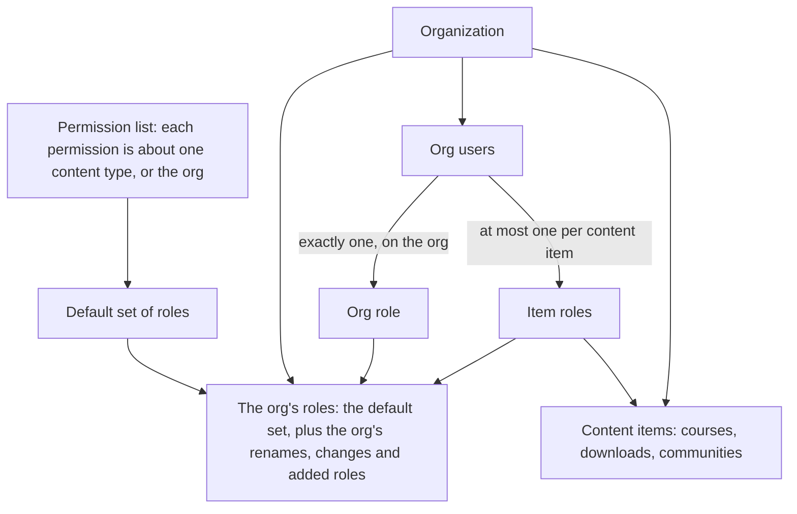

# Organizations — Domain Spec

Organizations owns the tenant: the organization itself, everyone who belongs to it, the roles they hold, and every decision about what they may do. It is the tenant root that every other context scopes to.

A permission names one thing a person may do, such as editing a course. A role is a named set of permissions. A role is given to a person on the whole organization or on one content item, such as a course or a community. Every decision about what a person may do is a permission check; nothing decides by a role's name.

## Glossary

| Term                  | Meaning                                                                                                                                                     |
| --------------------- | ----------------------------------------------------------------------------------------------------------------------------------------------------------- |
| Permission            | One `resource:action` from the permission list, such as `courses:write`. The only thing checked.                                                            |
| Permission list       | The fixed list of permissions. Each has a label, a description and what it is about: one content type, or the org. Part of the product, not data.           |
| Level                 | Where a role can be given: the org, or a content type. A permission's "about" is a level too.                                                               |
| Content item          | One course, one download, one community, and so on. Content owns it.                                                                                        |
| Role                  | A named set of permissions with the levels it can be given at. It has a stable key and a name the org can change.                                           |
| Default set           | The roles every org starts with. The product's default set is Owner, Admin, Instructor, Moderator and Member. A deployment can replace it with its own.     |
| System role           | Owner and Member. Every default set has them. They can be renamed, never changed or deleted.                                                                |
| Assignment            | A person holding a role on the org or on one content item.                                                                                                  |
| Org role              | The role a person holds on the org. Everyone has exactly one; it is Member unless they were given another.                                                  |
| Effective permissions | Everything a person may do on an item: their org role's permissions plus those of the role given to them on that item.                                      |
| Team                  | People shown as team on a content item: a badge with their role's name, the team section of a community's directory, and the direct-message rules for team. |

## Scope

- Owns the **organization (tenant)**, the **org user** (person ↔ org), the **invite**, the **roles** and the **assignments**.
- Owns the **permission list** and **authorization**: every permission check in the system is answered from what organizations holds.
- Owns **people management**: inviting, giving and removing roles, removing people, and transferring ownership.
- Does **not** own the person record (identity), access to content (entitlements), content (content), or completion (progress).

## System of record

| Better Auth                                             | Organizations                                                  |
| ------------------------------------------------------- | -------------------------------------------------------------- |
| Accounts, sign-in, sessions and the active organization | The permission list, roles and assignments                     |
| Organizations and memberships: who belongs to which org | Every role change, every assignment and every permission check |
| A fixed role value on each membership                   | What a person may do                                           |

Better Auth's organization plugin is the source of truth for organizations and memberships. Core holds a mirror of them. Core makes the membership writes itself, after its own checks, and writes its side in the same operation. Invites are domain-owned. Better Auth's role feature is not used: a membership carries `owner` for the owner and `participant` for everyone else, and nothing reads it. Because Better Auth is the source of truth for organizations and memberships, replacing it would be a **data migration, not a swap**.

## Containment

- An org's roles are the default set plus the org's own changes. An org that changes nothing uses the default set as it is.
- An org user has exactly one org role and at most one role on each content item, with no limit on how many items.
- Grants decide what content a person can open. Assignments decide what they can do.

## Models

- **Organization** — the tenant. The root every org-scoped record belongs to. Mirrors a Better Auth organization.
- **Org user** — links a person to an org. Never exists without a person behind it. Carries a **status**: `invited` until the person accepts an invite, `active` from then on. Every active org user holds a Better Auth membership.
- **Role** — a key, a name, a description, its levels, its permissions, and whether its holders are shown as team. A role the org changed or added also records the default role it started from.
- **Assignment** — an org user, a role, and the org or one content item.
- **Invite** — a pending invite to join an org, carrying the org role the invitee will hold. Domain-owned.
- **Org settings** — the organization's own settings. Among them are its notification categories: the ordered switches on a member's notification settings for what happens outside any community, such as comments on a course activity, access to content and their own account. Each covers kinds of notification for people with given reasons and offers channels with a default and an optional lock. An org without its own list uses the default list, and a holder of `notification_categories:write` can go back to it. Automations reads the list to file each notification; identity reads it to check a member's settings.

## Permissions

The permission list is part of the product. A deployment or an org can't add a permission.

- A key is `resource:action`. The resource is a plural domain noun: `courses`, `people`, `automations`. A record that belongs to a resource falls under it: modules, activities and lesson comments under `courses`; spaces, topics, posts, chats and space members under `communities`; an event's attached files and its attendees under `events`. A course's learners and their progress are `progress`, because it is personal data the course's content permissions shouldn't carry.
- The actions are `read`, `write`, `delete` and `moderate`. `read` sees the resource. `write` creates and changes it; creating a content item needs `write` on the org. `delete` permanently removes the resource itself; removing a part of it, such as a module or a space, is `write`. `moderate` acts on what other people post in an item and on who takes part in it, and the holder's own posts there skip review.
- Each `write` and `delete` implies the resource's `read`. `courses:moderate` implies `courses:read`, because a moderator of lesson comments holds no grant to the course. `people:read` implies `progress:read`, because a person's record shows their progress in every course. `communities:moderate` implies nothing: a moderator moderates as a member, through their grant.
- The read permission of each content type is the one exception to grants. `courses:read` and `downloads:read` open the item and its files without a grant, unpublished included. `communities:read` makes the person a member of the community without a grant and opens every space in it. `events:read` opens the event, its location, files and recording without a grant, in any status.

| Permission                      | Allows                                                                                                                     | About     |
| ------------------------------- | -------------------------------------------------------------------------------------------------------------------------- | --------- |
| `organizations:read`            | See the org's name, slug and general settings.                                                                             | org       |
| `organizations:write`           | Change the org's name, slug and general settings.                                                                          | org       |
| `api_keys:read`                 | List your own API keys.                                                                                                    | org       |
| `api_keys:write`                | Create your own API keys.                                                                                                  | org       |
| `api_keys:delete`               | Revoke your own API keys.                                                                                                  | org       |
| `notification_categories:read`  | See the notification types, channels and the org's categories and defaults.                                                | org       |
| `notification_categories:write` | Edit and reset the org's notification categories.                                                                          | org       |
| `integrations:read`             | See connected integrations.                                                                                                | org       |
| `integrations:write`            | Connect, configure and run actions on integrations.                                                                        | org       |
| `integrations:delete`           | Disconnect integrations.                                                                                                   | org       |
| `analytics:read`                | See the org's overview report.                                                                                             | org       |
| `people:read`                   | List the org's people and pending invites, with each person's roles, and open any person's record.                         | org       |
| `people:write`                  | Invite people, resend and cancel invites, set a person's org role, and give and remove roles on content items.             | org       |
| `people:delete`                 | Remove a person from the org.                                                                                              | org       |
| `roles:read`                    | See the org's roles and their permissions.                                                                                 | org       |
| `roles:write`                   | Rename roles; change, reset and add roles.                                                                                 | org       |
| `roles:delete`                  | Delete a role the org added.                                                                                               | org       |
| `access:read`                   | See grants, including a community's roster of grant holders.                                                               | org       |
| `access:write`                  | Grant, change and revoke access.                                                                                           | org       |
| `bundles:read`                  | See bundles and their names.                                                                                               | org       |
| `bundles:write`                 | Create and edit bundles.                                                                                                   | org       |
| `bundles:delete`                | Delete bundles.                                                                                                            | org       |
| `media:read`                    | See the whole media library and attach any of its files.                                                                   | org       |
| `media:write`                   | Upload to the media library and edit its files.                                                                            | org       |
| `media:delete`                  | Delete files from the media library.                                                                                       | org       |
| `courses:read`                  | See the course; open it, its lessons, files and titles without a grant, unpublished included.                              | course    |
| `courses:write`                 | Edit and publish the course; add, change and delete its modules and activities; upload media for it.                       | course    |
| `courses:delete`                | Delete the course.                                                                                                         | course    |
| `courses:moderate`              | See the course's lesson comments, held ones included; approve, remove, restore, reply to and resolve reports on them.      | course    |
| `progress:read`                 | See the course's learners, their progress and the course's analytics.                                                      | course    |
| `downloads:read`                | See the download; open it and its files without a grant, unpublished included.                                             | download  |
| `downloads:write`               | Edit and publish the download; upload files for it.                                                                        | download  |
| `downloads:delete`              | Delete the download.                                                                                                       | download  |
| `communities:read`              | See the community, its spaces, notification categories and analytics; be a member of it without a grant; open every space. | community |
| `communities:write`             | Configure the community, its spaces, topics, links, settings and notification categories; publish it; delete its spaces.   | community |
| `communities:delete`            | Delete the community.                                                                                                      | community |
| `communities:moderate`          | Review, approve, remove, restore, pin and lock posts, comments and messages; manage space members and join requests.       | community |
| `events:read`                   | See the event, drafts and canceled included; open it without a grant; see its attendees and analytics.                     | event     |
| `events:write`                  | Edit, publish and cancel the event; set its recording; add and remove attendees; upload, attach and arrange its files.     | event     |
| `events:delete`                 | Delete the event.                                                                                                          | event     |
| `automations:read`              | See workflows, webhooks and their runs.                                                                                    | org       |
| `automations:write`             | Create and edit workflows and webhooks, and reveal a webhook's signing secret.                                             | org       |
| `automations:delete`            | Delete workflows and webhooks.                                                                                             | org       |

Two actions are not permissions, because no role can hold them: transferring ownership is the owner's alone, and creating an org needs only a signed-in person, who becomes its owner, or the platform key. Connected apps are a person's own consents: every active org user lists and disconnects their own.

## Roles

Roles are data. The product ships a default set; a deployment can replace it with its own, and an org can rename its roles or change them.

| Key          | Name       | Levels         | Team | Holds                                                                                                                    |
| ------------ | ---------- | -------------- | ---- | ------------------------------------------------------------------------------------------------------------------------ |
| `owner`      | Owner      | org            | yes  | every permission, including ones added later                                                                             |
| `admin`      | Admin      | org            | yes  | every permission                                                                                                         |
| `instructor` | Instructor | org, course    | yes  | `courses:read`, `courses:write`, `courses:moderate`, `progress:read`; the `api_keys` permissions when it is the org role |
| `moderator`  | Moderator  | org, community | yes  | `communities:moderate`                                                                                                   |
| `member`     | Member     | org            | no   | nothing                                                                                                                  |

Instructor on the org covers every course; on one course, that course. Moderator on the org covers every community; on one community, that community. Instructor holds nothing in communities: a person who teaches and moderates holds both roles. No default role but Owner and Admin holds an `events` permission; an org that wants others to run events gives them a role that does, on the org or on one event.

- **Owner** holds every permission. Exactly one person holds it, on the org only. It moves only by transfer. It can be renamed, never changed, given or deleted.
- **Member** is the org role of everyone who wasn't given another. It holds no permissions: what a member opens is decided by their grants. It can be renamed, never changed, given on a content item, or deleted.
- **A deployment's set** must include Owner and Member unchanged, use each key once, name only permissions in the list and levels that exist, and give every role at least one level and only permissions that fit its levels. The server refuses to start otherwise.
- **An org's changes.** Renaming a role changes only its name; holders keep it, because assignments refer to the key. Changing a role's permissions, levels or team flag stores the org's version of that role, which applies from then on. Resetting returns it to the default set's version. An org can add roles of its own, each starting from a default role, and delete them while nobody holds them. Names are unique within an org, ignoring case.
- **A permission added in a later release** reaches every role the org hasn't changed with its default, and every changed role with the default of the role it started from, until the role is saved with an explicit choice.

## Levels

A role lists its levels: the org and/or content types. Levels are enforced in three places.

- **When a role is saved.** A role may hold a permission about a content type when its levels include that type or the org, and a permission about the org only when its levels include the org. A role whose only level is `course` can't hold `people:write`.
- **When a role is given.** A role is given only at a level it lists. Instructor can be given on the org or on a course, and giving it on a community is refused. Owner and Member are given on the org only.
- **When permissions are resolved.** A role given on an item contributes only its permissions about that item's type, and only for that item.

Removing a level from a role is refused while the role is given at that level. A new content type is a valid level as soon as content defines it, and brings its own permissions.

## Effective permissions

- A role given on the org applies everywhere. Its permissions about a content type cover every item of that type.
- A role given on an item contributes its permissions about that item's type for that item. Instructor on Spanish Basics gives course permissions on Spanish Basics and nothing else, never `api_keys:write`.
- On an item, a person holds their org role's permissions plus those of the role given to them there. Nothing is subtracted; there are no deny rules and no wildcards.
- Permissions are resolved on every request, so a change to a role or an assignment applies from the next request.
- **API keys** carry one of the org's roles. Creating a key needs `api_keys:write` and every permission the role holds, held somewhere, and only a signed-in person can do it: a key or app token never creates a key. On every request a key holds its role's current permissions intersected with its creator's current permissions, so a change to the role applies from the next request and the key never does more than its creator could at that moment. A role can't be deleted while a key carries it.
- **Connected apps** carry permissions as their scopes, chosen on consent from the permissions the person holds. On every request an app token holds its scopes intersected with its creator's current permissions.
- A key or app token is never the owner, so no token can transfer ownership.
- **The system** acts with every permission for work it does itself: automations, scheduled jobs, grant expiry and the upload sweep. Work done for a person, such as publishing their scheduled post, runs as that person with their current permissions.

## Platform

A platform that runs the LMS for its own customers creates an org for each of them with the platform key, a secret in the deployment's configuration. The platform key creates orgs and API keys for them, and does nothing else.

- The **platform account** is one person, owner of every org the platform creates. It has no password, and no sign-in method can start a session for it; it acts only through its API keys.
- Creating an org with the platform key creates the org, its roles, the platform account as owner, and an API key for the platform account carrying Owner, without expiry. The platform calls every other route with that key.
- The platform can store key-value metadata with each org it creates.
- The platform key also creates another key for an org whose owner, or an active member, is the platform account, to replace a lost or leaked one.

## Team

A person is team on a content item when the role given to them there, or their org role, is a team role. Their badge reads the name of the role given on the item, or else their org role's. Team decides the badge on posts, comments and lesson comments, the team section of a community's directory, and the direct-message rules a community sets for team.

## Managing roles and people

1. **No escalation in roles.** Renaming needs `roles:write`. Changing, adding or resetting a role also needs every permission the role holds before and after, on the org.
2. **No escalation in giving.** Giving or removing a role, on the org or on an item, and inviting with a role, needs `people:write` and every permission the old and the new assignment contribute there. Member contributes nothing, so inviting with Member needs only `people:write`.
3. **No managing above you.** Removing a person needs `people:delete` and, wherever the person holds a permission, the remover holds it there or on the org.
4. **Nobody changes their own assignments.**
5. **Ownership** moves only by transfer, which the owner alone starts. The new owner must be an active org user; the previous owner takes the org role the owner names, Member by default. The owner can't be removed.
6. **Removing a person** deletes their org user and their assignments, removes their Better Auth membership, and revokes their API keys, connected apps and tokens for the org. A refusal, such as for someone whose posts must be kept, changes nothing.
7. **Deleting a content item** deletes the roles given on it.

## Membership

Every org user who accepts an invite holds a Better Auth membership, whatever their role. A person has at most one membership per org, and changing their roles never touches it. Accepting an invite as an existing member, to change their role, keeps their one membership.

### Invites

An invite carries an org role, Member by default, and needs rule 2 for it. An invite for the owner, or with Owner, is refused.

Every invite creates the person and an `invited` org user at once, whatever the role. This is what makes someone findable, grantable and reportable while their invitation is outstanding. Accepting activates that same org user, creates their membership if they have none, and sets the invited org role, so anything granted while they were pending survives. Accepting is refused when the inviter no longer holds what the invite needs; resending makes the resender the inviter.

Whether the invitation is emailed is the inviter's choice; suppressing delivery changes nothing about the records, only who carries the link. The email names the role by the org's name for it.

Cancelling an invite deletes it, and deletes an `invited` org user who holds no grant and no role on a content item. Roles on content items are given after the person exists.

## Worked example

Sarah owns Spanish in 90 Days. Its courses are Spanish Basics and Spanish Grammar; its communities are Spring cohort, with the space Practice, and Autumn cohort. The org calls its Instructor role "Tutor".

| #   | Who    | Does                                              | Context and what decides                                                                                                                                    |
| --- | ------ | ------------------------------------------------- | ----------------------------------------------------------------------------------------------------------------------------------------------------------- |
| 1   | Sarah  | Renames Instructor to "Tutor"                     | organizations: Sarah holds `roles:write`. Only the name changes; every Instructor keeps the role.                                                           |
| 2   | Sarah  | Gives Instructor to James on Spanish Basics       | organizations: Sarah holds `people:write` and every course permission Instructor holds; Instructor lists `course`. `organization.role.assigned` is emitted. |
| 3   | system | Tells James                                       | automations: James gained a permission on Spanish Basics, so he is notified and emailed "You are now Tutor of Spanish Basics".                              |
| 4   | James  | Lists courses in the admin app                    | content: James holds `courses:read` on Spanish Basics only, so the list holds Spanish Basics.                                                               |
| 5   | James  | Uploads a video and saves a lesson                | assets: `courses:write` on Spanish Basics lets him upload for it. content: `courses:write` on Spanish Basics, and the video was uploaded for it.            |
| 6   | James  | Tries to edit a lesson in Spanish Grammar         | content: James doesn't hold `courses:write` on Spanish Grammar. Refused.                                                                                    |
| 7   | Sarah  | Tries to give Instructor to Emma on Spring cohort | organizations: Instructor doesn't list `community`. Refused.                                                                                                |
| 8   | Sarah  | Gives Moderator to Emma on Spring cohort          | organizations: Sarah holds `people:write` and `communities:moderate`; Moderator lists `community`.                                                          |
| 9   | Emma   | Removes Oliver's post in Practice                 | entitlements: Emma's grant makes her a member of Spring cohort. discussion: she holds `communities:moderate` on it.                                         |
| 10  | Emma   | Tries to remove a post in Autumn cohort           | discussion: Emma doesn't hold `communities:moderate` on Autumn cohort. Refused.                                                                             |
| 11  | Oliver | Reports a message in Spring cohort                | automations: the holders of `communities:moderate` on Spring cohort among its members are notified: Emma, and Sarah, who holds every permission.            |
| 12  | Emma   | Tries to make Oliver an Admin                     | organizations: Emma doesn't hold `people:write`. Refused.                                                                                                   |
| 13  | Sarah  | Makes James Instructor on the org                 | organizations: Sarah holds every Instructor permission. James now holds course permissions on every course, and step 6 succeeds.                            |

## Boundaries

1. **organizations ↔ Better Auth** — Better Auth is the source of truth for organizations, memberships and sessions; core holds a mirror and makes the membership writes after its own checks. Roles and assignments are core's alone.
2. **organizations ↔ identity** — identity owns the person; organizations references them by id on an org user, and that reference is always present. Reference only.
3. **organizations ↔ content** — content owns the content items and their types; organizations reads an item's type to check a role's level. An assignment's item is always a real content item, and deleting the item deletes the assignment.
4. **organizations → all contexts** — provides the tenant scope, the caller's effective permissions, and who holds a permission on an item. Every context checks the permission the action needs; none reads a role.
5. **organizations ↔ entitlements** — grants decide what a person opens; roles decide what they may do. A role opens content only through the read permission of its type.

## Events

- `organization.created`, `organization.updated`, `organization.deleted`
- `organization.user.linked`, `organization.user.deleted` — an org user was added or removed, with their org role.
- `organization.invite.created`, `organization.invite.accepted`, `organization.invite.canceled` — with the role the invite carries. Every acceptance emits `accepted`.
- `organization.student.created`, `organization.student.linked`, `organization.student.deleted` — an org user with the org role Member was created, linked to an account, or deleted. `linked` means they can sign in.
- `organization.role.updated` — a role was renamed, changed or reset, with what it was before and after.
- `organization.role.created`, `organization.role.deleted` — the org added or deleted a role.
- `organization.role.assigned` — a person's org role changed, or a role was given on a content item, with the role it replaced there.
- `organization.role.unassigned` — a role was removed from a content item.
- `organization.ownership.transferred` — with the previous and the new owner.

## Multi-tenancy

The organization is the tenant root. Every org-scoped record across the system belongs to exactly one organization. People are global; the link between a person and an org is their org user, and it is the target every actor-shaped reference in the system points at.

## Build state

The permission list, the default set, org roles, assignments on the org and on content items, effective permissions, the no-escalation rules, ownership transfer, invites and removal are built and **persisted**. Every method a person can reach checks a permission. API keys carry a role and app tokens carry scopes, and both are limited to their creator's current permissions. The platform key and the platform account are built. `organization.user.updated` is declared, and nothing emits it.
