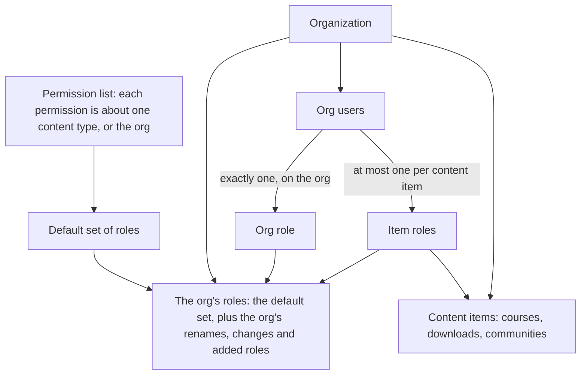

# Organizations — Domain Spec

Organizations owns the tenant: the organization itself, everyone who belongs to it, and the role each of them holds. It is the tenant root that every other context scopes to. Better Auth's organization plugin is the source of truth for staff membership; core holds a mirror, and staff membership writes go through Better Auth.

An **org user** links a _person_ (from the identity domain) to an organization under one role. Staff and learners are the same kind of link, distinguished only by role — a learner is an org user whose role is `student`. This is what makes it possible to say "whoever did this" about any actor in an organization without first asking which population they came from.

## Scope

- Owns the **organization (tenant)**, the **org user** (person ↔ org), the **invite**, the **roles** and the **assignments**.
- Owns the **permission list** and **authorization**: every permission check in the system is answered from what organizations holds.
- Owns **people management**: inviting, giving and removing roles, removing people, and transferring ownership.
- Owns the org's **apps**: the frontends it runs and their domains.
- Does **not** own the person record (identity), access to content (entitlements), content (content), or completion (progress).

## System of record

| Better Auth                                             | Organizations                                                  |
| ------------------------------------------------------- | -------------------------------------------------------------- |
| Accounts, sign-in, sessions and the active organization | The permission list, roles and assignments                     |
| Organizations and memberships: who belongs to which org | Every role change, every assignment and every permission check |
| A fixed role value on each membership                   | What a person may do                                           |

Better Auth's organization plugin is the source of truth for organizations and memberships. Core holds a mirror of them. Core makes the membership writes itself, after its own checks, and writes its side in the same operation. Invites are domain-owned. Better Auth's role feature is not used: a membership carries `owner` for the owner and `participant` for everyone else, and nothing reads it. Because Better Auth is the source of truth for organizations and memberships, replacing it would be a **data migration, not a swap**.

## Containment

- An org's roles are the default set plus the org's own changes. An org that changes nothing uses the default set as it is.
- An org user has exactly one org role and at most one role on each content item, with no limit on how many items.
- Grants decide what content a person can open. Assignments decide what they can do.

## Models

- **Organization** — the tenant. The root every org-scoped record belongs to. Mirrors a Better Auth organization.
- **Org user** — links a person to an org. Never exists without a person behind it. Carries a **status**: `invited` until the person accepts an invite, `active` from then on. Every active org user holds a Better Auth membership.
- **Role** — a key, a name, a description, its levels, its permissions, and whether its holders are shown as team. A role the org changed or added also records the default role it started from.
- **Assignment** — an org user, a role, and the org or one content item.
- **Invite** — a pending invite to join an org, carrying the org role the invitee will hold. Domain-owned.
- **Org settings** — the organization's own settings. Among them are its notification categories: the ordered switches on a member's notification settings for what happens outside any community, such as comments on a course activity, access to content and their own account. Each covers kinds of notification for people with given reasons and offers channels with a default and an optional lock. An org without its own list uses the default list, and a holder of `notification_categories:write` can go back to it. Automations reads the list to file each notification; identity reads it to check a member's settings.

## Roles

Roles are defined in the data. There is a default set; but a deployment can replace it with its own, and an org can rename its roles or change them.

| Key          | Name       | Levels         | Team | Holds                                                                                                                    |
| ------------ | ---------- | -------------- | ---- | ------------------------------------------------------------------------------------------------------------------------ |
| `owner`      | Owner      | org            | yes  | every permission, including ones added later                                                                             |
| `admin`      | Admin      | org            | yes  | every permission                                                                                                         |
| `instructor` | Instructor | org, course    | yes  | `courses:read`, `courses:write`, `courses:moderate`, `progress:read`; the `api_keys` permissions when it is the org role |
| `moderator`  | Moderator  | org, community | yes  | `communities:moderate`                                                                                                   |
| `member`     | Member     | org            | no   | nothing                                                                                                                  |

Instructor on the org covers every course; on one course, that course. Moderator on the org covers every community; on one community, that community. Instructor holds nothing in communities: a person who teaches and moderates holds both roles. No default role but Owner and Admin holds an `events` permission; an org that wants others to run events gives them a role that does, on the org or on one event.

- **Owner** holds every permission. Exactly one person holds it, on the org only. It moves only by transfer. It can be renamed, never changed, given or deleted.
- **Member** is the org role of everyone who wasn't given another. It holds no permissions: what a member opens is decided by their grants. It can be renamed, never changed, given on a content item, or deleted.
- **A deployment's set** must include Owner and Member unchanged, use each key once, name only permissions in the list and levels that exist, and give every role at least one level and only permissions that fit its levels. The server refuses to start otherwise.
- **An org's changes.** Renaming a role changes only its name; holders keep it, because assignments refer to the key. Changing a role's permissions, levels or team flag stores the org's version of that role, which applies from then on. Resetting returns it to the default set's version. An org can add roles of its own, each starting from a default role, and delete them while nobody holds them. Names are unique within an org, ignoring case.
- **A permission added in a later release** reaches every role the org hasn't changed with its default, and every changed role with the default of the role it started from, until the role is saved with an explicit choice.

## Effective permissions

- A role given on the org applies everywhere. Its permissions about a content type cover every item of that type.
- A role given on an item contributes its permissions about that item's type for that item. Instructor on Spanish Basics gives course permissions on Spanish Basics and nothing else, never `api_keys:write`.
- On an item, a person holds their org role's permissions plus those of the role given to them there. Nothing is subtracted; there are no deny rules and no wildcards.
- Permissions are resolved on every request, so a change to a role or an assignment applies from the next request.
- **API keys** carry one of the org's roles. Creating a key needs `api_keys:write` and every permission the role holds, held somewhere, and only a signed-in person can do it: a key or app token never creates a key. On every request a key holds its role's current permissions intersected with its creator's current permissions, so a change to the role applies from the next request and the key never does more than its creator could at that moment. A role can't be deleted while a key carries it.
- **Connected apps** carry permissions as their scopes, chosen on consent from the permissions the person holds. On every request an app token holds its scopes intersected with its creator's current permissions.
- A key or app token is never the owner, so no token can transfer ownership.
- **The system** acts with every permission for work it does itself: automations, scheduled jobs, grant expiry and the upload sweep. Work done for a person, such as publishing their scheduled post, runs as that person with their current permissions.

## Platform

A platform that runs the LMS for its own customers creates an org for each of them with the platform key, a secret in the deployment's configuration. The platform key creates orgs and API keys for them, finds an org it created by its slug, and does nothing else.

- The **platform account** is one person, owner of every org the platform creates. It has no password, and no sign-in method can start a session for it; it acts only through its API keys.
- Creating an org with the platform key creates the org, its roles, the platform account as owner, and an API key for the platform account carrying Owner, without expiry. The platform calls every other route with that key.
- The platform can store key-value metadata with each org it creates.
- The platform key also creates another key for an org whose owner, or an active member, is the platform account, to replace a lost or leaked one.
- The platform finds an org by its slug when it lost the response to creating it. Only an org the platform created is found.

## Team

A person is team on a content item when the role given to them there, or their org role, is a team role. Their badge reads the name of the role given on the item, or else their org role's. Team decides the badge on posts, comments and lesson comments, the team section of a community's directory, and the direct-message rules a community sets for team.

## Managing roles and people

1. **No escalation in roles.** Renaming needs `roles:write`. Changing, adding or resetting a role also needs every permission the role holds before and after, on the org.
2. **No escalation in giving.** Giving or removing a role, on the org or on an item, and inviting with a role, needs `people:write` and every permission the old and the new assignment contribute there. Member contributes nothing, so inviting with Member needs only `people:write`.
3. **No managing above you.** Removing a person needs `people:delete` and, wherever the person holds a permission, the remover holds it there or on the org.
4. **Nobody changes their own assignments.**
5. **Ownership** moves only by transfer, which the owner alone starts. The new owner must be an active org user; the previous owner takes the org role the owner names, Member by default. The owner can't be removed.
6. **Removing a person** deletes their org user and their assignments, removes their Better Auth membership, and revokes their API keys, connected apps and tokens for the org. A refusal, such as for someone whose posts must be kept, changes nothing.
7. **Deleting a content item** deletes the roles given on it.

## Apps

An org runs its frontends as apps, each on its own domain. An app serves courses, the community, or both.

- Listing an org's apps needs `organizations:read`. Creating, changing and deleting one needs `organizations:write`.
- An org has at most one app that serves courses and one that serves the community, and an app serves at least one of the two.
- A domain belongs to one app across every org. The installation's own addresses, such as the admin app's, cannot be an app's domain.
- A new org has no app.

For example, Acme creates one app at `acme.example.com` for both. Later it changes that app to serve courses at `learn.acme.com` and creates a community app at `club.acme.com`.

## Signing in on a domain

A domain tells which org a person is signing in to, because it belongs to one of an org's apps.

- A session started on an app's domain is for that app's org, when the person is active in it.
- A person who holds an open invite to that org gets a session with no org. Accepting the invite sets it.
- Anyone else is refused there.
- A session started on an address the installation lists as its own, such as the admin app, is for the person's org when they are in exactly one. A sign-in from any other address is refused.
- On an app's domain, a session for another org is not accepted.
- A link that signs a person in or resets their password, and returns to an app's domain, is sent only to a person who is active in that app's org. The email says which org and which app it was asked for on, as does the email that confirms a changed password.

For example, Sarah is in Acme and Globex, and James is only in Globex. Sarah signs in on `learn.acme.com` and gets an Acme session; on Globex's domain she gets a Globex one. James is refused on `learn.acme.com`. Emma was invited to Acme: she signs in on `learn.acme.com`, accepts the invite, and her session is for Acme.

## Membership

Every org user who accepts an invite holds a Better Auth membership, whatever their role. A person has at most one membership per org, and changing their roles never touches it. Accepting an invite as an existing member, to change their role, keeps their one membership.

### Invites

An invite carries an org role, Member by default, and needs rule 2 for it. An invite for the owner, or with Owner, is refused. A member's invite link opens the domain the invite names, which must be one of the org's apps, or else the app that serves courses. With neither, an emailed invite is refused.

Every invite creates the person and an `invited` org user at once, whatever the role. This is what makes someone findable, grantable and reportable while their invitation is outstanding. Accepting activates that same org user, creates their membership if they have none, and sets the invited org role, so anything granted while they were pending survives. Accepting is refused when the inviter no longer holds what the invite needs; resending makes the resender the inviter.

Whether the invitation is emailed is the inviter's choice; suppressing delivery changes nothing about the records, only who carries the link. The email names the role by the org's name for it.

Cancelling an invite deletes it, and deletes an `invited` org user who holds no grant and no role on a content item. Roles on content items are given after the person exists.

## Worked example

Sarah owns Spanish in 90 Days. Its courses are Spanish Basics and Spanish Grammar; its communities are Spring cohort, with the space Practice, and Autumn cohort. The org calls its Instructor role "Tutor".

| #   | Who    | Does                                              | Context and what decides                                                                                                                                    |
| --- | ------ | ------------------------------------------------- | ----------------------------------------------------------------------------------------------------------------------------------------------------------- |
| 1   | Sarah  | Renames Instructor to "Tutor"                     | organizations: Sarah holds `roles:write`. Only the name changes; every Instructor keeps the role.                                                           |
| 2   | Sarah  | Gives Instructor to James on Spanish Basics       | organizations: Sarah holds `people:write` and every course permission Instructor holds; Instructor lists `course`. `organization.role.assigned` is emitted. |
| 3   | system | Tells James                                       | automations: James gained a permission on Spanish Basics, so he is notified and emailed "You are now Tutor of Spanish Basics".                              |
| 4   | James  | Lists courses in the admin app                    | content: James holds `courses:read` on Spanish Basics only, so the list holds Spanish Basics.                                                               |
| 5   | James  | Uploads a video and saves a lesson                | assets: `courses:write` on Spanish Basics lets him upload for it. content: `courses:write` on Spanish Basics, and the video was uploaded for it.            |
| 6   | James  | Tries to edit a lesson in Spanish Grammar         | content: James doesn't hold `courses:write` on Spanish Grammar. Refused.                                                                                    |
| 7   | Sarah  | Tries to give Instructor to Emma on Spring cohort | organizations: Instructor doesn't list `community`. Refused.                                                                                                |
| 8   | Sarah  | Gives Moderator to Emma on Spring cohort          | organizations: Sarah holds `people:write` and `communities:moderate`; Moderator lists `community`.                                                          |
| 9   | Emma   | Removes Oliver's post in Practice                 | entitlements: Emma's grant makes her a member of Spring cohort. discussion: she holds `communities:moderate` on it.                                         |
| 10  | Emma   | Tries to remove a post in Autumn cohort           | discussion: Emma doesn't hold `communities:moderate` on Autumn cohort. Refused.                                                                             |
| 11  | Oliver | Reports a message in Spring cohort                | automations: the holders of `communities:moderate` on Spring cohort among its members are notified: Emma, and Sarah, who holds every permission.            |
| 12  | Emma   | Tries to make Oliver an Admin                     | organizations: Emma doesn't hold `people:write`. Refused.                                                                                                   |
| 13  | Sarah  | Makes James Instructor on the org                 | organizations: Sarah holds every Instructor permission. James now holds course permissions on every course, and step 6 succeeds.                            |

## Boundaries

1. **organizations ↔ Better Auth** — Better Auth is the source of truth for organizations, memberships and sessions; core holds a mirror and makes the membership writes after its own checks. Roles and assignments are core's alone.
2. **organizations ↔ identity** — identity owns the person; organizations references them by id on an org user, and that reference is always present. Reference only.
3. **organizations ↔ content** — content owns the content items and their types; organizations reads an item's type to check a role's level. An assignment's item is always a real content item, and deleting the item deletes the assignment.
4. **organizations → all contexts** — provides the tenant scope, the caller's effective permissions, and who holds a permission on an item. Every context checks the permission the action needs; none reads a role.
5. **organizations ↔ entitlements** — grants decide what a person opens; roles decide what they may do. A role opens content only through the read permission of its type.

## Events

- `organization.created`, `organization.updated`, `organization.deleted`
- `organization.user.linked`, `organization.user.deleted` — an org user was added or removed, with their org role.
- `organization.invite.created`, `organization.invite.accepted`, `organization.invite.canceled` — with the role the invite carries. Every acceptance emits `accepted`.
- `organization.student.created`, `organization.student.linked`, `organization.student.deleted` — an org user with the org role Member was created, linked to an account, or deleted. `linked` means they can sign in.
- `organization.role.updated` — a role was renamed, changed or reset, with what it was before and after.
- `organization.role.created`, `organization.role.deleted` — the org added or deleted a role.
- `organization.role.assigned` — a person's org role changed, or a role was given on a content item, with the role it replaced there.
- `organization.role.unassigned` — a role was removed from a content item.
- `organization.ownership.transferred` — with the previous and the new owner.

## Multi-tenancy

The organization is the tenant root. Every org-scoped record across the system belongs to exactly one organization. People are global; the link between a person and an org is their org user, and it is the target every actor-shaped reference in the system points at.

## Build state

The permission list, the default set, org roles, assignments on the org and on content items, effective permissions, the no-escalation rules, ownership transfer, invites, removal and signing in on a domain are built and **persisted**. Every method a person can reach checks a permission. API keys carry a role and app tokens carry scopes, and both are limited to their creator's current permissions. The platform key and the platform account are built. `organization.user.updated` is declared, and nothing emits it.
