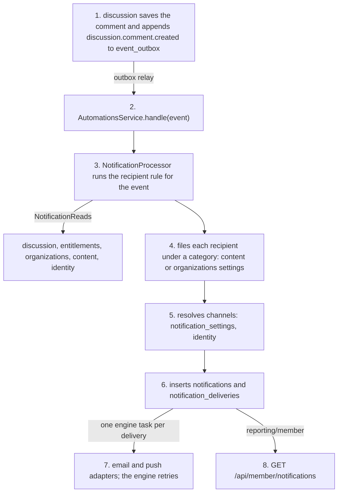
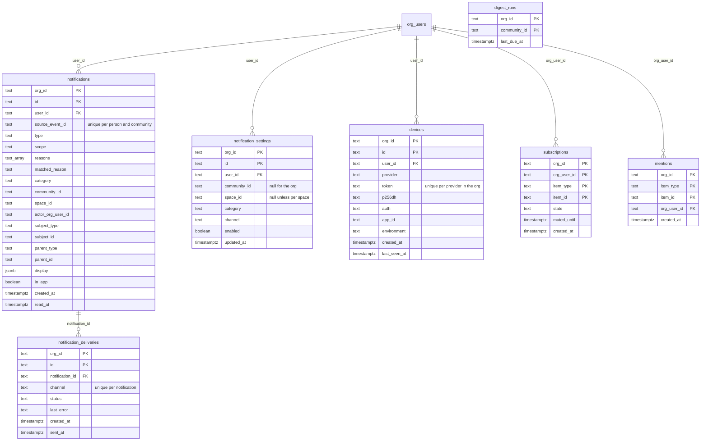

# Notification subsystem: design spec

Nov 2, 2026 · @Meiring

## 1. Overview

This document specifies the notification subsystem of Headless LMS. A notification is a message the server sends to a person in an org when an event concerns them: a comment on their post, a mention, a chat message, a new post in a space they follow, a published course activity, a membership about to end, a post awaiting review. The server delivers notifications in the app, by email and by push. A deployment can add channels by passing `NotificationChannel` adapters to the container (section 6). Account emails (sign-in links, password resets, invitations) are not notifications and are not covered here.

The subsystem:

- defines a fixed set of notification types in code;
- determines who receives each notification and why, from the data of the context that owns the triggering event;
- groups types into categories that members switch on and off per channel;
- stores each notification, and a delivery record for each email, push or other adapter channel;
- serves the notification list and the notification settings through the member API.

The design replaces the current notification kinds, per-kind preferences and the automation rows seeded today (section 24.4). Nothing is seeded after this change: creating an org or a community writes no automation, notification or category rows, and the seeding code is deleted (section 22). Defaults are code. Automations runs notifications as a system process in code (section 11), timed product work runs as scheduled jobs (section 14), and an automation row holds only what an org authored in the admin app (section 15). No data is migrated (section 16.11). The design adds no bounded context. The requirements come from the community app, `hlms-community/docs/notification-categories.md`; section 21 maps each one to the design.

**Example data.** Examples use the org Spanish in 90 Days and its community Spring cohort (`cmy_1`), which has the spaces Announcements, Practice and Speaking partners. Sarah, James and Emma are members.

## 2. Requirements

1. Members control notifications per category and per channel. The server delivers only what a member's settings allow.
2. Settings apply per community. A category marked per-space can also be set per space.
3. A new post in a space notifies only members who switched that space on. A community can make a space on by default.
4. A member can follow a post and receive notifications for its comments.
5. A member can mute a post, space or chat, optionally until a given time. Mentions, actions on the member and moderation work still notify.
6. One event produces at most one notification per person per community, even when the person qualifies for several reasons.
7. Editing a post, comment or message notifies only the people it newly mentions.
8. A run of chat messages notifies each participant once, after the chat has been quiet for 2 minutes, and not if they have read the chat by then. A mention notifies at once.
9. Moderators are notified when a post enters review, a member requests to join a space, or content is reported.
10. A category can lock a channel on, so members can't switch it off.
11. Access emails (access granted, access revoked, membership ended) are a category the org can remove.
12. A community can send a digest on its own schedule.
13. Course members are notified when an activity is published in a published course, and not while it is a draft.
14. Push notifications reach every device a member registered and used in the last 30 days.
15. The app's inbox tabs are filters on one notification list, each with its own unread count.
16. A failed channel is retried without repeating delivery on the other channels.
17. Nothing is seeded when an org or community is created, and no org can switch off product behaviour. Notifications, scheduled publishing, grant expiry and the upload sweep are code, not automation rows; an org changes its notifications through its categories.
18. A scheduled post is published at its time, survives a restart, and can be moved or cancelled until then.
19. An org's own workflows, webhooks and schedules work as they do today. The one change they see is `discussion.digest.due` (section 18.2).

## 3. Architecture

### 3.1 Responsibilities

The automations context runs the notification process in code. It is not an org-authored automation, has no automation row, and no org can edit or disable it. The recipient rules, the notifications and the deliveries are automations'. The other contexts emit the events and store the data the rules read, the categories and the settings.

| Context | Responsibility |
|---|---|
| automations | Declares the notification types and the default category lists. Subscribes to all domain events. Runs the recipient rule for each event, reading the data it needs through the `NotificationReads` port. Files each recipient under a category. Resolves settings into channels. Stores `notifications` and `notification_deliveries`. Dispatches each delivery as a task on the workflow engine. Keeps the org's workflows, webhooks and their runs, unchanged. |
| discussion | Stores posts, comments, messages, follows, mutes and mentions. Emits the discussion events. Answers `NotificationReads` for authors, followers, thread participants, chat participants and mutes. Defines the scheduled-post and digest jobs. |
| entitlements | Emits grant and space-membership events. Answers `NotificationReads` for space access, community and course holders, and moderators. Defines the grant-expiry job. |
| organizations | Stores the org's categories in org settings. Answers `NotificationReads` for staff and `NotificationCategories` for the org list. |
| content | Stores a community's categories and digest schedule in community settings. Emits `content.course.activity.published`. Answers `NotificationReads` for titles and `NotificationCategories` for community lists. |
| identity | Stores members' notification settings and push devices. Answers `NotificationReads` for names and email addresses. Gives the push channel a person's devices and deletes dead ones. |
| assets | Defines the upload-sweep job. |
| workflow adapter (`AutomationEngine` and `Scheduler`) | Runs workflows, delivery tasks and scheduled jobs. Hatchet stores the timers and retries failed tasks; the inline engine is for development. |
| `reporting/member` | Serves the notification list, the unread counts and the settings screen. |
| `shared/ports` | The `NotificationTypeRegistry`, `ChannelRegistry` and `NotificationChannel` interfaces. The composition root builds the registries. |
| `shared` | `resolveChannels`, the one resolution function automations and `reporting/member` both call (section 8.1). |
| composition root | The email and push channels, which implement `NotificationChannel`, render from the type declarations and call the mailer and the push adapter. |
| adapters | The push adapter, `@headless-lms/adapter-push`, behind the `PushSender` port; the configured mailer. |

### 3.2 Processing flow



1. A context commits a change and appends the domain event to `event_outbox` in the same transaction.
2. The outbox relay publishes the event and calls `AutomationsService.handle(event)`.
3. `handle` runs the org's automations as it does today, then calls `NotificationProcessor.process(event)`. The processor runs the recipient rule for the event type. The rule reads what it needs through `NotificationReads` and returns recipient lists.
4. The processor reads the categories of the community (content) or of the org (organizations) through `NotificationCategories` and files each recipient under the first matching category.
5. It reads each recipient's settings (identity) and resolves which channels are on.
6. In one transaction it inserts one `notifications` row per recipient and one `notification_deliveries` row with status `pending` per enabled adapter channel. The `notifications` row is the in-app notification.
7. It dispatches one engine task per delivery. The task calls the channel adapter and records the outcome on the delivery row. The engine retries a failed task.
8. The app reads the notification list with `GET /api/member/notifications`.

### 3.3 Example: a comment that mentions the post's author

James comments on Sarah's post in Practice and mentions her. Emma follows the post. Sarah has switched mention emails off. Emma has switched push off for followed posts.

| # | Runs in | Function | Reads | Writes |
|---|---|---|---|---|
| 1 | HTTP | `POST /api/member/posts/:postId/comments` | | |
| 2 | discussion, one transaction | `DiscussionService.postComment` saves the comment, extracts the `<@ou_sarah>` token and appends the event | `posts`, `content_access` | `comments`; `mentions` (`cmt_1`, `ou_sarah`); `event_outbox`: `discussion.comment.created` with `mentionedOrgUserIds: ["ou_sarah"]` |
| 3 | outbox relay | publishes the row and calls `AutomationsService.handle(event)` | `event_outbox` | `event_outbox.processed_at` |
| 4 | automations | `NotificationProcessor.process(event)` runs the `discussion.comment.created` rule: a `comment.created` list with Sarah (`post_author`) and Emma (`follower`), and a `mention` list with Sarah (`mentioned`). It drops James as the actor and anyone who muted the post or space or can't open the space. `display`: post title, James's name, excerpt. | through `NotificationReads`: `posts`, `subscriptions` (discussion); `content_access` (entitlements); names (identity) | |
| 5 | automations | files Sarah under `mentions`, which is listed before `comments_on_my_posts`, and Emma under `followed_posts` | `settings` row (`content`, `cmy_1`), key `notificationCategories` | |
| 6 | automations | resolves channels. Sarah's `mentions`: in-app and push. Emma's `followed_posts`: in-app. | `notification_settings` | |
| 7 | automations, one transaction | inserts the notifications and deliveries. A redelivered event inserts nothing, because of the unique key. | | `notifications`: Sarah `mention`, Emma `comment.created`; `notification_deliveries`: Sarah `push`, `pending` |
| 8 | automations | dispatches one engine task for Sarah's push delivery | | |
| 9 | engine task | loads the delivery, gets Sarah's devices from identity, calls the push adapter and marks the delivery `sent` when a device accepted it, `failed` with the provider's answers when none did and none is worth retrying. On a retryable failure it records the error and throws; the engine retries. | `notification_deliveries`; `devices` through identity | `notification_deliveries` |
| 10 | `reporting/member` | serves both notifications on `GET /api/member/notifications`, through `NotificationsService.list` | `notifications` | |
| 11 | automations | `POST /api/member/notifications/:notificationId/read` marks Sarah's notification read | | `notifications.read_at` |

```mermaid
sequenceDiagram
  participant App as app
  participant D as discussion
  participant A as automations
  participant C as content
  participant I as identity
  participant E as engine, email, push
  App->>D: 1 James comments, mentioning Sarah
  D->>A: 2 discussion.comment.created, via the outbox
  A->>D: 3 post author, followers, mutes (NotificationReads)
  D-->>A: 4 Sarah (post_author, mentioned), Emma (follower)
  A->>C: 5 Spring cohort's categories
  A->>I: 6 Sarah's and Emma's settings
  Note over A: 7 files under categories, resolves channels, inserts notifications and deliveries
  A->>E: 8 push task for Sarah; the engine retries on failure
  A-->>App: 9 notification list, through reporting/member
```

### 3.4 Code locations

| Piece | Location | Owner |
|---|---|---|
| Type declarations and default category lists | `packages/core/src/automations/notifications/types.ts`, `defaults.ts` | automations |
| Recipient rules | `automations/notifications/rules/`: `discussion.ts`, `entitlements.ts`, `content.ts`, `organizations.ts`, one per context whose events they read | automations |
| `NotificationProcessor` | `automations/notifications/processor.ts`, called by `AutomationsServiceImpl.handle` | automations |
| Chat debounce and the `automations.notifications.flush` job | `automations/notifications/debounce.ts` | automations |
| Delivery task | `automations/notifications/delivery.ts`, called by `AutomationsServiceImpl.runDelivery` | automations |
| `NotificationsService`: `list`, `get`, `unreadCounts`, `markRead`, `markAllRead` | `automations/notifications/service.ts`, exported from `@headless-lms/core/automations` | automations |
| `NotificationReads`, `NotificationCategories`, `NotificationsRepository` ports | `automations/ports.ts` | automations |
| `NotificationReads` implementation | `packages/server/src/app/notification-reads.ts`, built on `community-mail.ts`, which stays for the `sendEmail` action | composition root |
| `NotificationTypeRegistry`, `ChannelRegistry`, `NotificationChannel`, `PushSender`, `Scheduler` interfaces | `packages/core/src/shared/ports.ts` | shared |
| `resolveChannels` | `packages/core/src/shared/notification-settings.ts` | shared |
| Shared notification types | `packages/core/src/types/notifications.ts` | types |
| Job handlers and product jobs | each owning context, exported from its index: discussion, entitlements, assets, automations | owning context |
| `Scheduler` implementation | `adapters/workflow-hatchet` for deployments, `adapters/defaults/src/workflows` for development | adapter |
| Registry and channel wiring | `packages/server/src/app/notification-channels.ts`: the type registry from automations' declarations; the email channel over the configured `Mailer` and `email-templates`, rendering the template each type declares; the push channel over `PushSender`, rendering each type's push title and body, when push is configured; the deployment's added channels | composition root |
| Category lists: validation and storage | content (community list), organizations (org list) | content, organizations |
| `NotificationSettingsService`, `DevicesService` | `packages/core/src/identity` | identity |
| Follows, mutes, mentions | `packages/core/src/discussion` | discussion |
| Notification list, unread counts, settings view | `packages/core/src/reporting/member` | reporting |
| Tables | `adapters/db/src/schema/automations.ts`: `notifications`, `notification_deliveries`; `identity.ts`: `notification_settings`, `devices`; `discussion.ts`: `subscriptions`, `mentions`, `digest_runs` | db adapter |
| Push channel | `adapters/push`, published as `@headless-lms/adapter-push`: APNs, FCM, Web Push | adapter |
| Member routes | `packages/server/src/http/routes/member/`: `notifications.ts`, `notification-settings.ts`, `devices.ts` (with `push-config`), the subscription routes in `posts.ts`, `community.ts` and `chats.ts`, and `unschedule` in `posts.ts` | http |
| Admin routes | `packages/server/src/http/routes/communities.ts`, `organizations.ts` | http |

## 4. Data model

The subsystem has eleven records. Types, reasons, recipient rules, the default category lists and the channel registry are code. A recipient list exists only in memory. The other records are stored.

### 4.1 Notification type

A kind of notification the server can send. The set is fixed and declared in code by automations, next to the recipient rules. The composition root builds the `NotificationTypeRegistry` from the declarations; content and organizations validate category lists against it. Apps can't add types.

- **Fields:** key; scopes, one or more of `org`, `community`, `space`, `chat`; allowed reasons; display keys.
- **Example:** `comment.created`: scopes `space` and `org`; reasons `post_author`, `comment_author`, `follower`, `thread_participant`; display keys `postTitle`, `commenterName`, `excerpt`.

### 4.2 Reason

Why a person is on a recipient list. The set is fixed in code. Categories match on type and reason, so one event can land in different categories for different people.

- **Example:** for a comment on Sarah's post that mentions her, Sarah has `post_author` and `mentioned`; Emma, who follows the post, has `follower`.

### 4.3 Recipient list

The result of automations' recipient rule for one type and one event: who the event concerns, the reasons for each person, and the display text. The rule builds it from the owning contexts' data, read through `NotificationReads`. Automations applies settings afterwards; settings never determine who is on the list.

- **Fields:** type; scope; community, space or chat; actor; subject and parent references; display; recipients with reasons.
- **Owner:** automations. Not stored.
- **Examples:** a comment on Sarah's post: Sarah (`post_author`), Emma (`follower`). A post in Practice: everyone who can open Practice (`space_member`). A course grant to James: James (`subject`).

### 4.4 Category

One switch on a notification settings screen, such as "Comments on my posts" or "Mentions". A category covers one or more type-and-reason pairs and offers channels, each with a default and an optional lock. A community has an ordered list of categories. The org has one for org-scoped types. Default lists ship in code; an owner can replace a community's or the org's list.

- **Fields:** key; covered type-and-reason pairs; channels with default and lock; `perSpace`; `spaceDefaults`.
- **Owner:** content (community list, in community settings); organizations (org list, in org settings).
- **Example:** `comments_on_my_posts` covers `comment.created` for `post_author` and offers in-app, email and push, all on by default.

### 4.5 Setting

A member's explicit on/off for one category on one channel, in one community or in the org, optionally for one space. Where no setting exists, the category's default applies.

- **Fields:** person; community or org; space; category; channel; enabled.
- **Owner:** identity.
- **Example:** Sarah, Spring cohort, `mentions`, `email`, off.

### 4.6 Device

A push address for one app install: an iOS app, an Android app or a browser.

- **Fields:** person; provider (`apns`, `fcm`, `webpush`); token; Web Push keys; app id; APNs environment; last seen.
- **Owner:** identity.
- **Example:** Sarah's iPhone: `apns`, her device token, app id `com.spanishin90days.app`, `production`, last seen today.

### 4.7 Subscription

A member's state on one discussion item: a post followed or muted, a space or chat muted.

- **Fields:** person; item type and id; state; muted until.
- **Owner:** discussion.
- **Example:** Emma follows post `pst_1`. James mutes chat `cht_1` until tomorrow.

### 4.8 Mention

A person mentioned in a post, comment or message.

- **Fields:** item type and id; person; first mentioned at.
- **Owner:** discussion.

### 4.9 Notification

The stored message for one person and one event. It is the in-app notification; each adapter channel has a delivery.

- **Fields:** person; source event; type; scope; reasons; matched reason; category; community and space; actor; subject and parent references; display; in app; read at.
- **Owner:** automations.
- **Example:** Sarah's notification for James's comment: type `mention`, reasons `post_author` and `mentioned`, category `mentions`, subject comment `cmt_1`, parent post `pst_1`, in app.

### 4.10 Delivery

One send of a notification on one adapter channel: email, push, or a channel a deployment adds. In-app has no delivery; the notification is the in-app delivery.

- **Fields:** notification; channel; status (`pending`, `sent`, `failed`); last error; sent at.
- **Owner:** automations.
- **Example:** Sarah's mention on `push`: `sent` after one attempt.

### 4.11 Channel

A way of reaching a person. In-app, email and push ship with the server; a deployment adds channels as `NotificationChannel` adapters. Categories, settings and deliveries refer to channels by key.

### 4.12 Relations

- A category covers type-and-reason pairs that the type registry declares.
- A setting refers to a category key and a channel key.
- A recipient list becomes one notification per recipient.
- A notification has one delivery per enabled adapter channel.
- Subscriptions are inputs to automations' recipient rules, read through discussion. Mentions reach the rules on the item's event.

## 5. Notification types

Each type has a key, the event that produces it, its scopes, the reasons it allows, and the current mechanism it replaces. Keys are lower case, one word or snake_case, prefixed by the thing they concern: `post.awaiting_review`. Reasons and category keys follow the same rule.

A type is not a domain event. One event can produce several types: `discussion.comment.created` produces `comment.created` and `mention`. Several events can produce one type: `entitlement.deleted` and `entitlement.expired` both produce `community.membership_ended`. One event can produce one type for the org and another for a community: `entitlement.created` produces `access.granted` and `community.welcome`. Categories refer to types, so they don't change when events change.

Automations declares every type in code, next to its recipient rule. The tables group the types by the context whose events produce them.

Any content that emits events can produce notifications. A type's scope is where its item lives: a space, a chat, a community, or the org for items outside any community, such as a comment on a course activity. A notification about an item outside a community is filed in the org's list.

### 5.1 Discussion events

| Type | Produced when | Scope | Reasons | Replaces |
|---|---|---|---|---|
| `post.published` | a post is published | space | `space_member` | `newPostInSpace` |
| `post.approved` | a post leaves review and is published | space | `subject` | `yourPostWasPublished` |
| `post.awaiting_review` | a post enters review | space | `moderator` | `postAwaitingReview` |
| `post.removed` | someone other than the author removes a post | space | `subject` | `yourPostWasRemoved` |
| `post.reacted` | someone first reacts to a post | space | `post_author` | — |
| `comment.created` | a comment is published, on a post or on a course activity | space, org | `post_author`, `comment_author`, `follower`, `thread_participant` | `newCommentOnPost`, `replyToYourComment` |
| `comment.removed` | someone other than the author removes a comment | space, org | `subject` | `yourCommentWasRemoved` |
| `comment.reacted` | someone first reacts to a comment | space, org | `comment_author` | — |
| `content.flagged` | someone reports a post or comment | space, org | `moderator` in a community, `staff` for a course activity | `somethingWasFlagged` |
| `mention` | a post, comment or message mentions people, on publish or edit | space, chat, org | `mentioned` | — |
| `message.sent` | someone sends a message; debounced per chat per person (11.3) | chat | `participant` | `newMessage` |
| `message.reacted` | someone first reacts to a message | chat | `message_author` | — |
| `message.flagged` | someone reports a message | chat | `staff` | `messageWasFlagged` |
| `chat.request` | a direct chat starts as a request | chat | `participant` | `messageRequest` |
| `chat.added` | someone adds a person to a group chat | chat | `subject` | `addedToGroupChat` |
| `digest` | a community's digest is due | community | `community_member` | the disabled `digest` derivation |

### 5.2 Entitlements events

| Type | Produced when | Scope | Reasons | Replaces |
|---|---|---|---|---|
| `space.join_requested` | someone requests to join a space | space | `moderator` | `joinRequest` |
| `space.invited` | someone invites a person to a space | space | `subject` | `invitedToSpace` |
| `space.request_approved` | a moderator approves a join request | space | `subject` | `requestApproved` |
| `space.request_declined` | a moderator declines a join request | space | `subject` | `requestDeclined` |
| `community.welcome` | a grant opens a community | community | `subject` | `welcomeToCommunity` |
| `community.ending_soon` | a community grant ends within a week | community | `subject` | `membershipEndingSoon` |
| `community.membership_ended` | a grant that opened a community expires or is deleted, and the person holds that community through no other grant | org | `subject` | the `membershipEnded` email automation |
| `access.granted` | a grant is created | org | `subject` | the `accessGranted` email automation |
| `access.revoked` | a grant is deleted | org | `subject` | the `accessRevoked` email automation |

`community.membership_ended` is org-scoped because the person no longer holds the community. It lists only the communities the person holds through no other grant, as entitlements answers it; when they still hold every one, the event produces nothing.

### 5.3 Content events

| Type | Produced when | Scope | Reasons | Replaces |
|---|---|---|---|---|
| `course.activity_added` | an activity in a published course is published | org | `course_member` | — |

`course.activity_added` is org-scoped because there is no course scope; it has no per-course setting and no course filter.

### 5.4 Organizations events

| Type | Produced when | Scope | Reasons | Replaces |
|---|---|---|---|---|
| `moderator.assigned` | a person is given the moderator role | org | `subject` | `youAreNowAModerator` |

### 5.5 Reasons

| Reason | The person |
|---|---|
| `subject` | is what the notification is about: their post was removed, they were invited, their grant ends soon |
| `post_author` | wrote the post |
| `comment_author` | wrote the comment that was replied to or reacted to |
| `message_author` | wrote the message that was reacted to |
| `follower` | follows the post |
| `thread_participant` | has commented on the same post or course activity |
| `mentioned` | was mentioned |
| `participant` | is in the chat |
| `space_member` | can open the space |
| `community_member` | can open the community |
| `course_member` | holds the course through a grant |
| `moderator` | moderates the community: an owner, admin or instructor, or a moderator who is a member of it |
| `staff` | is an owner, admin or instructor |

"Can open" is entitlements' answer, and staff can open every community and space in their org, as `spaceOpeners` and `communityMemberIds` answer today. So `space_member` and `community_member` include staff, and staff get the community's notifications, unread counts and settings screen like any member. `course_member` is grant holders only.

### 5.6 Recipient rules

Every recipient rule applies these constraints:

- The actor is never a recipient.
- A recipient must be able to open the item, as entitlements decides it: a space, chat or community through a grant that opens it, a course activity through a grant that opens the course. Staff (owners, admins, instructors) can open everything in their org. The exceptions are recipients with `subject` on the access types and the entitlements space types: the person whose grant changed or ended, an invitee, and a person whose join request was declined get the notification although they can't open the item.
- A recipient can have several reasons for one type, for example `post_author` and `thread_participant`.
- A chat recipient is a participant who hasn't left the chat and isn't in a blocked pair with the actor.
- The rules carry over today's conditions on the event's state, listed per event in section 11.1.

## 6. Channels

| Channel | Delivery | Provided by | Available when |
|---|---|---|---|
| `inApp` | The `notifications` row, read through the notification list | core: automations stores it, `reporting/member` serves it | always |
| `email` | An email to the person's address | the email channel in the composition root: the configured mailer, rendering the `email-templates` package | a mailer is configured |
| `push` | A push notification to each registered device | the push channel in the composition root, sending through `@headless-lms/adapter-push`: Web Push (VAPID), APNs, FCM | push credentials are configured |

The channel registry in `shared/ports` lists the configured channels and is built in the composition root. `ChannelRegistry.list()` returns every configured key, `inApp` always first; `get(key)` returns the `NotificationChannel` for an adapter channel and nothing for `inApp`, which has no delivery. Content and organizations reject a category list that names an unconfigured channel. When a deployment removes an adapter, its channel disappears from `GET /api/notification-channels`, automations ignores it in categories and settings, and the settings view omits it.

The email and push channels implement `NotificationChannel`. A deployment adds a channel by passing more `NotificationChannel` objects in the container's `adapters.notificationChannels`; each one resolves its own recipient address (`recipient`) and sends (`deliver`), and its key must not repeat a built-in one.

### 6.1 Rendering

Each recipient list carries `display`, the text a channel needs. Each type declares its display keys per scope, because an item outside a community has no post or space: a comment on a course activity carries `activityTitle` and `courseTitle` instead. The recipient rule fills them through `NotificationReads`: post, comment, chat and author names from discussion, space, community and course titles from content, and names from identity. Automations validates the keys and stores `display` on the notification.

- **Email:** each type declaration names its `email-templates` template per scope, and a template per reason where they differ. The notification's `matched_reason`, the reason of the pair its category matched, selects it. Params come from `display`, the subject references and the deployment's `TemplateContext`.
- **Push:** each type declaration gives a title and body per scope, with `{{key}}` placeholders filled from `display`; a list of strings joins with `, `, and a list of objects is not a placeholder. The push channel in the composition root renders them from `NotificationTypeRegistry.get(type).push[scope]` and calls `PushSender.send(devices, { title, body, data: { notificationId, type, subject, parent, communityId, spaceId } })`, so the app can open the item in its community and mark the notification read; `communityId` and `spaceId` are null for a notification outside a community or a space. The push adapter renders nothing.
- **In-app:** nothing is rendered on send. The list resolves current names and titles when it is read.

| Type | Display keys | Email template |
|---|---|---|
| `post.published` | `spaceName`, `postTitle`, `authorName`, `excerpt` | `newPostInSpace` |
| `post.approved` | `postTitle`, `spaceName` | `yourPostWasPublished` |
| `post.awaiting_review` | `spaceName`, `postTitle`, `authorName` | `postAwaitingReview` |
| `post.removed` | `postTitle`, `spaceName` | `yourPostWasRemoved` |
| `post.reacted` | `postTitle`, `reactorName`, `reaction` | `postReacted` (new) |
| `comment.created` | `postTitle`, `commenterName`, `excerpt` | `replyToYourComment` when the matched reason is `comment_author`, otherwise `newCommentOnPost` |
| `comment.removed` | `postTitle` | `yourCommentWasRemoved` |
| `comment.reacted` | `postTitle`, `excerpt`, `reactorName`, `reaction` | `commentReacted` (new) |
| `content.flagged` | `spaceName`, `excerpt`, `reason` | `somethingWasFlagged` |
| `mention` | `authorName`, `excerpt`, and `postTitle` or `chatTitle` | `mention` (new) |
| `message.sent` | `senderName`, `chatTitle`, `excerpt`, `count`, `summary` ("3 new messages", which the push body shows) | `newMessage` |
| `message.reacted` | `excerpt`, `reactorName`, `reaction` | `messageReacted` (new) |
| `message.flagged` | `reason` | `messageWasFlagged` |
| `chat.request` | `senderName`, `excerpt` | `messageRequest` |
| `chat.added` | `adderName`, `participantNames` | `addedToGroupChat` |
| `digest` | `communityTitle`, `from`, `to`, `posts: [{ postId, title, authorName, spaceName, commentCount }]` | `digest`, extended with the posts |
| `space.join_requested` | `spaceName`, `memberName`, `seatsLeft` | `joinRequest` |
| `space.invited` | `spaceName`, `inviterName` | `invitedToSpace` |
| `space.request_approved` | `spaceName` | `requestApproved` |
| `space.request_declined` | `spaceName` | `requestDeclined` |
| `community.welcome` | `communityTitle`, `spaceNames` | `welcomeToCommunity` |
| `community.ending_soon` | `communityTitle`, `expiresAt` | `membershipEndingSoon` |
| `community.membership_ended` | `communities: [{ communityId, communityTitle }]` | `membershipEnded`, changed: params `{ communities: { communityId: string; communityTitle: string }[] }` replace `{ communityTitle, communityId }`; its `SEND_EMAIL_DERIVATIONS` entry passes one community |
| `access.granted` | `contentTitle`, `contentType` (`course`, `download`, `community` or `bundle`) | `accessGranted`, whose `contentType` param adds `bundle`, linked to the portal home |
| `access.revoked` | `contentTitle` | `accessRevoked` |
| `course.activity_added` | `courseTitle`, `moduleTitle`, `activityTitle` | `courseActivityAdded` (new) |
| `moderator.assigned` | `communityTitles` | `youAreNowAModerator` |

On a course activity, scope `org`:

| Type | Display keys | Email template |
|---|---|---|
| `comment.created` | `activityTitle`, `courseTitle`, `courseId`, `commenterName`, `excerpt` | `activityCommentCreated` (new) |
| `comment.removed` | `activityTitle`, `courseTitle`, `courseId` | `activityCommentRemoved` (new) |
| `comment.reacted` | `activityTitle`, `courseTitle`, `courseId`, `excerpt`, `reactorName`, `reaction` | `activityCommentReacted` (new) |
| `content.flagged` | `activityTitle`, `courseTitle`, `courseId`, `excerpt`, `reason` | `activityCommentFlagged` (new) |
| `mention` | `authorName`, `excerpt`, `activityTitle`, `courseTitle`, `courseId` | `activityMention` (new) |

The activity templates take `courseId` from `display` and `activityId` from the parent reference for their links, where the post templates take `postId` and `communityId`. The rule reads `courseId` with the titles through `NotificationReads.activity`.

A display value is a string or a list of strings; `digest.posts` and `community.membership_ended`'s `communities` are lists of objects. `excerpt` is the start of the body with mention tokens replaced by names. A `subject` type has one recipient per list, so its display can be specific to that person.

## 7. Categories

### 7.1 Shape

A category list is an ordered array. One category:

```json
{
  "key": "comments_on_my_posts",
  "covers": [{ "type": "comment.created", "reasons": ["post_author"] }],
  "channels": {
    "inApp": { "default": true, "locked": false },
    "email": { "default": true, "locked": false },
    "push": { "default": true, "locked": false }
  }
}
```

| Field | Meaning |
|---|---|
| `key` | Unique in the list. `^[a-z][a-z0-9_]{0,63}$`. |
| `covers` | Type-and-reasons pairs. The category matches a notification of `type` for a person with any of `reasons`. |
| `channels` | The channels offered. `default` applies until the member sets a value. `locked: true` fixes the default. |
| `perSpace` | Community lists only. `true` allows a setting per space. Every covered type must be able to occur in a space. |
| `spaceDefaults` | With `perSpace` only. `{ [spaceId]: { [channel]: boolean } }` overrides `channels.default` for a space. Unknown space ids never match and are not validated. |

A per-space category that is on by default only in Announcements:

```json
{
  "key": "new_posts",
  "perSpace": true,
  "covers": [{ "type": "post.published", "reasons": ["space_member"] }],
  "channels": { "inApp": { "default": false, "locked": false }, "push": { "default": false, "locked": false } },
  "spaceDefaults": { "spc_announcements": { "inApp": true, "push": true } }
}
```

The server stores keys only. Labels, descriptions and grouping on a screen are the app's.

### 7.2 Matching

Automations applies these rules when it files a recipient list:

1. **First match with a channel on.** For each person, the notification is filed under the first category in list order that covers one of the person's type-and-reason pairs and has at least one channel on for the person after resolution (8.1). A category the person switched off on every channel is passed over, and the next matching category applies. The list order is the priority of reasons: a mention, then a reply to the person or their post, then a followed post or thread, as Discourse orders them. Placing `mentions` before `comments_on_my_posts` files a mention inside a comment on the person's own post as a mention; if the person switched `mentions` off, it is filed under `comments_on_my_posts`. The matched pair's type is the notification's type, and its `matched_reason` is the first reason, in the order of the matching cover's `reasons`, that the person has.
2. **One per person per event per list.** The recipient rule returns all of an event's recipient lists together. Automations collects each person's pairs and files the person once in the community's list and, for lists with no community, once in the org's list. Each community counts separately: a bundle grant that opens two communities produces `community.welcome` in each.
3. **One list per person per category.** When one person has pairs from several lists of one event that match the same category in one group, the first list the rule returned that resolves to at least one channel on for the person wins (rule 1), so a per-space setting or space default decides between lists in different spaces. The `entitlement.deleted` rule returns `community.membership_ended`, one list naming in `communities` every community the grant opened that the person holds through no other grant, when the grant opened a community, and `access.revoked` otherwise.
4. **No match, no notification.** A pair no category covers is not delivered. A community without a `digest` category sends no digest.
5. **Offered channels only.** Delivery uses only the channels the category offers.
6. **Locks.** A locked channel always uses its default. The settings endpoint rejects changes to it.
7. **Per space.** A `perSpace` category matches only notifications that occur in a space. A mention in a chat never matches one.

### 7.3 Validation

`PUT` replaces the whole list. Content (community list) or organizations (org list) validates it against the type and channel registries and returns 422 when:

- a key repeats;
- a type has no scope the list covers: `org` for the org list; `community`, `space` or `chat` for a community list;
- a reason is not allowed for the type;
- a channel is not configured;
- a category offers no channel;
- `perSpace` is set and a covered type can't occur in a space, or `perSpace` is set on the org list;
- `spaceDefaults` appears without `perSpace` or names a channel the category doesn't offer;
- earlier categories already cover every pair of a category.

### 7.4 Effect on settings

Changing a list writes nothing in identity. Resolution (8.1) reads only the categories and channels of the list in use:

- **Removed category:** its settings are ignored. If a category with the same key returns, they apply again.
- **Channel no longer offered:** its settings for the category are ignored.
- **New category or newly offered channel:** members get its default.
- **`perSpace` turned off:** the category's space-level settings are ignored.

### 7.5 Defaults

Automations defines the default lists for communities and for the org in code, next to the type declarations. Content and organizations read them through `NotificationTypeRegistry.defaults(scope)`. Nothing is written to the database when an org or community is created.

- A community or org with no stored list uses the default. A change to the default reaches it on the next deploy.
- The first `PUT` stores the whole list. From then on the stored list applies, and a type added to the server later reaches that community only when its list covers it.
- `DELETE` restores the default. `SettingsRepository.patch` can't remove a key, so it writes `notificationCategories: null`; a `null` or absent key means the default.

The defaults offer only configured channels. `GET` returns the list in use with `source: "default" | "stored"`, leaving out channels the deployment no longer configures, their `spaceDefaults` entries, and categories left with no configured channel, so a list read and written back validates.

**Default community list.** It contains the community app's categories plus `about_you` and `review`, which the app's list doesn't have.

| # | Key | Per space | Covers | inApp | email | push |
|---|---|:-:|---|:-:|:-:|:-:|
| 1 | `about_you` | | `post.approved`, `post.removed`, `comment.removed`, `space.invited`, `space.request_approved`, `space.request_declined`, `community.welcome`, `community.ending_soon`, `chat.added` · `subject` | on, locked | on | on |
| 2 | `review` | | `post.awaiting_review`, `space.join_requested`, `content.flagged` · `moderator`; `message.flagged` · `staff` | on | on | on |
| 3 | `mentions` | | `mention` · `mentioned` | on | on | on |
| 4 | `comments_on_my_posts` | | `comment.created` · `post_author` | on | on | on |
| 5 | `replies_to_my_comments` | | `comment.created` · `comment_author` | on | on | on |
| 6 | `followed_posts` | | `comment.created` · `follower`, `thread_participant` | on | off | on |
| 7 | `messages` | | `message.sent`, `chat.request` · `participant`; `message.reacted` · `message_author` | on | off | on |
| 8 | `likes_on_my_posts` | | `post.reacted` · `post_author` | on | off | off |
| 9 | `likes_on_my_comments` | | `comment.reacted` · `comment_author` | on | off | off |
| 10 | `new_posts` | yes | `post.published` · `space_member` | off | off | off |
| 11 | `digest` | | `digest` · `community_member` | — | on | — |

`new_posts` is off by default, so a new post reaches only members who switched it on for the space or for all spaces. Switching `new_posts` on for a space is how a member follows a space. A community makes a space on by default with `spaceDefaults`.

**Default org list.**

| # | Key | Covers | inApp | email | push |
|---|---|---|:-:|:-:|:-:|
| 1 | `about_you` | `moderator.assigned`, `comment.removed` · `subject` | on, locked | on | on |
| 2 | `review` | `content.flagged` · `staff` | on | on | on |
| 3 | `mentions` | `mention` · `mentioned` | on | on | on |
| 4 | `replies_to_my_comments` | `comment.created` · `comment_author` | on | on | on |
| 5 | `followed_threads` | `comment.created` · `thread_participant` | on | off | on |
| 6 | `likes_on_my_comments` | `comment.reacted` · `comment_author` | on | off | off |
| 7 | `access` | `access.granted`, `access.revoked`, `community.membership_ended` · `subject` | on | on, locked | — |
| 8 | `course_content` | `course.activity_added` · `course_member` | on | off | off |

Rows 1 to 6 cover comments on course activities, which belong to no community. `followed_threads` matches the community's `followed_posts`: commenting on a lesson notifies the person of later comments in the app and by push, not by email, as Discourse (Tracking on reply) and Skool (daily email summary) do; a direct reply to their comment still emails.

An org that doesn't send access emails removes `access` from its list or offers it without email.

## 8. Member settings

Identity stores only explicit choices: `(person, community | org, space?, category, channel) → enabled`.

### 8.1 Resolution

Automations resolves the effective value per person, category and offered channel when it delivers, and `reporting/member` resolves it for the settings screen. Both call one pure function in `packages/core/src/shared/notification-settings.ts`:

```ts
resolveChannels(
  category: NotificationCategory,
  settings: StoredSetting[],
  spaceId: string | null,
  configured: string[],
): { channel: string; enabled: boolean; source: 'locked' | 'space' | 'community' | 'spaceDefault' | 'default'; locked: boolean }[]
```

`settings` are the person's settings for the category in that community or the org; `configured` is `ChannelRegistry.list()`. It returns one entry per channel the category offers that is configured. The first rule that applies wins:

1. The channel is locked: the category's default.
2. `perSpace` category: the person's setting for that space.
3. The person's setting for the category in the community. For a `perSpace` category this is the value for all spaces.
4. `perSpace` category: the category's `spaceDefaults` for that space.
5. The category's default.

Each returned value carries its `source`: `locked`, `space`, `community`, `spaceDefault` or `default`. Sending `enabled: null` deletes the stored setting.

### 8.2 Multi-valued controls

Settings are booleans. A multi-valued control is several categories. A chat space set to "@Mentions" is two `perSpace` categories for that space, `chat_posts` off and `chat_mentions` on; the app presents them as one control.

## 9. Subscriptions

Discussion stores follows and mutes. Automations reads them through `NotificationReads` when it builds recipient lists.

| Item | `following` | `muted` |
|---|---|---|
| Post | adds `follower` for `comment.created` on the post | removes activity on the post, including for its author |
| Space | — | removes activity in the space, and its posts from the person's digest |
| Chat | — | removes activity in the chat |

A mute removes every reason the person has in the item except `subject`, `moderator`, `staff` and `mentioned`. Every reason a mute removes belongs to a discussion type; the entitlements space types carry only `subject` and `moderator`, so mutes never affect them.

- A follow adds the person to `comment.created` on the post with `follower`.
- Mutes are applied last: the rule removes the muted reasons and drops anyone left with none.
- A space mute leaves the space's posts out of the person's digest (section 12); `community_member` stays.
- A mute with `mutedUntil` stops applying at that time.
- No row means neither following nor muted.
- `subscriptions` replaces `post_follows`, `chat_users.muted` and `chat_users.muted_until`.
- New posts in a space are controlled by the `new_posts` setting, not by a subscription.

## 10. Devices

A device is one install of an app that can receive push: an iOS app, an Android app or a browser. Devices are the person's own records, so identity owns them. Like every org-scoped record, a device belongs to the person in the org of the session that registered it; an install signed in to two orgs registers once in each. The server sends to the platform push services directly, with no third-party push service in between.

| Provider | Platform | Token | Sent through | Token is dead when the provider answers |
|---|---|---|---|---|
| `apns` | iOS | APNs device token | HTTP/2 to `api.push.apple.com`, or `api.sandbox.push.apple.com` for development builds; token auth with the team's `.p8` key; `apns-topic` is the app's bundle id | `410 Unregistered`, `400 BadDeviceToken`, `400 DeviceTokenNotForTopic` |
| `fcm` | Android | FCM registration token | FCM HTTP v1 API, with a service account | `404 UNREGISTERED`; `400 INVALID_ARGUMENT` for a payload known to be valid |
| `webpush` | browsers | the subscription's endpoint URL, with its `p256dh` and `auth` keys | the endpoint, signed with the VAPID key pair and encrypted with the subscription's keys | `404`, `410` |

A native app built with Expo registers the native token from `getDevicePushTokenAsync`, not an Expo push token, so pushes don't pass through Expo's service.

- **Register.** The app calls `POST /api/member/devices` after sign-in and on every launch. Identity upserts by `(provider, token)`: a new token adds a device, a known token updates `last_seen_at`, and a token registered by another person moves to the caller. A browser first reads the VAPID public key from `GET /api/member/push-config` for `pushManager.subscribe({ applicationServerKey })`, and registers again with the new endpoint on `pushsubscriptionchange`. Registration answers 422 for a provider that isn't configured, and for an `apns` device whose `app_id` isn't one of the configured bundle ids.
- **Sign out.** The app calls `DELETE /api/member/devices/:deviceId` before it signs out, so the next person on the device receives none of the previous person's pushes.
- **Send.** The push channel gets the person's devices seen in the last 30 days from identity and passes them to `PushSender.send`, which sends to each. APNs uses the device's `app_id` as `apns-topic`. A device not seen for 30 days receives nothing until the app registers again. Old rows are not swept; they stay until the token is registered again, reported dead or deleted.
- **Partial failure.** A delivery succeeds when at least one device accepts it; devices that failed are not retried. `PushSender.send` throws, so the engine retries, only when no device accepted and at least one failure was retryable (network error, 429, 5xx, an APNs `403 ExpiredProviderToken`, an FCM `401`). When no device accepted and no failure was retryable, because every device was dead or answered a failure not worth retrying such as an APNs `400 BadTopic`, it returns `accepted: false` with `error` naming each device's answer, `push accepted by no device: dev_1: apns 400 BadTopic`; the delivery is `failed` with that `last_error`, not retried. A person with no device seen in the last 30 days at send time gets the delivery `failed` with `last_error: 'no address'`, not retried.
- **Dead tokens.** The push adapter reports the devices the provider answered as dead. The delivery task asks identity to delete them. The adapter writes nothing.
- **Provider auth.** The adapter signs the APNs provider token (ES256, the team id and key id) and reuses it for 50 minutes; it exchanges a signed service-account assertion (RS256) for an FCM access token and reuses it until a minute before it expires. Either is dropped when the provider rejects it as expired.
- **Payload.** APNs gets `{ aps: { alert: { title, body } }, data }`; FCM gets `notification: { title, body }` and `data` with string values, `subject` and `parent` JSON-encoded, and `subject`, `parent`, `communityId` and `spaceId` left out when null; Web Push gets the JSON `{ title, body, data }`, encrypted with `aes128gcm`.
- **Configuration.** APNs: team id, key id, the `.p8` key, and the bundle ids of the apps it serves; one key serves every app of the team. FCM: the service account of the Firebase project the apps belong to; a token from another project is answered `403 SENDER_ID_MISMATCH` and reported dead. Web Push: the VAPID key pair, the same on every server instance, and the VAPID subject, a `mailto:` or `https:` contact. The installation passes the configuration as `adapters.push` and the adapter as `adapters.pushSender`; with no provider configured, the `push` channel is not registered.

## 11. Processing

### 11.1 Recipient rules

Automations keeps one recipient rule per event in code, next to the type declarations. The rule for an event:

1. determines every type the event produces;
2. for each type, lists the recipients with their reasons and fills `display`;
3. returns all lists for the event together.

Returning all lists together is what allows one notification per person per event.

| Event from | Event | Types | Condition |
|---|---|---|---|
| discussion | `discussion.post.published` | `post.published`, `mention`; `post.approved` | nothing when the previous status was `removed` (a restore); `post.approved` only when the previous status was `pending` |
| discussion | `discussion.post.created` | `post.awaiting_review` | `status` is `pending` |
| discussion | `discussion.post.updated` | `post.awaiting_review`, `mention` | `post.awaiting_review` only when `status` is `pending` and the previous status was not |
| discussion | `discussion.post.removed` | `post.removed` | removed by someone other than the author |
| discussion | `discussion.post.reaction.added` | `post.reacted` | |
| discussion | `discussion.comment.created` | `comment.created`, `mention` | `status` is `published`; a `pending` comment produces nothing |
| discussion | `discussion.comment.published` | `comment.created`, `mention` | |
| discussion | `discussion.comment.updated` | `mention` | `status` is `published` |
| discussion | `discussion.comment.removed` | `comment.removed` | removed by someone other than the author |
| discussion | `discussion.comment.reaction.added` | `comment.reacted` | |
| discussion | `discussion.post.reported`, `discussion.comment.reported` | `content.flagged` | |
| discussion | `discussion.message.sent` | `message.sent`, `mention` | the chat is not `pending` |
| discussion | `discussion.message.updated` | `mention` | the chat is not `pending` |
| discussion | `discussion.message.reaction.added` | `message.reacted` | |
| discussion | `discussion.message.reported` | `message.flagged` | |
| discussion | `discussion.chat.created` | `chat.request` | a `direct` chat with `status` `pending` |
| discussion | `discussion.chat.participant.added` | `chat.added` | |
| discussion | `discussion.digest.due` | `digest` | |
| entitlements | `entitlement.space_member.created` | `space.join_requested`, `space.invited` | `space.join_requested` when `status` is `requested`; `space.invited` when `status` is `invited` |
| entitlements | `entitlement.space_member.updated` | `space.request_approved` | `status` is `active` and the previous status was `requested`; an accepted invite produces nothing |
| entitlements | `entitlement.space_member.deleted` | `space.request_declined` | the previous status was `requested` |
| entitlements | `entitlement.created` | `access.granted`, `community.welcome` | `community.welcome` per community the grant opens |
| entitlements | `entitlement.ending_soon` | `community.ending_soon` | |
| entitlements | `entitlement.deleted` | `access.revoked`, `community.membership_ended` | 7.2, rule 3; `communities` leaves out those the person holds through another grant, and nothing is produced when none is left |
| entitlements | `entitlement.expired` | `community.membership_ended` | the communities the grant opened that the person holds through no other grant; nothing when none is left |
| content | `content.course.activity.published` | `course.activity_added` | |
| organizations | `organization.user.updated` | `moderator.assigned` | `role` is `moderator`; the event fires only when the role changes |

The conditions on existing events are today's in `community-derivations.ts`, carried over; those on the new events follow them. A chat type's recipients also follow 5.6: participants who left are skipped, and so is a recipient in a blocked pair with the sender (`pairBlocked`).

A rule can return an audience instead of a list of people, for a type that goes to everyone who can open a space. The `post.published` rule returns its list with `audience: { reason: 'space_member', spaceId, exclude: [authorOrgUserId] }`. The processor expands it before it collects each person's pairs (11.2, step 2), against the first category in the group's list that covers `post.published` with `space_member`: when that category has a channel on by default, or its `spaceDefaults` turns one on for the space, the list is every member who can open the space; otherwise it is the members who switched the category on for that space or for all spaces (`NotificationReads.switchedOn`, org-user ids: members with an `enabled = true` setting for the category on any channel, at that space or at the all-spaces level), kept to those who can open the space. No covering category expands to nobody. In every case the processor then removes `exclude` and the members who muted the space (`mutedAmong`). No rule names a category.

Rules read other contexts through `NotificationReads` (section 17): posts, comments, chats, follows and mutes from discussion; space access, holders and moderators from entitlements; staff from organizations; titles from content; names from identity. The rules replace the `notify` action and `NOTIFICATION_PLACEMENTS`. `SEND_EMAIL_DERIVATIONS` stays for the `sendEmail` action of org automations.

### 11.2 Delivery

For each event's recipient lists, automations:

1. **Groups:** groups the lists by community; a list with no community goes to the org group. It reads each group's category list through `NotificationCategories.listFor(orgId, communityId)`.
2. **Expands:** turns each audience list into recipients (11.1).
3. **Debounces:** takes the `message.sent` list out of the event and hands each of its recipients to the chat debounce (11.3). It is stored and delivered later, when the chat goes quiet, if at all.
4. **Collects:** each person's type-and-reason pairs per group, from every list.
5. **Matches and resolves:** reads each person's settings from identity (`NotificationSettingsService.getMany`) and walks the group's categories in list order. For each category that covers one of the person's pairs it calls `resolveChannels` (8.1); the first with at least one channel on is the match (7.2, rule 1). Push counts as on only when the person has a device seen in the last 30 days. No such category files nothing.
6. **Stores:** inserts in one transaction one `notifications` row per person and group, and one `notification_deliveries` row with status `pending` per enabled adapter channel. The row holds the matched type, every reason the person has for the event in that group, the matched reason (7.2, rule 1), the category, scope, actor, subject and parent references, `display`, and `in_app`, which is true when the in-app channel is on. `(source_event_id, user_id, community_id)` is unique, so a redelivered event inserts nothing.
7. **Dispatches:** every `pending` delivery of the event's notifications, new rows and rows a previous attempt inserted, one engine task each through `AutomationEngine.deliver`.

### 11.3 Chat debounce

`message.sent` is debounced per person per chat: a run of messages produces one notification, sent when the chat has been quiet for 2 minutes, and none if the person has read the chat by then. The rule lives in `automations/notifications/debounce.ts`; the scheduler holds the timer and no table is added.

1. **Arm.** For each recipient left on the `message.sent` list after mutes and blocks, automations calls `scheduler.at('automations.notifications.flush', occurredAt + 2 min, '{userId}:{chatId}', { orgId, userId, orgUserId, chatId })`. A later message in the chat calls it again with the same key, which moves the timer (14.1).
2. **Mention.** When the same event, or a later one, files a `mention` for that person in that chat, automations stores and delivers the mention at once and calls `cancel('automations.notifications.flush', '{userId}:{chatId}')`. Messages after it arm a new timer.
3. **Flush.** When the timer fires, the job reads `NotificationReads.unreadInChat(orgId, chatId, orgUserId)`. A count of 0, because the person read the chat, ends it. So does a person who left the chat, can no longer open it, has muted it (`mutedAmong` at the time the job runs) or is in a blocked pair with the sender of the latest unread message: the job stores nothing. Otherwise it builds one `message.sent` recipient list for the person: subject the latest unread message, parent the chat, `display` with `senderName`, `chatTitle`, `excerpt`, `count` and `summary`; and runs it through 11.2 steps 4 to 7 like any other list. Its `source_event_id` is `chat-flush:{chatId}:{latest message id}`.

### 11.4 Delivery task

The delivery task runs on the `AutomationEngine` adapter. For one delivery it:

1. **Loads** the delivery and stops if it is not `pending`. A channel no longer configured marks it `failed` with `last_error: 'channel not configured'`.
2. **Loads** the notification and the recipient's address through the channel's `recipient(orgId, userId)`: the email channel reads the email address through identity, the push channel the devices seen in the last 30 days. `null` marks the delivery `failed` with `last_error: 'no address'`, not retried.
3. **Sends** through the channel's `deliver`, which returns `{ accepted, deadDeviceIds, error? }`.
4. **On a result** asks identity to delete the devices the adapter reported dead. When `accepted` is true it sets `status = sent` and `sent_at`; otherwise it sets `status = failed` with `last_error` the result's `error`, the provider's answers (`not accepted` when the channel gives none), and does not retry. Push answers not accepted when no device accepted and no failure was retryable (section 10); email when the mailer rejects the message for good.
5. **On a thrown error** sets `last_error` and rethrows, so the engine retries the task.
6. **On the engine's last attempt** sets `status = failed` instead of rethrowing.

The Hatchet adapter runs the delivery task with `concurrency: { expression: 'input.deliveryId', maxRuns: 1, limitStrategy: GROUP_ROUND_ROBIN }`, which queues a second run instead of cancelling the first, so two tasks for the same delivery never run together; after a redelivered event, the second finds the delivery `sent` and stops. A failure on one channel doesn't affect the other channels or the in-app notification.

### 11.5 Execution and retries

Processing runs in automations' event handler, which the outbox relay already calls. Retries belong to the engine:

- **Hatchet** runs the delivery task with `retries: 3`, the setting automation actions use (`ACTION_RETRIES` in `adapters/workflow-hatchet`).
- **The `InlineAutomationEngine`** is for development and runs it once. Deployments run Hatchet.

There is no recurring retry job and no polling of `notifications` or `notification_deliveries`.

`AutomationsService.handle` runs the org's automations first, as today, and then the processor. Its contract changes from "never throws" to "throws only when the notification process fails": an error from a `NotificationReads` call, the category or settings reads, the insert or the dispatch propagates, and the outbox relay redelivers the event. On redelivery the org's automations don't run twice, because `automation_runs_org_automation_event_idx` is unique per automation and event, as today; the unique key on `notifications` prevents a second notification; and automations dispatches the event's deliveries still `pending` (11.2, step 7). A recipient list that fails validation is logged and dropped (section 17), not retried.

## 12. Digest

The `digest` type is produced on a schedule instead of by a member's action.

- **Schedule:** community settings hold `digest: { cadence: "daily" | "weekly", weekday: 0–6, hour: 0–23, timeZone }`. `weekday` applies to `weekly`; 0 is Sunday; `timeZone` is an IANA name. A community with no `digest` key sends no digest. Owners set it with `PATCH /api/communities/:communityId/settings` (section 19.2).
- **Trigger:** discussion's hourly job `discussion.digest.open`, run by the scheduler, emits `discussion.digest.due` for each community whose schedule is due.
- **Ledger:** discussion keeps `digest_runs`, one row per community with the latest due time it has handled. Each run computes the community's latest due time at or before now:
  - no row: the job inserts the row with that due time and emits nothing, so the first digest after a schedule is set goes out at the next slot;
  - after `last_due_at` and at most one hour old: the community is due;
  - after `last_due_at` and older than one hour: the job moves `last_due_at` to it and emits nothing, so a changed schedule never sends for a slot already past, and a slot the job missed is skipped;
  - otherwise: nothing to do.
- **Once only:** the job moves the row with `INSERT … ON CONFLICT (org_id, community_id) DO UPDATE SET last_due_at = excluded.last_due_at WHERE digest_runs.last_due_at < excluded.last_due_at RETURNING`, and appends the event in the same transaction only when a row comes back, so two concurrent or retried runs never emit a digest twice.
- **Window:** `discussion.digest.due` carries `{ communityId, from, to }`. `to` is the due time; `from` is the previous `last_due_at`.
- **Reads:** the job reads the schedule of every published community across orgs through content's `communitiesWithDigest()`, wired in the composition root; the rule reads the window's posts through `NotificationReads.postsPublished` and who can open each of their spaces through `spaceOpeners`.
- **Recipients:** every member of the community, with `community_member`, sees only posts in spaces they can open and have not muted (`mutedAmong` at the due time). The rule returns one list per distinct set of such spaces, each with `display.posts` filtered to those spaces, and no list for members with no post in the window. A window with no posts sends nothing.
- **Delivery:** categories and settings apply as for any type.

## 13. Notification list

The app reads the list with `GET /api/member/notifications`. `reporting/member` reads the caller's notifications where `in_app` is true, newest first, through automations' `NotificationsService.list`, and resolves the current titles, excerpts and actor names through discussion's and content's `ItemTitles` and identity's names. `ItemTitles` takes the caller and returns only the items the caller can open, so the list never decides access itself; a subject or parent it doesn't return, because it was deleted or the caller lost access, is `null`. Reading or rendering the list writes nothing. `read_at` is set only by `POST /api/member/notifications/:notificationId/read` and `POST /api/member/notifications/read`. A notification is unread while `read_at` is null.

| Filter | Meaning |
|---|---|
| `scope` | `org`: the org's list, `community_id` is null; `community`: any community, `community_id` is not null |
| `communityId` | notifications in this community; implies `scope=community`, and `scope=org` with it answers 400 |
| `includeOrg` | with `communityId`, `true` adds the org list (`community_id` is null): the community plus courses and account in one query. 400 without `communityId` or with `scope` |
| `category` | one or more category keys |
| `reason` | one or more reasons; matches any |
| `type` | one or more types |
| `unread` | `true` for unread only |

Different filters combine with AND; values of one filter combine with OR. `unreadCount` in the response uses the same filters, and `POST /api/member/notifications/read` takes them. With the default categories, the app's tabs map to:

- Mentions: `category=mentions`
- Threads: `reason=comment_author,thread_participant`
- Following: `category=followed_posts,new_posts`

`GET /api/member/notifications/unread-counts` returns the unread count for the org scope and for each community the person can open, staff included (5.5).

`GET /api/member/notifications/:notificationId` returns one notification in the list's item shape, for a push or email link to open; reading it does not mark it read. It answers 404 when the notification isn't the caller's or isn't in the app (`in_app` false).

## 14. Scheduled jobs

Timed product work is a job: a named piece of work that the context owning it defines and the scheduler runs, at a time or on a cron. Publishing a scheduled post, expiring grants, opening due digests and sweeping unattached uploads are jobs. They replace the seeded scheduled automations (section 15), so no org can switch them off.

### 14.1 Port

The scheduler is a deployment port in `shared/ports`, implemented by the workflow adapter beside `AutomationEngine`. Every context that defines a job uses it the same way. It knows a job by its name, its time, a key and an opaque payload; what a job does belongs to the context that defines it.

```ts
interface Scheduler {
  registerJobs(handlers: ScheduledJob[], recurring: RecurringJob[]): void;
  at(job: string, runAt: Date, key: string, payload: JsonValue): Promise<void>;
  cancel(job: string, key: string): Promise<void>;
}

interface ScheduledJob {
  job: string;
  run(payload: JsonValue, fire: { id: string; startedAt: Date }): Promise<void>;
}

interface RecurringJob {
  job: string;
  cron: string;
}
```

| Call | Meaning |
|---|---|
| `registerJobs` | Called once by the composition root with every context's handlers and product jobs. The workflow adapter's `start` then arms each product job on its cron, in UTC. |
| `at` | Runs `job` once at `runAt` with `payload`. A second `at` with the same `job` and `key` replaces the first. |
| `cancel` | Removes a pending `at` by its key. Cancelling one that already ran or never existed does nothing. |

**Rules:**

- **Registration.** Each context exports its `ScheduledJob` handlers and its `RecurringJob` product jobs from its index. The composition root passes them to `registerJobs`. One object implements both ports: the container's `adapters.workflows` is typed `AutomationEngine & Scheduler`, and the container exposes it as `automationEngine` and `scheduler`. Its single `start()` registers every task on one worker (workflow runs, actions, delivery tasks, `scheduled-job`) and arms the product jobs. `apps/api/src/main.ts` calls it after `listen`, as today. The `create-headless-lms` template's `main.ts` gains the same calls it lacks today: `outboxRelay.start()` and `automationEngine.start()` after `listen`.
- **At least once.** A firing can run more than once, because the engine retries it, and two firings of one key can overlap. `fire.id` is the same for every attempt of one firing (Hatchet's workflow run id) and is for logs only. Each handler makes its state change a conditional write in the owner's table and emits only when that write changed a row: a post moves with `UPDATE posts … WHERE status = 'scheduled' AND scheduled_at <= now RETURNING`, a digest with the `digest_runs` upsert (section 12), a grant notice with the notice ledger's `claimNotice`.
- **Unknown jobs.** A firing whose job has no handler is logged and dropped, not retried.
- **Run history.** Hatchet keeps the history of every job run. Product jobs have no row in `automation_runs`.
- **Org schedules are not jobs.** An org automation's `schedule:` trigger keeps running as it does today, through the engine's `syncSchedules` and the executor's `fireSchedule`.

### 14.2 State and timers

The context that asks for a job keeps the state the job acts on. The scheduler holds only the timer; there is no scheduler table.

- **A scheduled post** is a row in discussion's `posts` with `status = 'scheduled'` and `scheduled_at`. Listing a member's scheduled posts reads `posts`.
  - Creating a post with `scheduledAt`, scheduling a draft and moving a scheduled post commit the change, then call `at(…, scheduled_at, postId, { orgId, postId })`.
  - If `at` fails, discussion reverts in a second transaction, emits `discussion.post.updated` with the reverted post, and the request fails with 503 whose body carries `details: { postId }`: a new post or a scheduled draft becomes a `draft` with no `scheduled_at`; a moved post gets its previous `scheduled_at` back, which its existing timer still holds. A client opens that draft instead of creating the post again. `UnavailableError` carries the details, and every 503 body may have `details`, ids of what the request left behind.
  - Cancelling is `PostService.unschedule`, `POST /api/member/posts/:postId/unschedule`, for the author: the post becomes a `draft` with no `scheduled_at`, discussion emits `discussion.post.updated`, then calls `cancel`.
  - Publishing it now is the existing `PostService.submit`, which then calls `cancel`.
  - A `cancel` that fails after `unschedule` or `submit` is logged and the request succeeds: the timer's handler finds the post no longer `scheduled` and stops.
  - `submit`, `schedule` and the publish job write with a guarded update on the status they read, so a timer firing in between can't publish twice or reschedule a published post; the losing request answers 409.
  - `remove` refuses a scheduled post, as today; the author unschedules it first.
- **Product jobs** have no state of their own; `start` arms them.

When a timer fires, the handler reads the owner's state and acts only if the work is still due. A post still `scheduled` whose `scheduled_at` is in the future, because a move raced the timer, calls `at(scheduled_at)` again instead of stopping. A cancel that never reached the engine, or a firing that runs twice, changes nothing.

### 14.3 Hatchet adapter

`adapters/workflow-hatchet` implements `Scheduler` with Hatchet, which stores the scheduled runs and crons, fires them, retries them and keeps their history. One generic task, `scheduled-job`, takes the input `{ job, key, payload }`.

| Call | Hatchet |
|---|---|
| `at` | `scheduled.list` for runs of `scheduled-job` with metadata `job` and `key`, each URL-encoded because Hatchet's filter is `name:value` and keys contain colons, and `statuses: [SCHEDULED]`; updates the trigger time of the first found (`scheduled.update(id, { triggerAt })`) and deletes any others, otherwise creates one with `schedule(runAt, input, { additionalMetadata: { job, key } })` |
| `cancel` | `scheduled.bulkDelete` with that metadata filter |
| fire | `scheduled-job` calls the handler registered for `job` with the payload and `fire = { id: ctx.workflowRunId(), startedAt: now }` |
| `start` | creates the worker, which registers `scheduled-job` with Hatchet; then lists every `hlms-job:` cron of `scheduled-job`, deletes those whose job is no longer registered, extra copies of a name, and those whose expression changed, and creates the missing ones with the input `{ job, key: job, payload: null }`; then starts the worker |
| retries | the task's retry policy, `retries: 3` |
| concurrency | `scheduled-job` runs with `concurrency: { expression: "input.job + ':' + input.key", maxRuns: 1, limitStrategy: GROUP_ROUND_ROBIN }`, so two firings of one key queue instead of overlapping |

`crons.list` and `scheduled.list` resolve `scheduled-job` by name, which Hatchet knows only after a worker has registered it. An `at` called before `start` has registered it fails, as an `at` failure (14.2); `cancel` deletes by metadata and needs no registration.

Hatchet triggers a run when it enqueues the task, so a job can start slightly after its time; handlers compare against the current time. The adapter stores nothing outside Hatchet, and nothing outside the adapter knows Hatchet. The adapter's existing `automation-schedule` crons, which run org `schedule:` triggers, are unchanged.

The inline engine in `adapters/defaults` implements the same port for development: crons on a minute loop, one-off jobs as in-process timers that a restart loses. Deployments run Hatchet.

### 14.4 Product jobs

| Job | Defined by | Schedule | Does |
|---|---|---|---|
| `discussion.post.publish` | discussion | `at` the post's `scheduled_at`, key = post id, payload `{ orgId, postId }` | publishes one scheduled post, or sends it to review, as `submitDue` does today, through the conditional update (14.1). A post the author can no longer publish, because they can't open the space or the topic no longer fits, reverts to `draft` with `discussion.post.updated`, as `submitDue` does. `discussion.post.published` carries `mentionedOrgUserIds` (18.3) |
| `discussion.digest.open` | discussion | every hour | emits `discussion.digest.due` for each community whose digest is due (section 12) |
| `entitlements.grants.expire` | entitlements | every hour | emits `entitlement.expired` once per grant whose `expires_at` has passed, and `entitlement.ending_soon` once per grant, per published community it opens, per term, through the notice ledger; the grant rows don't change |
| `assets.uploads.removeUnattached` | assets | every hour | removes member uploads older than an hour that nothing references |
| `automations.notifications.flush` | automations | `at` 2 minutes after the latest message, key = `{userId}:{chatId}`, payload `{ orgId, userId, orgUserId, chatId }` | sends one notification for a person's unread messages in a chat, or nothing if they read it (11.3) |

A recurring handler works across all orgs:

- **Entitlements** reads its own due grants and its notice ledger across orgs.
- **Assets** lists stray storage objects per org prefix. It reads the org ids through an `OrgDirectory { orgIds() }` port, wired in the composition root from organizations.
- **Discussion** reads every community's digest schedule through a `DigestScheduleReader { communitiesWithDigest() }` port, wired from content.

When there is nothing to do, a handler returns.

## 15. Changes to automations

Nothing is seeded after this change. The seeding code is deleted (section 22). Notifications move to the notification process (section 11) and timed product work to jobs (section 14). An automation row then holds only what an org authored in the admin app. Org workflows and webhooks, their triggers, actions, schedules and runs, are unchanged.

### 15.1 What replaces each seeded row

| Seeded today, no longer seeded | Replaced by |
|---|---|
| Access granted, Access revoked, Membership ended emails | the notification types `access.granted`, `access.revoked`, `community.membership_ended`, in the org's list |
| You are now a moderator, Welcome to the community, and one `notify` automation per community for each of 17 kinds | notification types (section 5) |
| Digest, one per community | the `digest` type, from discussion's digest job |
| Publish due posts, Expire due grants, Send digest, Remove unattached uploads | product jobs (section 14.4) |

### 15.2 Actions

The five actions that only seeds used are removed from the catalog and from `actions.ts`: `notify`, `publishDuePosts`, `expireDueGrants`, `sendDigest`, `removeUnattachedUploads`. Every other action, built-in or from an integration, is unchanged, including `sendEmail` and its templates. `create` and `update` reject the removed action types.

### 15.3 Triggers

Org automations can trigger on the six new events (18.1); each joins `TRIGGERS` in `catalog.ts` with the `publicData` in 18.1. `discussion.digest.due` stays a trigger and is the one change org automations see: version 2 data, and it fires only for communities with a digest schedule, at their own time, instead of daily at 07:00 for every community through the seeded "Send digest" (18.2). Every other trigger is unchanged.

### 15.4 Data model

- **`automations`:** drops `source` and `automations_system_seed_idx`. `automationSourceSchema` and `AutomationSource` go.
- **No scheduler table:** Hatchet stores the timers; the state of a scheduled thing stays in its owner's table (section 14.2).

### 15.5 HTTP API

- **`GET /api/automations`:** returns only the org's own automations.
- **`DELETE /api/automations/:id`:** works on every automation.
- **`GET /api/automations/actions`:** without the five removed actions.
- **Admin app:** the community Notifications dialog stops listing automations and edits the community's notification categories.

## 16. Database

### 16.1 Summary

Six tables are new; `notifications`, `automations` and `chat_users` change; and the settings table gains keys in the community row and a new org row. Every table has `org_id` first in its key.



| Table | Context | Change | Stores |
|---|---|---|---|
| `notifications` | automations (identity today) | changed: moves to automations; `kind` removed; adds `source_event_id`, `type`, `scope`, `reasons`, `matched_reason`, `category`, `display`, `in_app`; the subject id columns become `subject_type`, `subject_id`, `parent_type`, `parent_id` | one row per person per event; the in-app notification |
| `notification_deliveries` | automations | new | one row per notification per adapter channel: status, last error |
| `notification_settings` | identity | new; replaces `notification_preferences` | explicit on/off per category and channel, optionally per space |
| `devices` | identity | new | push tokens |
| `subscriptions` | discussion | new; replaces `post_follows`, `chat_users.muted`, `chat_users.muted_until` | follows and mutes |
| `mentions` | discussion | new | who an item mentions |
| `digest_runs` | discussion | new | the latest due time each community's digest job has handled |
| `automations` | automations | drops `source` and `automations_system_seed_idx` | org-authored automations |
| `chat_users` | discussion | drops `muted`, `muted_until` | chat participants |
| `settings` (namespace `content`, scope = community id) | content | `value` adds `notificationCategories`, `digest` | the community's stored category list and digest schedule |
| `settings` (namespace `organizations`, scope = org id) | organizations | new namespace; `value` holds `notificationCategories` | the org's stored category list |

### 16.2 notifications (changed)

Written by automations on insert and by the read endpoints. Read by `reporting/member` for the list and unread counts, and by automations for redelivery. A row is the in-app notification.

| Column | Type | Notes |
|---|---|---|
| `org_id`, `id` | text | primary key |
| `user_id` | text | the recipient |
| `source_event_id` | text, null | the triggering event; unique index `(org_id, source_event_id, user_id, coalesce(community_id, ''))` where not null, which also serves the redelivery lookup |
| `type` | text | notification type |
| `scope` | text | `org`, `community`, `space` or `chat`: where the item lives |
| `reasons` | text[] | every reason the recipient has for the event, so reason filters find it whichever category it was filed under |
| `matched_reason` | text | the reason of the type-and-reason pair the category matched; selects the email template variant |
| `category` | text | the category it was filed under |
| `community_id`, `space_id` | text, null | null `community_id` means the org's list |
| `actor_org_user_id` | text, null | who caused the event |
| `subject_type`, `subject_id` | text, null | `post`, `comment`, `chat`, `message`, `space`, `community`, `course`, `download`, `bundle` or `activity` |
| `parent_type`, `parent_id` | text, null | the subject's container where needed: a comment's post, a message's chat |
| `display` | jsonb | display text |
| `in_app` | boolean | true when the person's in-app channel was on; the list shows only these rows |
| `created_at` | timestamptz | |
| `read_at` | timestamptz, null | set by the read endpoints only |

Indexes: `(org_id, user_id, created_at desc, id desc)` where `in_app`; `(org_id, user_id, community_id)`; `(org_id, user_id, category)`; GIN on `reasons`.

Foreign keys: `(org_id, user_id)` → `org_users (org_id, user_id)`, `(org_id, community_id)` → `communities`, `(org_id, space_id)` → `spaces`, each on delete cascade, as today. `subject_*` and `parent_*` refer to records of several tables and have no foreign key; a row whose subject or parent was deleted stays, and the list shows that reference as `null` (section 13).

### 16.3 notification_deliveries (new)

One row per notification per adapter channel: email, push, or a channel a deployment adds. In-app has no row; the notification is the in-app delivery. Written by automations: inserted `pending` with the notification, updated by the delivery task. Read by the delivery task and on redelivery.

| Column | Type | Notes |
|---|---|---|
| `org_id`, `id` | text | primary key |
| `notification_id` | text | the notification |
| `channel` | text | channel key: `email`, `push` |
| `status` | text | `pending`, `sent`, `failed` |
| `last_error` | text, null | the adapter's error from the last failed attempt |
| `created_at` | timestamptz | |
| `sent_at` | timestamptz, null | when the adapter accepted it |

Unique on `(org_id, notification_id, channel)`. Foreign key `(org_id, notification_id)` → `notifications`, on delete cascade.

Example: Sarah's mention, push: `status: sent`, `sent_at` set. Had all four Hatchet attempts failed, the first and three retries: `status: failed`, `last_error` the service's last response. Hatchet keeps each attempt's history.

### 16.4 notification_settings (new)

Written by identity from the settings `PATCH`. Read by automations and `reporting/member`.

| Column | Type | Notes |
|---|---|---|
| `org_id`, `id` | text | primary key |
| `user_id` | text | |
| `community_id` | text, null | null for the org's categories |
| `space_id` | text, null | only for `perSpace` categories |
| `category` | text | |
| `channel` | text | |
| `enabled` | boolean | |
| `updated_at` | timestamptz | |

Unique on `(org_id, user_id, coalesce(community_id, ''), coalesce(space_id, ''), category, channel)`. Index `(org_id, coalesce(community_id, ''), category, coalesce(space_id, ''))` where `enabled`, for `switchedOn`. Foreign keys: `(org_id, user_id)` → `org_users (org_id, user_id)`, `(org_id, community_id)` → `communities`, `(org_id, space_id)` → `spaces`, each on delete cascade.

### 16.5 devices (new)

Written by identity from the device routes and when the delivery task reports dead tokens. Read by identity for the device routes and the delivery task.

| Column | Type | Notes |
|---|---|---|
| `org_id`, `id` | text | primary key |
| `user_id` | text | the person |
| `provider` | text | `apns`, `fcm`, `webpush` |
| `token` | text | APNs device token, FCM registration token, or Web Push endpoint |
| `p256dh`, `auth` | text, null | Web Push keys; `webpush` only |
| `app_id` | text, null | iOS bundle id or Android package name; APNs sends it as `apns-topic` |
| `environment` | text, null | `production` or `sandbox`; `apns` only |
| `created_at`, `last_seen_at` | timestamptz | |

Unique on `(org_id, provider, token)`. Index `(org_id, user_id, last_seen_at)`. Foreign key `(org_id, user_id)` → `org_users (org_id, user_id)`, on delete cascade.

### 16.6 subscriptions (new)

Written by discussion from the subscription routes. Read by discussion for item views and by automations through `NotificationReads`.

| Column | Type | Notes |
|---|---|---|
| `org_id` | text | |
| `org_user_id` | text | |
| `item_type` | text | `post`, `space`, `chat` |
| `item_id` | text | |
| `state` | text | `following` (posts only), `muted` |
| `muted_until` | timestamptz, null | with `muted` only |
| `created_at` | timestamptz | |

Primary key `(org_id, org_user_id, item_type, item_id)`. Index `(org_id, item_type, item_id, state)`. Foreign key `(org_id, org_user_id)` → `org_users`, on delete cascade. `item_*` refers to several tables and has no foreign key: discussion never hard-deletes posts, comments or chats (removal is a status), so rows stay with their item; rows left by a cascade from a deleted space or community are never read, because reads go by item.

### 16.7 mentions (new)

Written by discussion on create and edit of an item. Read by discussion for item views.

| Column | Type | Notes |
|---|---|---|
| `org_id` | text | |
| `item_type` | text | `post`, `comment`, `message` |
| `item_id` | text | |
| `org_user_id` | text | the person mentioned |
| `created_at` | timestamptz | first mention |

Primary key `(org_id, item_type, item_id, org_user_id)`. Foreign key `(org_id, org_user_id)` → `org_users`, on delete cascade. `item_*` has no foreign key; rows stay with their item, as for `subscriptions`, except that deleting a message deletes its mention rows. On an edit, discussion inserts the new mentions, deletes the removed ones and keeps the rest, so `created_at` stays the first mention (18.3).

### 16.8 digest_runs (new)

Written by discussion's `discussion.digest.open` job, in the transaction that appends `discussion.digest.due`. Read by that job.

| Column | Type | Notes |
|---|---|---|
| `org_id`, `community_id` | text | primary key; `(org_id, community_id)` → `communities`, on delete cascade |
| `last_due_at` | timestamptz | the latest due time handled, emitted or skipped (section 12) |

### 16.9 settings (keys added)

The shared `settings` table, `(org_id, namespace, scope_id) → value`, stores both category lists. A row is written only when an owner changes a list; an absent or `null` key means the default, and `null` `digest` means no digest.

| Row | Namespace | Scope | Keys added to `value` |
|---|---|---|---|
| Community settings | `content` | community id | `notificationCategories`, `digest` |
| Org settings | `organizations` | org id | `notificationCategories` |

### 16.10 Dropped

- `notification_preferences`
- the `NOTIFICATION_KINDS` enum and `notifications.kind`
- `notifications.post_id`, `comment_id`, `chat_id`, `message_id`
- `post_follows`
- `chat_users.muted`, `chat_users.muted_until`
- `automations.source`, `automations_system_seed_idx`

### 16.11 Schema migration

The schema migration creates the tables and columns in this section, changes `notifications` to the shape in 16.2, and drops what 16.10 lists. No data is migrated: existing rows are not converted, copied or backfilled.

## 17. Ports and adapters

| Port | Declared in | Implemented by | Used by |
|---|---|---|---|
| `NotificationReads` | automations; extends `CommunityMailReads` | composition root, from the discussion, entitlements, organizations, content and identity services | automations |
| `NotificationTypeRegistry { list(); get(type); defaults(scope) }` | `shared/ports` | composition root, from automations' type declarations | content, organizations, automations; discovery routes |
| `NotificationChannel { key; recipient; deliver }` | `shared/ports` | the email and push channels built in the composition root; channels a deployment adds | automations |
| `PushSender { send(devices, message) }` | `shared/ports` | `@headless-lms/adapter-push` | the push channel |
| `ChannelRegistry { list(); get(key) }` | `shared/ports` | composition root, from the configured channels | content, organizations, automations, `reporting/member` |
| `NotificationCategories { listFor(orgId, communityId) }` | automations | composition root, from content and organizations | automations' processor |
| `NotificationSettingsService { get; getMany; set; switchedOn }` | identity | identity | automations, `reporting/member`, settings routes |
| `NotificationCategoryReader { communityList(orgId, communityId); orgList(orgId) }` | identity | composition root, from content and organizations | identity, to validate a settings change |
| `CommunityAccessReader { canOpen(orgId, actor, communityId) }` | identity | composition root, from entitlements | identity, to check a community settings change |
| `DevicesService { register; list; remove; activeDevices; removeDead }` | identity | identity | the push channel, automations, device routes |
| `NotificationsService { list; get; unreadCounts; markRead; markAllRead }` | automations | automations | `reporting/member`, notification routes |
| `ItemTitles { titlesFor(orgId, actor, refs) }` | discussion and content, one each | discussion: posts, comments, chats, messages; content: courses, activities, downloads, bundles, spaces, communities | `reporting/member` |
| content's and organizations' category services: `get`, `replace`, `reset`, `defaults` | content, organizations | content, organizations | category routes |
| `NotificationSettingsRepository`, `DevicesRepository` | identity | db adapter | identity |
| `AutomationEngine`, adds `deliver` | `types/automations` | `InlineAutomationEngine`, Hatchet adapter | automations |
| `AutomationExecutor`, adds `runDelivery` | `types/automations` | automations | engine adapters |
| `Scheduler { registerJobs; at; cancel }` | `shared/ports` | Hatchet adapter; inline engine, the same object as the `AutomationEngine` | contexts that schedule work; composition root |
| `OrgDirectory { orgIds() }` | assets | composition root, from organizations | assets' upload sweep |
| `DigestScheduleReader { communitiesWithDigest() }` | discussion | composition root, from content | discussion's digest job |
| `NotificationsRepository` | automations | db adapter, over `notifications` and `notification_deliveries` | automations |
| `SubscriptionsRepository` | discussion | db adapter | discussion |

Automations reads categories from content and organizations through `NotificationCategories`, and settings and devices from identity through its services. Identity's `NotificationDesk` port is removed with the table move.

The shared notification types live in `packages/core/src/types/notifications.ts` (`@headless-lms/core/types`), because `shared/ports` and the adapters use them and import no context: `Reason`, `Scope`, `SubjectRef`, `NotificationTypeDeclaration`, `NotificationCategory`, `StoredNotification`, `StoredSetting`, `PushDevice`, `PushMessage`, `ChannelRecipient`, `DeliveryResult` and `NotificationFilter`.

```ts
type Scope = 'org' | 'community' | 'space' | 'chat';

interface NotificationTypeDeclaration {
  type: string;
  scopes: Scope[];
  reasons: Reason[];
  display: Partial<Record<Scope, string[]>>;
  email?: Partial<Record<Scope, { template: EmailTemplateId; byReason?: Partial<Record<Reason, EmailTemplateId>> }>>;
  push?: Partial<Record<Scope, { title: string; body: string }>>;
}

interface NotificationCategory {
  key: string;
  covers: { type: string; reasons: Reason[] }[];
  channels: Record<string, { default: boolean; locked: boolean }>;
  perSpace?: boolean;
  spaceDefaults?: Record<string, Record<string, boolean>>;
}

interface StoredNotification {
  id: string;
  orgId: string;
  userId: string;
  type: string;
  scope: Scope;
  reasons: Reason[];
  matchedReason: Reason;
  category: string;
  communityId: string | null;
  spaceId: string | null;
  actorOrgUserId: string | null;
  subject: SubjectRef | null;
  parent: SubjectRef | null;
  display: Record<string, JsonValue>;
  createdAt: Date;
}

interface PushDevice {
  id: string;
  provider: 'apns' | 'fcm' | 'webpush';
  token: string;
  p256dh: string | null;
  auth: string | null;
  appId: string | null;
  environment: 'production' | 'sandbox' | null;
}

interface NotificationReads extends Omit<CommunityMailReads, 'recentMessageRecipients'> {
  threadParticipants(orgId: string, item: SubjectRef): Promise<string[]>;
  mutedAmong(orgId: string, item: SubjectRef, orgUserIds: string[], at: Date): Promise<string[]>;
  communityMembers(orgId: string, communityId: string): Promise<string[]>;
  switchedOn(orgId: string, communityId: string, category: string, spaceId: string | null): Promise<string[]>;
  courseHolders(orgId: string, courseId: string): Promise<string[]>;
  activity(orgId: string, activityId: string): Promise<{ title: string; moduleTitle: string; courseId: string; courseTitle: string } | null>;
  userIdsOf(orgId: string, orgUserIds: string[]): Promise<Record<string, string>>;
  emailOf(orgId: string, userId: string): Promise<string | null>;
  contentInfo(orgId: string, item: { contentId: string } | { bundleId: string }): Promise<{ title: string; type: string } | null>;
  message(orgId: string, messageId: string): Promise<{ orgUserId: string; chatId: string; body: string } | null>;
  postsPublished(orgId: string, communityId: string, from: Date, to: Date): Promise<{ postId: string; spaceId: string; title: string; authorName: string; spaceName: string; commentCount: number }[]>;
  unreadInChat(orgId: string, chatId: string, orgUserId: string): Promise<{ count: number; latest: { messageId: string; senderOrgUserId: string; body: string } | null }>;
}

type RecipientRule = (event: DomainEvent, reads: NotificationReads) => Promise<RecipientList[]>;

interface NotificationChannel {
  key: string;
  recipient(orgId: string, userId: string): Promise<ChannelRecipient | null>;
  deliver(notification: StoredNotification, to: ChannelRecipient): Promise<DeliveryResult>;
}

interface ChannelRecipient {
  email?: string;
  devices?: PushDevice[];
  address?: JsonValue;
}

interface DeliveryResult {
  accepted: boolean;
  deadDeviceIds: string[];
  error?: string;
}

interface ChannelRegistry {
  list(): string[];
  get(key: string): NotificationChannel | undefined;
}

interface PushMessage {
  title: string;
  body: string;
  data: { notificationId: string; type: string; subject: SubjectRef | null; parent: SubjectRef | null; communityId: string | null; spaceId: string | null };
}

interface PushSender {
  send(devices: PushDevice[], message: PushMessage): Promise<DeliveryResult>;
}

interface NotificationCategories {
  listFor(orgId: string, communityId: string | null): Promise<NotificationCategory[]>;
}

interface StoredSetting {
  communityId: string | null;
  spaceId: string | null;
  category: string;
  channel: string;
  enabled: boolean;
}

type SettingsScope = { communityId: string } | 'org';

interface NotificationSettingsService {
  get(orgId: string, userId: string, scope: SettingsScope): Promise<StoredSetting[]>;
  getMany(orgId: string, userIds: string[], scope: SettingsScope, categories: string[]): Promise<Record<string, StoredSetting[]>>;
  set(orgId: string, actor: Actor, scope: SettingsScope, changes: { category: string; spaceId?: string; channel: string; enabled: boolean | null }[]): Promise<void>;
  switchedOn(orgId: string, communityId: string, category: string, spaceId: string | null): Promise<string[]>;
}

interface DevicesService {
  register(orgId: string, actor: Actor, input: { provider: PushDevice['provider']; token: string; keys?: { p256dh: string; auth: string }; appId?: string; environment?: 'production' | 'sandbox' }): Promise<PushDevice>;
  list(orgId: string, actor: Actor): Promise<(PushDevice & { lastSeenAt: Date })[]>;
  remove(orgId: string, actor: Actor, deviceId: string): Promise<void>;
  activeDevices(orgId: string, userId: string, since: Date): Promise<PushDevice[]>;
  removeDead(orgId: string, deviceIds: string[]): Promise<void>;
  pushConfig(): { vapidPublicKey: string | null };
}

interface NotificationFilter {
  scope?: 'org' | 'community';
  communityId?: string;
  includeOrg?: boolean;
  category?: string[];
  reason?: Reason[];
  type?: string[];
  unread?: boolean;
}

interface NotificationsService {
  list(orgId: string, userId: string, filter: NotificationFilter, page: { page: number; pageSize: number }): Promise<{ items: (StoredNotification & { readAt: Date | null })[]; total: number; unreadCount: number }>;
  get(orgId: string, userId: string, notificationId: string): Promise<(StoredNotification & { readAt: Date | null }) | null>;
  unreadCounts(orgId: string, userId: string, communityIds: string[]): Promise<{ org: number; communities: { communityId: string; unread: number }[] }>;
  markRead(orgId: string, userId: string, notificationId: string): Promise<void>;
  markAllRead(orgId: string, userId: string, filter: NotificationFilter): Promise<{ marked: number }>;
}

interface NotificationsRepository {
  insert(orgId: string, rows: NewNotification[], deliveries: NewDelivery[]): Promise<void>;
  pendingDeliveriesForEvent(orgId: string, sourceEventId: string): Promise<{ id: string }[]>;
  findDelivery(orgId: string, deliveryId: string): Promise<{ delivery: Delivery; notification: StoredNotification } | null>;
  markSent(orgId: string, deliveryId: string, at: Date): Promise<void>;
  recordError(orgId: string, deliveryId: string, error: string): Promise<void>;
  markFailed(orgId: string, deliveryId: string, error: string): Promise<void>;
  page(orgId: string, userId: string, filter: NotificationFilter, page: { page: number; pageSize: number }): Promise<{ items: (StoredNotification & { readAt: Date | null })[]; total: number; unreadCount: number }>;
  find(orgId: string, userId: string, notificationId: string): Promise<(StoredNotification & { readAt: Date | null }) | null>;
  unreadCounts(orgId: string, userId: string, communityIds: string[]): Promise<{ org: number; communities: { communityId: string; unread: number }[] }>;
  markRead(orgId: string, userId: string, notificationId: string, at: Date): Promise<boolean>;
  markAllRead(orgId: string, userId: string, filter: NotificationFilter, at: Date): Promise<number>;
}

interface ItemTitles {
  titlesFor(orgId: string, actor: Actor, refs: SubjectRef[]): Promise<Record<string, { title: string; excerpt?: string }>>;
}

interface CommunityAccessReader {
  canOpen(orgId: string, actor: Actor, communityId: string): Promise<boolean>;
}

interface NotificationCategoryService {
  get(orgId: string, scopeId: string): Promise<{ categories: NotificationCategory[]; source: 'default' | 'stored' }>;
  replace(orgId: string, scopeId: string, categories: NotificationCategory[]): Promise<{ categories: NotificationCategory[]; source: 'stored' }>;
  reset(orgId: string, scopeId: string): Promise<void>;
  defaults(): NotificationCategory[];
}

interface DeliveryDispatch {
  orgId: string;
  deliveryId: string;
}

interface AutomationEngine {
  register(executor: AutomationExecutor): void;
  dispatch(d: AutomationDispatch): Promise<void>;
  deliver(d: DeliveryDispatch): Promise<void>;
  start(): Promise<void>;
  stop(): Promise<void>;
  syncSchedules?(): Promise<void>;
}

interface AutomationExecutor {
  runAction(d: AutomationDispatch, index: number): Promise<AutomationActionResult>;
  finalize(d: AutomationDispatch, results: AutomationActionResult[]): Promise<void>;
  runDelivery(d: DeliveryDispatch, lastAttempt: boolean): Promise<void>;
  listSchedules?(): Promise<ScheduledAutomation[]>;
  fireSchedule?(orgId: string, automationId: string, firedAt: Date): Promise<void>;
}

interface SubjectRef {
  type: 'post' | 'comment' | 'chat' | 'message' | 'space' | 'community' | 'course' | 'download' | 'bundle' | 'activity';
  id: string;
}

interface RecipientList {
  type: string;
  scope: Scope;
  actorOrgUserId: string | null;
  communityId: string | null;
  spaceId: string | null;
  subject: SubjectRef | null;
  parent: SubjectRef | null;
  display: Record<string, JsonValue>;
  recipients?: { orgUserId: string; userId: string; reasons: Reason[] }[];
  audience?: { reason: 'space_member'; spaceId: string; exclude: string[] };
}
```

Notes on the signatures:

- `insert` is `INSERT … ON CONFLICT DO NOTHING` on the notifications' unique key; deliveries of a skipped notification are not inserted. `NewNotification` and `NewDelivery` are the 16.2 and 16.3 rows; `Delivery` is a 16.3 row.
- `pendingDeliveriesForEvent` returns the `pending` deliveries of every notification with that `source_event_id` (11.2, step 7).
- `unreadInChat` answers from `chat_users.last_read_message_id`, the marker `ChatService.markRead` sets and `ChatListItem.unread` is counted from today: the messages after it that the person didn't send, their count and the latest.
- The flush notification's `source_event_id` is `chat-flush:{chatId}:{latest message id}`, so a retried flush inserts nothing twice.
- `NotificationsService.markRead` throws `NotFoundError` (404) when the notification isn't the caller's; the read routes answer 204. `get` and `find` answer `null` for a notification that isn't the caller's or isn't in the app.
- `ItemTitles.titlesFor` keys its result `"{type}:{id}"` and returns only the refs the actor can open, with excerpts for comments and messages. Discussion builds it from today's `posts.visibleTitles` and `chats.titlesFor`.
- `Actor` here is the member actor with the person's `userId` beside the org-user id, because `notification_settings` and `devices` are keyed by `user_id`. `NotificationCategoryService` takes no actor: the category routes check owner or admin.
- `NotificationSettingsService.set` throws `NotFoundError` (404) when `CommunityAccessReader.canOpen` says no, and a validation error (422) for the cases in 19.3. `getMany` and `switchedOn` serve automations: `getMany` is keyed by user id; `switchedOn` returns org-user ids.
- `NotificationCategoryService` is implemented by content (`scopeId` = community id) and by organizations (`scopeId` = org id). `replace` validates (7.3) and throws a validation error (422); `reset` stores `null` (7.5).
- `NotificationTypeRegistry.list()` returns each declaration's `{ type, scopes, reasons }`.

The composition root refuses to start when two declarations share a type key. Automations logs and drops a recipient list whose type isn't registered, whose reasons aren't allowed for the type, or whose display keys don't match the declaration. It doesn't retry them.

`NotificationReads` is today's `CommunityMailReads` plus the methods above. `comment()` gains `activityId` and `parentId`. Followers (`followerIds`), moderators (`moderationAudience`), staff (`staffIds`) and space openers (`spaceOpeners`) exist already. Every mute, on a post, space or chat, comes from `subscriptions` through `mutedAmong`; `chat()` keeps its participants' `muted` and `mutedUntil` for the `sendEmail` derivations, read from `subscriptions`. `NotificationReads` omits `recentMessageRecipients`, because the chat debounce replaces it; it stays in `CommunityMailReads` for the `sendEmail` derivations. A recipient list has either `recipients` or an `audience` (section 11.1).

A channel throws for a failure worth retrying, such as a network error, a 429 or a 5xx, and otherwise returns a `DeliveryResult`: `accepted: true` when the provider took it, `accepted: false` with `error` naming the provider's answer when it refused it for good; `PushSender.send` throws only as section 10 says for partial failure. The email channel answers `accepted: false` for an `EmailRejectedError` (`shared/mailer`), which the mailers throw for a permanent refusal: the Resend adapter for a 4xx other than 408 and 429, such as a 422; the SES adapter for a client fault that is not throttling. Every other mailer error stays a plain error and is retried. `Mailer.send` passes the error through, so account emails and the `sendEmail` action see a thrown error as before. `runDelivery` with `lastAttempt` true marks a failed delivery `failed` instead of throwing; Hatchet passes it on the last retry, the inline engine always. Product jobs run on the `Scheduler` port (section 14); `syncSchedules`, `listSchedules` and `fireSchedule` stay for org schedules.

## 18. Domain events

### 18.1 New events

| Event | Emitted by | Data | `publicData` |
|---|---|---|---|
| `content.course.activity.published` | content | `activityId`, `moduleId`, `courseId` | the same |
| `discussion.post.reaction.added` | discussion | `postId`, `spaceId`, `communityId`, `orgUserId`, `reaction` | the same |
| `discussion.comment.reaction.added` | discussion | `commentId`, `postId` or `activityId`, `spaceId`, `communityId`, `orgUserId`, `reaction` | the same |
| `discussion.message.reaction.added` | discussion | `messageId`, `chatId`, `communityId`, `orgUserId`, `reaction` | the same |
| `discussion.comment.updated` | discussion | the comment, `mentionedOrgUserIds` | the comment's public fields, as `discussion.comment.created` has them |
| `discussion.message.updated` | discussion | the message, `mentionedOrgUserIds` | the message's public fields, as `discussion.message.sent` has them |

Each joins the trigger catalog (15.3). A reaction event fires when a person's reaction row is inserted. Changing the emoji replaces the reaction and emits nothing; removing it emits nothing; reacting again after removing emits again.

### 18.2 Changed events

| Event | Change |
|---|---|
| `discussion.post.published`, `discussion.post.updated`, `discussion.comment.created`, `discussion.comment.published`, `discussion.message.sent` | `data` gains `mentionedOrgUserIds`; `publicData`, which webhooks receive, does not |
| `discussion.comment.published`; `discussion.comment.created`, `discussion.comment.updated`, `discussion.comment.removed`, `discussion.comment.reported` on a course activity | `metadata.actorOrgUserId` names the actor, as on comments on posts: the approving moderator for `discussion.comment.published` |
| `discussion.digest.due` | version 2: `data` and `publicData` become `{ communityId, from, to }`, replacing `{ communityId, period }`; it fires per community with a digest schedule, at its time, not daily for every community. An org automation or webhook on this trigger sees the new shape and timing; this is the one exception to requirement 19 |

### 18.3 Mentions

A mention is a token `<@orgUserId>` in the body, for example `Great take, <@ou_2ab9>`. The body is the only source of mentions; requests carry no separate list.

Client:

- The editor's `@` picker searches the community directory and inserts the token.
- The client renders tokens as names, using the `mentions` field returned with the item.

Discussion, on create and edit of a post, comment or message:

1. Extracts the tokens from the body, and from the title for a post.
2. Keeps the people who can open the space, the participants of the chat, or for a comment on a course activity the people who can open the course, as entitlements decides it, staff included (5.5). Other tokens stay as text, are not stored and notify no one.
3. Inserts the new mentions, deletes the ones no longer in the body, and keeps the rest. A person is newly mentioned when they are in the new set and had no row before.
4. Sets `mentionedOrgUserIds` on the item's event. A publish event carries every person the item mentions. An edit of a published item carries only the people it newly mentions. An edit of a draft, scheduled or pending item carries none, and neither does `discussion.comment.created` for a `pending` comment. Removing a token notifies no one; removing it and adding it back in a later edit notifies again.

The publish events are `discussion.post.published`, `discussion.comment.created` for a published comment, `discussion.comment.published` and `discussion.message.sent`. Every path that publishes an item fills them: create, `submit`, the publish job (14.4), approving a post (`approve`) and approving a comment. Each reads the item's `mentions` rows and keeps the people who can open the item at that moment. Restoring a removed post emits `discussion.post.published` with no `mentionedOrgUserIds`, and its rule produces nothing (11.1), so a restore notifies no one.

Mentions travel on the item's own event. The recipient rule for the event returns the `comment.created` and `mention` lists together, so automations files a person who qualifies for both once.

| Event | `mentionedOrgUserIds` |
|---|---|
| `discussion.post.published` | people the post mentions at publication; a post in review notifies no one until then |
| `discussion.post.updated` | people newly mentioned in an edit of a published post |
| `discussion.comment.created`, `discussion.comment.published` | people the comment mentions at publication; none for a `pending` comment, whose mentions travel on `discussion.comment.published` |
| `discussion.comment.updated` (new) | people newly mentioned in an edit |
| `discussion.message.sent` | people the message mentions |
| `discussion.message.updated` (new) | people newly mentioned in an edit |

Post, comment and message views carry `mentions: [{ orgUserId, name }]`, resolved when read.

### 18.4 Course activities

An activity is published when its `settings.published` is not `false`, as progress and reporting read it today; a missing key counts as published. Content emits `content.course.activity.published`, in a course whose `status` is `published`:

- when `saveActivity` updates an activity that was not published before and is published after, using that same test;
- when `saveActivity` creates an activity that is published.

The admin treats a missing key as a draft (`published ?? false`); it sends `settings.published: false` explicitly when it creates an activity, so a new activity is a draft until its publish control sets `true`. Publishing a course emits the event for none of its activities.

### 18.5 Digest

Discussion emits `discussion.digest.due` per community when its schedule is due (section 12).

## 19. HTTP API

All routes are schema-first, appear in the OpenAPI spec and the generated SDK, and call one core service.

### 19.1 Discovery

| Method and path | Access | Response |
|---|---|---|
| `GET /api/notification-types?scope=org\|community` | owner, admin | `[{ type, scopes[], reasons[] }]`: the types a list of that scope can cover (7.3), each with all its scopes, so an editor can apply the `perSpace` rule |
| `GET /api/notification-channels` | owner, admin | `[{ channel }]` |

### 19.2 Categories

| Method and path | Access | Body / response |
|---|---|---|
| `GET /api/notification-categories` | owner, admin | the org list in use, with `source` |
| `PUT /api/notification-categories` | owner, admin | the whole list; 422 on validation failure |
| `DELETE /api/notification-categories` | owner, admin | removes the stored org list; 204 |
| `GET /api/communities/:communityId/notification-categories` | owner, admin | the community list in use, with `source` |
| `PUT /api/communities/:communityId/notification-categories` | owner, admin | the whole list; 422 on validation failure |
| `DELETE /api/communities/:communityId/notification-categories` | owner, admin | removes the stored list; 204 |
| `GET /api/notification-categories/defaults?scope=org\|community` | owner, admin | the default list |

`GET` and `PUT` answer `{ categories, source }`. The org routes call organizations' `NotificationCategoryService`; the community routes call content's; the defaults route calls the one for its scope.

`PATCH /api/communities/:communityId/settings`, owner and admin, accepts `digest` beside the existing direct-message settings: `{ cadence, weekday, hour, timeZone }`, or `null` to stop the digest. Content validates it (cadence `daily` or `weekly`, weekday 0–6, hour 0–23, an IANA time zone) and stores it in community settings; `communitySettingsSchema` gains `digest`.

### 19.3 Member settings

`GET /api/member/communities/:communityId/settings/notifications`, for people who can open the community, staff included, and 404 for anyone else, is served by `reporting/member` from content's categories, spaces and digest schedule, identity's settings and the spaces the member can open (entitlements):

```json
{
  "communityId": "cmy_1",
  "digest": { "cadence": "weekly", "weekday": 1, "hour": 8, "timeZone": "Europe/Madrid" },
  "categories": [
    {
      "key": "mentions",
      "perSpace": false,
      "channels": [
        { "channel": "push", "enabled": true, "default": true, "source": "default", "locked": false },
        { "channel": "email", "enabled": false, "default": true, "source": "community", "locked": false }
      ]
    },
    {
      "key": "new_posts",
      "perSpace": true,
      "channels": [{ "channel": "push", "enabled": false, "default": false, "source": "default", "locked": false }],
      "spaces": [
        { "spaceId": "spc_1", "name": "Practice", "channels": [{ "channel": "push", "enabled": true, "default": false, "source": "space", "locked": false }] }
      ]
    }
  ]
}
```

`spaces` lists every space the member can open, with its name. `default` is what the channel resolves to without the member's own setting at that level, the community level or the space (8.1): what `enabled: null` would give. `digest` is the community's digest schedule (section 12), `null` when it sends none, so the app can label the `digest` category.

`PATCH` on the same path, for the same people:

```json
{ "settings": [
  { "category": "mentions", "channel": "email", "enabled": false },
  { "category": "new_posts", "spaceId": "spc_1", "channel": "push", "enabled": true },
  { "category": "comments_on_my_posts", "channel": "push", "enabled": null }
] }
```

It answers 204, and the app reads the GET again. A channel the category offers but the deployment doesn't configure counts as not offered; when one request changes the same setting twice, the last change wins. It answers 404 when the caller can't open the community, and 422 when the category doesn't exist, doesn't offer the channel, the channel is locked, or `spaceId` is given for a category that isn't `perSpace`. The route calls identity's `NotificationSettingsService.set`, which checks access through its `CommunityAccessReader` port (entitlements), reads the list in use through its `NotificationCategoryReader` port and validates against it. Identity stores space settings without checking the space; a setting for a space the member can't open never matches.

`GET` and `PATCH /api/member/settings/notifications` do the same for the org's categories, for anyone signed in to the org; the GET has no `digest` and no `spaces`.

### 19.4 Subscriptions

| Method and path | Access | Body |
|---|---|---|
| `PUT /api/member/posts/:postId/subscription` | can open the post | `{ "state": "following" \| "none" }` or `{ "state": "muted", "mutedUntil"?: date }` |
| `PUT /api/member/spaces/:spaceId/subscription` | can open the space | `{ "state": "muted" \| "none", "mutedUntil"?: date }` |
| `PUT /api/member/chats/:chatId/subscription` | chat participant | `{ "state": "muted" \| "none", "mutedUntil"?: date }` |

`mutedUntil` goes with `muted` only; any other combination answers 400. The routes answer 204. `none` deletes the row. Post, space and chat views include the caller's `subscription`, `{ state, mutedUntil } | null`; a mute past its `mutedUntil` reads as `null`. The subscription routes call discussion.

### 19.5 Devices

| Method and path | Access | Body / response |
|---|---|---|
| `GET /api/member/devices` | signed in | the caller's devices |
| `POST /api/member/devices` | signed in | `{ "provider": "apns" \| "fcm" \| "webpush", "token": "...", "keys"?: { "p256dh", "auth" }, "appId"?, "environment"? }` → the device; registers or refreshes |
| `DELETE /api/member/devices/:deviceId` | the device's owner | 204 |
| `GET /api/member/push-config` | signed in | `{ vapidPublicKey: string \| null }`; `null` when Web Push is not configured |

The device routes call identity's `DevicesService`; `push-config` reads the deployment's Web Push configuration through the same service. `POST` answers 422 for an unconfigured provider, an `apns` `appId` that isn't a configured bundle id (section 10), `webpush` without `keys`, `keys` on another provider, and `environment` on a provider other than `apns`.

### 19.6 Scheduled posts

| Method and path | Access | Body / response |
|---|---|---|
| `POST /api/member/posts/:postId/unschedule` | the post's author | → the post as a `draft`; 409 when the post isn't `scheduled` |

The route calls `PostService.unschedule` (14.2). Scheduling, moving and publishing now use the existing post routes; a failed `at` answers 503 with `details: { postId }`. Only `POST /api/member/communities/:communityId/spaces/:spaceId/posts` in schedule mode and `POST /api/member/posts/:postId/schedule` set or move a timer, so only they answer 503; `PATCH /api/member/posts/:postId` takes no `scheduledAt`.

### 19.7 Notifications

| Method and path | Access | Calls; notes |
|---|---|---|
| `GET /api/member/notifications` | signed in | `reporting/member`; filters `scope`, `communityId`, `includeOrg`, `category`, `reason`, `type`, `unread`; `page`, `pageSize` |
| `GET /api/member/notifications/unread-counts` | signed in | `reporting/member`; `{ org, communities: [{ communityId, unread }] }` |
| `GET /api/member/notifications/:notificationId` | the recipient | `reporting/member`; one item in the shape below; 404 when it isn't the caller's or isn't in the app |
| `POST /api/member/notifications/:notificationId/read` | the recipient | `NotificationsService.markRead` (automations) |
| `POST /api/member/notifications/read` | signed in | `NotificationsService.markAllRead` (automations); marks notifications matching the same filters read |

```json
{
  "id": "ntf_1",
  "type": "comment.created",
  "scope": "space",
  "reasons": ["post_author", "thread_participant"],
  "matchedReason": "post_author",
  "category": "comments_on_my_posts",
  "display": { "postTitle": "My first recording", "commenterName": "James", "excerpt": "Your rolled r is much better" },
  "community": { "id": "cmy_1", "title": "Spring cohort" },
  "space": { "id": "spc_2", "name": "Practice" },
  "actor": { "orgUserId": "ou_2", "name": "James", "imageUrl": "https://lms.example.com/api/files/img_1" },
  "subject": { "type": "comment", "id": "cmt_1", "excerpt": "Your rolled r is much better" },
  "parent": { "type": "post", "id": "pst_1", "title": "My first recording" },
  "createdAt": "2026-11-01T09:00:00Z",
  "readAt": null
}
```

`matchedReason` is the reason the category matched (7.2, rule 1), which picks the wording as it picks the email template. `community`, `space`, `actor`, `subject` and `parent` carry current titles, names and excerpts, as `NotificationView` does today. A subject or parent the person can no longer open, or that was deleted, is `null`. `display` is the text stored at send time; the app uses it for what the references don't carry, such as `expiresAt`, `reason`, `seatsLeft`, `participantNames`, `contentType`, `communities` and `posts`.

### 19.8 Removed

- `GET`, `PUT /api/member/notification-preferences`
- `POST`, `DELETE /api/member/posts/:postId/follow`
- `POST /api/member/chats/:chatId/mute`, `/unmute`
- the wire fields `PostView.following`, `ChatListItem.muted` and `mutedUntil`, `chatUserSchema.muted` and `mutedUntil`, replaced by `subscription` (19.4)
- the seeded automations and the `notify` action (section 15)
- `NotificationKind`, `defaultPreference`, `preferencesFor` and `NOTIFICATION_PLACEMENTS`
- `NotificationDesk` in identity, and `emptyNotificationDesk` in `automations/community-mail.ts`

## 20. Scenarios

All scenarios use the example data in section 1. Spring cohort uses the default community list (7.5), stored with one change: `new_posts` has `spaceDefaults` on for Announcements. James has switched `new_posts` on for Practice, in-app and push. Emma has switched `followed_posts` push off.

### 20.1 A community changes its categories

An owner opens the community's notification settings in the admin app. The app calls `GET /api/communities/cmy_1/notification-categories` (`source: "default"`), edits the list and sends `PUT` with the whole list. Content validates it (7.3) and stores it in community settings; `GET` now returns `source: "stored"`. Other communities keep the default. An owner can rename, regroup or reorder categories and change defaults and locks, but can't add types. Members' settings screens reflect the stored list through `GET /api/member/communities/cmy_1/settings/notifications`.

### 20.2 A member switches mention emails off

Sarah's app calls `PATCH /api/member/communities/cmy_1/settings/notifications` with `{ category: "mentions", channel: "email", enabled: false }`. Identity stores one row. Resolution (8.1) uses it over the category default. `enabled: null` deletes it. The setting applies only to Spring cohort.

### 20.3 New posts reach only members who opted in

Sarah publishes a post in Practice. The rule returns the `post.published` list as an audience of Practice. The processor matches it to `new_posts`, which is off by default with no space default for Practice, so it lists only the members who switched `new_posts` on for Practice or for all spaces and can open it: James. James's setting is on for in-app and push, so automations stores his notification and sends. Emma has no setting and is not listed. A post in Announcements, whose `spaceDefaults` is on, lists every member who can open Announcements, and reaches Emma unless she switched it off.

### 20.4 A member follows a post

Emma's app calls `PUT /api/member/posts/pst_1/subscription` with `{ state: "following" }`. Discussion checks access and stores the row. On each new comment, the recipient rule adds Emma with `follower`, and automations files her under `followed_posts`. `{ state: "none" }` deletes the row.

### 20.5 A member mutes a chat

James's app calls `PUT /api/member/chats/cht_1/subscription` with `{ state: "muted", mutedUntil }`. For each message, the recipient rule removes James's `participant` reason and drops him. A message that mentions him keeps him on the `mention` list with `mentioned`. `chat.added` keeps `subject`. After `mutedUntil` the mute no longer applies. A muted space works the same way for the space types of discussion's events.

### 20.6 One comment, one notification

As in 3.3. Sarah qualifies through `comment.created` (`post_author`) and `mention` (`mentioned`). Both lists arrive in one call; `mentions` precedes `comments_on_my_posts`, so Sarah gets one notification under `mentions`. Her Mentions tab, `GET /api/member/notifications?communityId=cmy_1&category=mentions`, lists it.

### 20.7 An edit mentions someone new

James edits the comment to also mention Emma. Discussion adds Emma's `mentions` row, keeps Sarah's, and emits `discussion.comment.updated` with `mentionedOrgUserIds: ["ou_emma"]`. The rule returns one `mention` list with Emma. Sarah, already mentioned, is not on it.

### 20.8 A run of chat messages

Emma sends Sarah ten messages in two minutes. The first calls `at('automations.notifications.flush', +2 min, 'usr_sarah:cht_1', …)`; each of the next nine calls it again and moves the timer. Two minutes after the tenth, the flush asks discussion for Sarah's unread messages in the chat. Unread: Sarah gets one notification, "Emma: 10 new messages", in-app and by push. Read in the meantime: nothing is sent. If the third message mentions Sarah, she gets the `mention` at once and her pending flush is cancelled; messages four to ten start a new one, and once the chat is quiet she gets "Emma: 10 new messages", the chat's unread count, unless she has read it.

### 20.9 Moderation work

`discussion.post.created` for a post entering review produces `post.awaiting_review`; `discussion.comment.reported` produces `content.flagged`; `entitlement.space_member.created` for a join request produces `space.join_requested`. Each rule lists the community's moderators with `moderator`: owners, admins, instructors, and moderators who are members. All three match `review` in the default list. `message.flagged` goes to `staff` only, because only staff can open the message queue.

### 20.10 Actions on a member

A moderator removes Sarah's comment. `discussion.comment.removed` produces `comment.removed` with Sarah as `subject`. It matches `about_you`, whose in-app channel is locked on, so Sarah can't switch it off; email and push follow her settings. A mute doesn't remove `subject`.

### 20.11 Access emails

`entitlement.created` produces `access.granted` for the org list and, when the grant opens a community, `community.welcome` for that community's list; the person gets both. The default org list offers `access` in-app and by email, email locked. An owner who sends `PUT /api/notification-categories` without `access` stops `access.granted`, `access.revoked` and `community.membership_ended` for the org.

### 20.12 Weekly digest

Spring cohort's settings hold `digest: { cadence: "weekly", weekday: 4, hour: 7, timeZone: "Europe/Madrid" }`, set on a Monday; the job's next run inserts the `digest_runs` row with the previous Thursday's slot and sends nothing. On Thursday at 07:00, `discussion.digest.open` moves the row and emits `discussion.digest.due` for the week. The week has posts in Announcements and in Speaking partners, which Emma can't open. The recipient rule returns two `digest` lists with `community_member`: Sarah and James with both spaces' posts in `display`, and Emma with the Announcements posts only. They match `digest`, which is email-only and on by default. A week with no posts sends nothing, and a community without a `digest` category sends none.

### 20.13 New course content

An instructor adds an activity to a published course, unpublished. Publishing it with the course editor's control sets `settings.published` to `true`, and content emits `content.course.activity.published`. The recipient rule returns a `course.activity_added` list of all course holders, read through entitlements, with `course_member`. It matches the org's `course_content`, in-app on by default.

### 20.14 Push to a phone

Sarah's iPhone app calls `POST /api/member/devices` on launch with `provider: "apns"`, her device token, `appId` and `environment: "production"`. A mention with push on creates a `push` delivery. The delivery task asks the push channel for her devices seen in the last 30 days, and the push adapter sends to APNs with her `appId` as `apns-topic`. If APNs answers `410 Unregistered`, the adapter reports the device dead and identity deletes it; the delivery is `sent` if another device accepted it and `failed` if none did. Without push credentials the `push` channel is not registered and doesn't appear in categories or settings.

### 20.15 Inbox tabs

Each tab is one `GET /api/member/notifications` call with a filter (section 13). `unreadCount` uses the same filter; `POST /api/member/notifications/read` with the filter marks the tab read. `GET /api/member/notifications/unread-counts` provides the per-community badge.

### 20.16 Email provider failure

Sarah's notification is inserted with an `email` delivery, `pending`. The email adapter fails with a 503; the delivery task records the error and throws. Hatchet retries the task three times; if the last attempt fails, the delivery is `failed`. Had the provider refused the message for good, such as Resend's 422 for an invalid address, the delivery would be `failed` at once with the provider's answer, not retried. The inline engine makes one attempt. The in-app notification and other channels are unaffected. If the insert or the dispatch fails, the outbox redelivers the event; the unique key prevents a second notification and automations dispatches the deliveries still `pending`.

### 20.17 A reply on a lesson

Sarah comments on a lesson in the course Spanish in 90 Days, and James replies and mentions Emma. The comment has an activity and no community. The `discussion.comment.created` rule lists Sarah with `comment_author` and Emma with `mentioned`, keeping only people who can open the course, staff included. Both lists have no community, so automations files them in the org's list: Sarah under `replies_to_my_comments`, Emma under `mentions`.

### 20.18 A member schedules a post

Sarah schedules a post in Practice for 09:00. Discussion stores the post with `status: 'scheduled'`, then calls `at('discussion.post.publish', 09:00, 'pst_9', { orgId, postId })`. Her scheduled posts list reads `posts`. She moves it to 10:00: discussion stores the new time, then calls `at` with it, and the Hatchet run moves. At 10:00 the handler publishes the post, or sends it to review, with the conditional update, and emits `discussion.post.published` with the people it mentions. Had she unscheduled it, the post would be a `draft` and the handler would stop.

### 20.19 Grants expire on time

`entitlements.grants.expire` runs every hour. It emits `entitlement.expired` once per grant whose `expires_at` has passed, and emits `entitlement.ending_soon` once per grant ending within a week, per published community it opens, using its notice ledger. Those events produce `community.membership_ended` and `community.ending_soon`.

## 21. Community app requirements

Mapping of `hlms-community/docs/notification-categories.md` to the design.

| # | Requirement | Met by | Depends on |
|---|---|---|---|
| 1 | Comments on my posts | `comments_on_my_posts`: `comment.created` · `post_author` | — |
| 2 | Replies to my comments | `replies_to_my_comments`: `comment.created` · `comment_author` | — |
| 3 | Mentions | `mentions`: `mention` · `mentioned` | mention tokens; `mentionedOrgUserIds` on discussion events |
| 4 | Direct messages | `messages`: `message.sent`, `chat.request` · `participant`; `chat.added` · `subject` in `about_you` | — |
| 5 | Likes on my posts | `likes_on_my_posts`: `post.reacted` · `post_author` | `discussion.post.reaction.added` |
| 6 | Likes on my comments | `likes_on_my_comments`: `comment.reacted` · `comment_author` | `discussion.comment.reaction.added` |
| 7 | Live streams/rooms | — | a live rooms feature; none exists |
| 8 | New course content | org `course_content`: `course.activity_added` · `course_member` | `content.course.activity.published` |
| 9 | Connections | — | a connections feature; none exists |
| 10 | Event invitations | — | an events feature; none exists |
| 11 | Weekly digest on Thursdays | `digest`; schedule `weekly`, weekday 4 | digest delivery |
| 12 | Polls | — | a polls feature; none exists |
| 13 | Gamification | — | a points and levels feature; none exists |
| 14 | New posts in a post space | `new_posts`, `perSpace`, with `spaceDefaults` | — |
| 15 | New posts in a chat space, set to a level | two `perSpace` categories presented as one control | a chat space type; none exists |
| — | Channels per category | `channels` per category | `@headless-lms/adapter-push` for push |
| — | Recorded defaults | `default` per channel; `spaceDefaults` per space | — |
| — | Follow a post | post subscription `following` | — |
| — | Mute a chat | chat subscription `muted` | — |
| — | Inbox, Mentions, Threads, Following tabs | list filters (section 13) | — |
| — | Mark all read | `POST /api/member/notifications/read` with the tab's filter | — |
| — | Kinds without an app switch (moderation, requests, welcome, ending soon) | `about_you`, `review` in the default list | — |

## 22. Code removed

- `seeds.ts`, `SeedAutomation`, `orgSeeds`, `communitySeeds`; `AutomationsService.seedFor` and `seedsFor`; `insertSeed` on the automations repository; the handling of `organization.created` and `content.community.created` for seeding
- the five removed actions and their executors in `actions.ts`
- the `ScheduledWork` port, its `hasDuePosts`, `hasDueGrants` and `hasUnattachedUploads` checks, and `pendingWork` in `AutomationsService`; automations keeps no knowledge of posts, grants or uploads
- `PostService.publishDue` and `hasDue`, the due-post queries in `adapters/db/src/repositories/posts.ts`, and `EntitlementsService.hasDueNotices` with its repository method `hasDueNotices`
- `DiscussionService.sendDigest` and its port entry; `AssetsService.hasUnattached` and the repository's `hasUnreferencedMemberUploads`
- `emptyScheduledWork` and `firedAtOf` in `automations/community-mail.ts`, `scheduleHasWork` in `automations/service.ts`, and the `scheduledWork` builder in `packages/server/src/app/community-mail.ts`
- `community-notifications.ts`, `NOTIFY_ACTION`, `notificationKindSchema` and the preference schemas in `types/schemas/identity.ts`; `NotificationView.kind` in `reporting/member/model.ts`
- `PostService.follow` and `unfollow`, `ChatService.mute` and `unmute`, and the repository's `setMuted`, replaced by the subscription operations
- `automations.source`, `AutomationSource` and `automationSourceSchema`
- `NOTIFICATION_PLACEMENTS` and `NotificationKind`; the `notify` entries of `SEND_EMAIL_DERIVATIONS` stay, because org `sendEmail` actions use the same templates
- `ActionDeps.desk` and `ActionDeps.scheduledWork`
- identity's `NotificationDesk`, `NotificationInbox`, `NotificationService` and `NotificationServiceImpl`, its `NotificationsRepository`, `notification_preferences` and `defaultPreference`, and `container.notifications`
- the wire fields `PostView.following`, `ChatListItem.muted` and `mutedUntil`, and `chatUserSchema.muted` and `mutedUntil`, replaced by `subscription`

## 23. Domain docs to update

`docs/domain/identity.md`:

- "Notifications" becomes "Notification settings and devices". Preferences become settings per category and channel. A device is one app install's push address: provider, token, keys, last seen. The notifications table and `NotificationDesk` move to automations.
- "Boundaries": "automations decides when a person is told and who. Identity keeps the person's notifications and preferences" becomes "automations determines who an event concerns from the owning contexts' data, and stores and delivers notifications using categories and settings; identity keeps settings and devices."
- "Boundaries" adds identity ↔ discussion: discussion owns follows and mutes; automations reads them for notifications.

`docs/domain/discussion.md`:

- "Follow, bookmark, reaction, flag" adds mute; spaces can be muted.
- "A mute is per participant per chat" becomes: a mute is a subscription state on a post, space or chat, with an optional end time.
- "Boundaries" adds discussion → automations: automations reads authors, followers, participants and mutes for notifications.
- "Notification fan-out … are configured automations, not behaviour of this domain" becomes: notifications are automations' system process.
- "Edits are neither versioned nor evented" and "reactions ... not evented" become false: edits emit `*.updated` with newly mentioned people, and a first reaction emits `*.reaction.added`.
- The mentions entity is added, and the digest ledger `digest_runs`.
- Discussion owns the scheduled-publish and digest jobs; a scheduled post can be unscheduled back to a draft.

`docs/community-spec.md`: the Automations and Emails sections describe the seeded model ("Every email is sent by the `sendEmail` action of an automation"); mark them superseded by this document.

`docs/architecture.md`: the adapters table adds `@headless-lms/adapter-push`, and the scheduler is a deployment port implemented by the workflow adapter, beside `AutomationEngine`. `docs/project-structure.md` adds `adapters/push`.

`docs/domain/content.md`: community settings add the notification categories and the digest schedule; content emits `content.course.activity.published`, the first activity publish event.

`docs/domain/organizations.md`: org settings add the org's notification categories.

`docs/domain/entitlements.md`: automations reads space access, holders and moderators for notifications.

`docs/domain/automations.md`:

- Replace the paragraph starting "An automation is the org's own or a system one" with: every automation is the org's own, and product behaviour is not an automation.
- "Users build their own in the dashboard, and the system ships standard ones" loses its second half.
- Boundary 3, "Automations keeps the definition and none of the running state": automations now also stores notifications and their delivery status.
- The scheduled seeds: timed product work is jobs on the scheduler, which the workflow adapter implements; no system automation remains. Org schedules are unchanged.
- Automations runs the notification process in code: recipient rules, categories, settings, notifications and deliveries, with deliveries run as engine tasks (section 3.1).

`docs/domain/assets.md`: boundary 6 and line 54, "a system automation runs hourly": the upload sweep is a job on the scheduler, not a system automation.

`docs/domain/reporting.md`, the Reporting paragraph in `docs/architecture.md`, and the `reporting/member` sentence in `AGENTS.md`: the member product adds the notification list, the unread counts and the notification settings view.

## 24. Current state

The baseline at commit `81b4d67`.

### 24.1 Processing today

1. A domain event fires, for example `discussion.comment.created`.
2. Every community is seeded at creation with one automation per notification kind. The automation for the kind runs the `notify` action.
3. `notify` looks up `SEND_EMAIL_DERIVATIONS[kind]`, which selects recipients and renders the email, reading posts, follows, mutes, grants and roles through a port wired from six contexts.
4. `preferencesFor(org, users, kind)` reads `notification_preferences`. Each person's `email` and `inApp` flags decide whether `notify` sends the email and writes the in-app row through identity's `NotificationDesk` (`automations/actions.ts:211`).

### 24.2 Endpoints today

| Endpoint | Behaviour |
|---|---|
| `GET /api/member/notifications` | The caller's notifications, newest first, paginated, with one org-wide `unreadCount`. No filters. |
| `POST /api/member/notifications/:notificationId/read` | Marks one notification read. |
| `POST /api/member/notifications/read` | Marks all the caller's notifications read. |
| `GET /api/member/notification-preferences` | One row per kind, 19 rows: `{ kind, inApp, email }`; missing rows return on/on. |
| `PUT /api/member/notification-preferences` | `{ preferences: [{ kind, inApp, email }] }`; omitted kinds keep their values. |
| `POST`, `DELETE /api/member/posts/:postId/follow` | Follow, unfollow; stored in `post_follows`. |
| `POST /api/member/chats/:chatId/mute`, `/unmute` | Stored as `chat_users.muted`, `muted_until`. |
| `/api/automations` | Lists the seeded per-kind automations; disabling one turns the kind off for the community. The admin app's community Notifications dialog does this. |
| `PATCH /api/communities/:communityId/settings` | Direct-message settings only. |

### 24.3 Limitations replaced by this design

- A kind fixes trigger, recipients, channels and template together. Preferences can only address a whole kind; `newCommentOnPost` can't separate post authors from followers.
- Channels are fixed columns (`inApp`, `email`). There is no push channel, device registration or push adapter.
- Preferences are per org, with no community or space level.
- `defaultPreference` returns on/on; "never set" and "set" are indistinguishable.
- Reactions emit no event, bodies don't record mentions, publishing a course activity notifies no one, and the digest delivery is disabled (`community-derivations.ts:555`).
- Notifications, access emails and timed work are seeded automation rows per org and community. Seeds are copied at creation, so code changes don't reach existing orgs and communities.
- The list has no filters.
- `newPostInSpace` goes to everyone who can open the space.

### 24.4 Seeded automations today, removed by this design

**Seeding.** `AutomationsService.seedFor` runs on `organization.created` (`orgSeeds()`) and `content.community.created` (`communitySeeds(communityId)`), in `packages/core/src/automations/seeds.ts`. Each seed is written as an `automations` row with `source: 'system'`. Community seeds carry the filter `{ communityId }`. The `automations_system_seed_idx` unique index on `(org_id, name, communityId)` stops a seed being written twice. Staff can turn a seed off or change its actions, but can't delete it. Scheduled seeds use `schedule:` triggers, which `syncSchedules` registers with the execution infrastructure alongside the org's own schedules.

Org seeds:

| Seed | Trigger | Action |
|---|---|---|
| Access granted | `entitlement.created` | `sendEmail` `accessGranted` |
| Access revoked | `entitlement.deleted` | `sendEmail` `accessRevoked` |
| You are now a moderator | `organization.user.updated` | `notify` `youAreNowAModerator` |
| Publish due posts | `schedule:* * * * *` | `publishDuePosts` |
| Expire due grants | `schedule:0 * * * *` | `expireDueGrants` |
| Send digest | `schedule:0 7 * * *` | `sendDigest` |
| Remove unattached uploads | `schedule:0 * * * *` | `removeUnattachedUploads` |
| Welcome to the community | `entitlement.created` | `notify` `welcomeToCommunity` |
| Membership ended | `entitlement.expired`, `entitlement.deleted` | `sendEmail` `membershipEnded` |

Community seeds: one `notify` automation for each of 17 community notification kinds, plus "Digest" (`discussion.digest.due` → `sendEmail` `digest`, silenced). `notify` is the action that writes the in-app notification rows and sends the emails for one kind, following each person's preferences.
