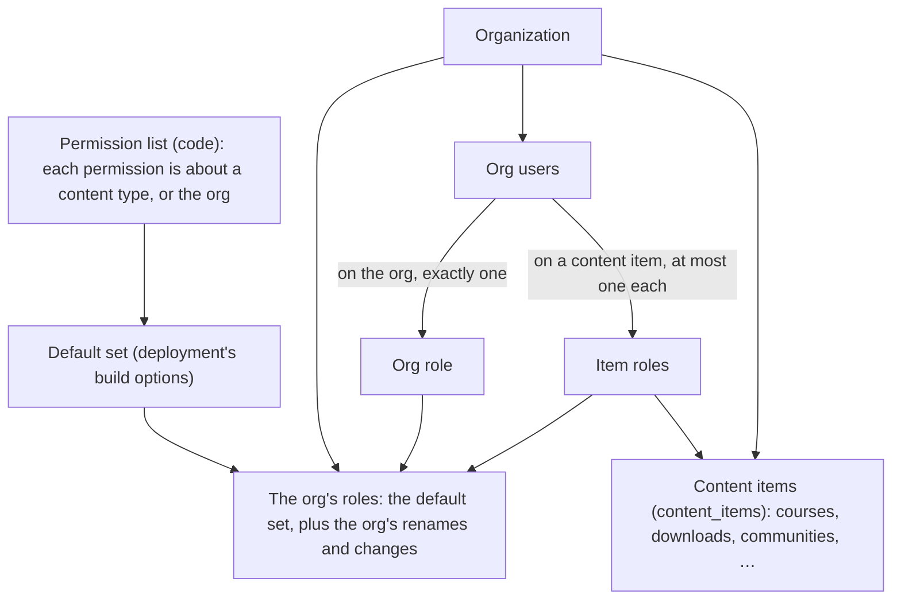

# Roles and permissions: design spec

Nov 5, 2026 · @Meiring

## 1. Overview

This document specifies roles and permissions for Headless LMS. A permission names one thing the server lets a person do, such as editing a course. The list of permissions is code. A role is a named set of permissions and is data: the product ships a default set, a deployment can replace it, and an org can rename its roles or, through the API, change them. A role is given to a person on the whole org or on one content item, such as a course or a community. Every check is a permission check inside a core service method. No code reads a role's name or key to decide anything.

Today the five roles owner, admin, instructor, moderator and student are fixed in code, and code branches on them by name. Excluding tests: `isStaffRole` occurs 39 times, `canModerate` 29, `STUDENT_ROLE` 24, literal role comparisons 18 and `isManager` 57 in the admin app, plus `STAFF_ROLES` in SQL and role checks across the community app. "Staff" carries many different meanings across those places (section 8). The same instructor can call routes through a session that their API key can't reach. A moderator moderates posts but not chats, has their posts held for review, and can be invited to a space but can't ask to join one. The instructor's "assigned courses" resolve to no access because nothing records an assignment. The design replaces all of it.

The model:

- the permission list is code; each permission is about one content type, or about the org;
- a role holds permissions from the list, has a stable key and a name an org can change;
- a role lists its levels: where it can be given, the org and/or content types;
- a role is given on the org, where it covers everything, or on one content item of a type it lists, where it covers that item;
- a person's permissions on an item are their org role's plus the role given to them on that item;
- the owner and the member role are system roles;
- nobody can grant a permission they don't hold;
- the apps read the person's effective permissions from the API.

Better Auth keeps authentication, sessions, organizations and memberships. Roles, permissions and assignments live in the organizations context, which already owns roles and authorization (`docs/domain/organizations.md`). Section 9 explains why Better Auth's dynamic access control is not used. The design adds no bounded context. Where it touches things other than roles (API keys, MCP, invites), they keep working as they do today, except where roles force a change. No data is migrated: the change is a schema change, and development databases are recreated.

**Example data.** Examples use the org Spanish in 90 Days, its courses Spanish Basics (`crs_1`) and Spanish Grammar (`crs_2`), and its communities Spring cohort (`cmy_1`, with the space Practice) and Autumn cohort (`cmy_2`). Sarah owns the org. James teaches Spanish Basics. Emma moderates Spring cohort. Oliver is a learner.

## 2. Requirements

1. The permission list is code. A deployment or an org can't add a permission.
2. Roles are data. The product ships a default set; a deployment can replace it when it builds the server.
3. An org can rename any of its roles. An org that changes nothing uses the deployment's set.
4. Through the API, a holder of `roles:write` can change a role's permissions and levels and add roles to the org.
5. A role lists its levels: the org and/or content types. It is given on the org or on one content item of a type it lists, and nowhere else.
6. A role holds only permissions that fit its levels. A permission that doesn't fit is refused when the role is saved.
7. A new content type becomes a valid level as soon as the content context defines it. It brings its own permissions, and a default role if it needs one. Nothing else in roles, assignments or checks changes.
8. No code in the server, the adapters or the apps compares a role's name or key. Every decision is a permission check in a core service method.
9. Nobody can give a role, change a role or manage a person beyond what they hold themselves. Nobody changes their own roles.
10. The owner holds every permission, and ownership moves only by transfer.
11. Access to content stays with grants. A role never opens a content item by itself, except through the read permission of its type (section 6).
12. API keys and connected apps keep working as today: they reach MCP, and a token can never do more than its creator holds at the time of the request.
13. The admin app, the student app and the community app show and hide actions from the person's effective permissions, read from the API.
14. Every role change, assignment and ownership transfer emits an event. Org-visible events that carried `role` change version (section 12.1).
15. Better Auth stays the system of record for organizations, memberships and sessions.

## 3. Glossary

| Term | Meaning |
|---|---|
| Permission | One `resource:action` key from the permission list, such as `courses:write`. The only thing code checks. |
| Permission list | The fixed list of permissions. Each has a label, a description, a group and what it is about: a content type, or the org. Code. |
| Level | Where a role can be given: `org` or a content type. A role lists its levels. A permission's `about` is also a level. |
| Content type | A kind of content item the content context defines: `course`, `download`, `community`, and any type added later. |
| Content item | One course, one download, one community, and so on. Has an id and a type, registered in `content_items`. |
| Scope | Where a role is given: the org, or one content item. |
| Role | A named set of permissions with the levels it can be given at. Has a stable key and an editable name. Data. |
| Default set | The roles a deployment gives every org. The product's default set is Owner, Admin, Instructor, Moderator and Member. |
| System role | Owner and Member. Every default set has them; they can be renamed, never deleted. |
| Assignment | A person holding a role at a scope. |
| Org role | The role a person holds on the org. Every person has exactly one; it is Member unless they were given another. |
| Effective permissions | Everything a person may do on an item: their org role's permissions plus those of the role given to them on that item. |
| Team | People shown as team on a content item: badge, "Team" section, DM rules (section 4.7). |
| System actor | The actor the system uses for work it does itself, which holds every permission. Never built from a request. |

## 4. Model

### 4.1 Containment



- The permission list is code. The default set is passed to the server when it is built.
- An org's roles are the default set plus the org's own changes.
- An org user has exactly one org role and at most one role per content item.
- Grants decide what content a person can open. Assignments decide what they can do.

### 4.2 Roles

A role has:

- `key`: stable and never changed. Assignments refer to it, so renaming never detaches anyone.
- `name` and `description`: editable per org. Instructor can become "Doctor", Moderator "Community lead", Member "Client".
- `levels`: where the role can be given: `org` and/or content types, such as `course`. At least one. The values come from the content context's list of content types, so a new type is a valid level as soon as it exists.
- `permissions`: the permissions it grants. Each must fit the role's levels (section 4.5).
- `team`: whether holders are shown as team where the role applies.
- `base`: the default role it started from. A permission added to the list later resolves from the base's default until the role is saved with an explicit choice (section 5.3).

**Owner** holds every permission, including ones added later. Exactly one person holds it, on the org only, and it moves only by transfer (section 10.3). It can be renamed, not changed, given or deleted.

**Member** is the org role of everyone who wasn't given another. It holds no permissions: what a member opens is decided by grants, and nothing in the permission list is a member-side action today. It can be renamed, not changed, given on a content item, or deleted.

### 4.3 The default set

The product's default set, built from the permission list (section 5.1):

| Key | Name | Levels | Team | Holds |
|---|---|---|---|---|
| `owner` | Owner | org | yes | everything |
| `admin` | Admin | org | yes | every permission |
| `instructor` | Instructor | org, course | yes | teaching: see, open, edit and publish courses, moderate lesson comments, see a course's learners, progress and analytics; create API keys when it is the org role |
| `moderator` | Moderator | org, community | yes | community moderation: posts, comments, chats, reports and space members; posts skip review |
| `member` | Member | org | no | nothing |

Instructor on the org covers every course; on one course, that course. Moderator on the org covers every community; on one community, that community. Instructor holds nothing in communities: a person who teaches and moderates holds both roles.

A deployment replaces the default set with its own by passing `roles` to `buildContainer` (`BuildContainerOptions`, `packages/server/src/app/container.ts:145-149`). A community-only deployment might ship Owner, Host, Moderator and Member. At startup the server refuses a set that:

- lacks `owner` or `member`, or changes what either holds;
- repeats a key;
- names a permission that isn't in the list;
- names a level that is neither `org` nor a content type, or gives a role no level;
- gives a role a permission that doesn't fit its levels.

Changing the deployment's set changes every org that hasn't changed that role. Against an existing database, after a replacement:

- an assignment or stored row whose role key the set no longer has resolves to nothing, and the server logs each one at startup;
- an assignment at a level its role no longer lists contributes nothing;
- a role contributes only the permissions that fit its current levels, saved or from its base.

### 4.4 Org roles

An org that changes nothing stores nothing and uses the default set. When an org renames or changes a role, its version of that role is stored (`org_roles`, section 17.1), and that version applies from then on. A rename stores only the name, so later changes to the deployment's version still reach its permissions. Resetting deletes the stored version. Roles the org adds through the API are stored the same way, with a generated key (`role_<ksuid>`). Creating an org writes no `org_roles` rows. It does create the creator's active org user and their `owner` assignment, in `OrganizationService.createOrganization`, so every org has its owner from the start.

### 4.5 Assignments

An assignment is `(org user, role, scope)`, where scope is the org or one content item.

- Every org user has exactly one assignment on the org. It is Member unless they were given another role. Member is never stored: an org user without an org row has Member. The owner's org row has the role `owner`, and exactly one such row exists per org.
- An org user has at most one assignment per content item.
- **A role is given only at a level it lists.** Instructor lists `org` and `course`, so it can be given on the org or on a course, and giving it on a community is refused. Owner and Member list `org` only.
- **A role's permissions fit its levels.** A role may hold a permission about a content type when its levels include that type or `org`, and a permission about the org only when its levels include `org`. A role whose only level is `course` can't hold `members:write`; saving it is refused. Adding the wrong permission to a role therefore can't widen where it applies.
- An assignment never grants access by itself. James can edit Spanish Basics because he holds `courses:write` on it. He opens it as a learner does with a grant, or through `courses:read` on it (section 6).

### 4.6 Effective permissions

- **On the org.** A role given on the org applies everywhere. Its permissions about a content type cover every item of that type: Instructor on the org covers every course. Its permissions about the org itself, such as `members:write`, apply too.
- **On a content item.** A role given on an item contributes only its permissions about that item's type, and only for that item. Instructor on Spanish Basics gives course permissions for `crs_1` and nothing else, never `api_keys:write`.
- **On an item, a person holds** their org role's permissions plus those of the role given to them on that item. Nothing is subtracted.
- The owner's org role holds every permission in the list. A permission that implies another (section 5.2) grants both.

There are no deny rules and no wildcards.

### 4.7 Team

A person is team on a content item when either the role given to them on that item or their org role has `team`. The label is the name of the role given on the item, or else of the org role. So:

- James's replies in Spanish Basics show the badge "Instructor" (or the org's name for it); in Spanish Grammar they don't.
- Emma appears under "Team" in Spring cohort's directory.
- DM rules resolve at the chat's community: member to member, member to team, team to anyone. A direct message to or from a team member is never a message request.
- Lesson comments resolve team at the course.

## 5. Permission list

### 5.1 The list

**Naming rules.** Every permission follows them, and a permission added later is named by them:

1. A key is `resource:action`.
2. The resource is a domain noun the API exposes, in the plural: `courses`, `members`, `automations`. It is never a database table, a screen or a role.
3. The resource never carries a level. Where a permission applies comes only from its `about` and from where the role is given, so there is no `course_` or `community_` prefix: a course's learners are `progress` about `course`, not `course_learners`.
4. A record that belongs to a resource falls under that resource's permissions: modules, activities and lesson comments under `courses`, spaces, topics, posts, chats and space members under `communities`. A part gets its own resource only when it is a domain noun of its own that a role or a token needs apart from its parent; learners' progress is the one case, because it is personal data the course's content permissions shouldn't carry.
5. The actions are `read`, `write` and `delete`, and one special action, `moderate`. No other action exists.
   - `read` sees the resource. On a content type it also opens the item the way a learner does, without a grant and unpublished included (section 6).
   - `write` creates and changes it. Creating a content item needs `write` on the org.
   - `delete` permanently removes the resource itself. Removing a record that belongs to it, such as a module or a space, changes the resource and is `write`; so is revoking a grant. A resource that can't be removed has no `delete`.
   - `moderate` acts on what other people post in a content item: approving, removing, restoring, pinning, locking and reports. The holder's own posts skip review there.
6. Each `write` and `delete` implies the resource's `read`. No other implication exists unless 5.2 lists it with its reason.

Today's API scopes that break these rules are renamed: `students:read` to `members:read`, `students:invite` to `members:write`, `comments:read` and `comments:moderate` to `courses:moderate`, `community_moderation:read`, `community_moderation:write`, `community_members:read` and `community_members:write` to `communities:moderate`. Keys and app consents that carry the old names lose them. The other scopes keep their names.

"About" is the content type the permission is about, or `org` for permissions about the org itself; a role's permissions are checked against its levels with it (section 4.5). The last three columns are the product's default set.

| Group | Permission | Allows | About | Admin | Instructor | Moderator |
|---|---|---|---|:-:|:-:|:-:|
| Organization | `org:write` | Change the org's name, slug and general settings. | org | ✓ | | |
| Organization | `api_keys:read` | List your own API keys. | org | ✓ | ✓ | |
| Organization | `api_keys:write` | Create your own API keys. | org | ✓ | ✓ | |
| Organization | `api_keys:delete` | Revoke your own API keys. | org | ✓ | ✓ | |
| Organization | `notification_categories:read` | See the notification types, channels and the org's categories and defaults. | org | ✓ | | |
| Organization | `notification_categories:write` | Edit and reset the org's notification categories. | org | ✓ | | |
| Organization | `integrations:read` | See connected integrations. | org | ✓ | | |
| Organization | `integrations:write` | Connect, configure and run actions on integrations. | org | ✓ | | |
| Organization | `integrations:delete` | Disconnect integrations. | org | ✓ | | |
| Organization | `analytics:read` | See the org's overview report. | org | ✓ | | |
| People | `members:read` | List the org's people and pending invites, with each person's roles, and open any person's record. | org | ✓ | | |
| People | `members:write` | Invite people, resend and cancel invites, set a person's org role and give and remove roles on content items, under rule 2. | org | ✓ | | |
| People | `members:delete` | Remove a person from the org, under rule 3. | org | ✓ | | |
| People | `roles:read` | See the org's roles and their permissions. | org | ✓ | | |
| People | `roles:write` | Rename roles; change, reset and add roles through the API. | org | ✓ | | |
| People | `roles:delete` | Delete a role the org added. | org | ✓ | | |
| Access | `access:read` | See grants, including a community's roster of grant holders. | org | ✓ | | |
| Access | `access:write` | Grant, change and revoke access. | org | ✓ | | |
| Content | `bundles:read` | See bundles and their names. | org | ✓ | | |
| Content | `bundles:write` | Create and edit bundles. | org | ✓ | | |
| Content | `bundles:delete` | Delete bundles. | org | ✓ | | |
| Content | `media:read` | See the whole media library and attach any of its files. | org | ✓ | | |
| Content | `media:write` | Upload to the media library and edit its files. | org | ✓ | | |
| Content | `media:delete` | Delete files from the media library. | org | ✓ | | |
| Courses | `courses:read` | See the course, its modules and activities in the admin app; open it, its lessons, files and titles without a grant, unpublished included; be reachable for its lesson-comment mentions. | course | ✓ | ✓ | |
| Courses | `courses:write` | Edit and publish the course; add, change and delete its modules and activities; upload media for it and attach media uploaded for it. | course | ✓ | ✓ | |
| Courses | `courses:delete` | Delete the course. | course | ✓ | | |
| Courses | `courses:moderate` | See the course's lesson comments, held ones included; approve, remove, restore, reply to and resolve reports on them; be notified of reports. | course | ✓ | ✓ | |
| Courses | `progress:read` | See the course's learners, their progress and the course's analytics. | course | ✓ | ✓ | |
| Downloads | `downloads:read` | See the download in the admin app; open it and its files without a grant, unpublished included. | download | ✓ | | |
| Downloads | `downloads:write` | Edit and publish the download; upload files for it and attach files uploaded for it. | download | ✓ | | |
| Downloads | `downloads:delete` | Delete the download. | download | ✓ | | |
| Communities | `communities:read` | See the community, its spaces, notification categories and analytics in the admin app; be a member of it without a grant, unpublished included, open every space in it and see its thumbnail while unpublished. | community | ✓ | | |
| Communities | `communities:write` | Configure the community, its spaces, topics, links, settings and notification categories; publish it; delete its spaces. | community | ✓ | | |
| Communities | `communities:delete` | Delete the community. | community | ✓ | | |
| Communities | `communities:moderate` | See the review queue, pending and removed posts, held comments and their titles; open every space; approve, remove, restore, pin and lock posts and comments; turn comments and reactions on and off; delete any message, see deleted messages, read reported attachments, lock chats, see the message queue; see every space member with their status and locked spaces' rosters; invite, add, approve, decline and remove space members; resolve reports; be notified of reviews, reports and join requests. | community | ✓ | | ✓ |
| Automations | `automations:read` | See workflows, webhooks and their runs. | org | ✓ | | |
| Automations | `automations:write` | Create and edit workflows and webhooks, and reveal a webhook's signing secret. | org | ✓ | | |
| Automations | `automations:delete` | Delete workflows and webhooks. | org | ✓ | | |

Connected apps are the person's own consents, not a resource of the org: any active org user lists and disconnects their own (section 11). Owner-only actions are not permissions, because no role can hold them: transferring ownership and deleting the org. Creating an org needs no permission: any signed-in person can create one and becomes its owner.

### 5.2 Shape in code

The keys are `permissionSchema` in `packages/core/src/types/schemas/organizations.ts`, so the wire schema and the SDK are typed from the same source. `packages/core/src/organizations/permissions.ts` declares each one's definition, and `packages/core/src/organizations/default-roles.ts` declares the product's default set.

```ts
// packages/core/src/types/schemas/organizations.ts
export const levelSchema = z.union([z.literal('org'), contentTypeSchema]);
export type Level = z.infer<typeof levelSchema>;
export const permissionSchema = z.enum(['courses:read', 'courses:write', 'members:write', /* … every key in 5.1 */]);
export type Permission = z.infer<typeof permissionSchema>;
```

```ts
// packages/core/src/organizations/permissions.ts
export const PERMISSIONS = {
  'courses:write': {
    group: 'courses',
    label: 'Edit courses',
    description: 'Edit and publish the course. Creating a course needs it on the org.',
    about: 'course',
    implies: ['courses:read'],
  },
  'members:write': {
    group: 'people',
    label: 'Manage people',
    description: 'Invite people, manage invites, and set and give roles you hold.',
    about: 'org',
    implies: ['members:read'],
  },
} as const satisfies Record<Permission, PermissionDefinition>;

interface PermissionDefinition {
  group: string;
  label: string;
  description: string;
  about: Level;
  implies?: readonly Permission[];
}
```

```ts
// packages/core/src/organizations/default-roles.ts
instructor: {
  name: 'Instructor',
  levels: ['org', 'course'],
  team: true,
  permissions: ['courses:read', 'courses:write', 'courses:moderate', 'progress:read', 'api_keys:read', 'api_keys:write', 'api_keys:delete'],
},
```

- `about` and `levels` share the `Level` type. `contentTypeSchema` (`packages/core/src/types/schemas/content.ts:6`) is the list of content types; the compiler checks every `about`, and `levelSchema` validates a deployment's set at startup and every role an org changes or adds.
- Each permission names what it implies, and every implied key exists. The implications:
  - every `*:write` and `*:delete` implies its `*:read` (rule 6);
  - `courses:moderate` implies `courses:read`, because lesson comments are moderated from the admin app, where the moderator holds no grant;
  - `members:read` implies `progress:read`, because a person's record shows their progress in every course.
- `communities:moderate` doesn't imply `communities:read`: a moderator moderates as a member of the community, through their grant (section 6).
- `GET /api/access/permissions/list` serves the definitions to any org user, for the role screens, the key-creation screen and the consent screen.

### 5.3 Adding a permission later

A stored role saves an explicit `true` or `false` for every permission it was saved with. A permission it has never been saved with resolves from the default of its base in the deployment's set, if it fits the role's levels. A permission added in a later release therefore reaches every unchanged role and every stored role with its base's default. No stored role is rewritten.

### 5.4 Adding a content type

A new content type, such as events, is added to `contentTypeSchema` and to `content_items` by the content context. `event` is then a valid level. For roles it brings:

- its permissions, about the new type and named by the rules of 5.1: `events:read`, `events:write`, `events:delete`, and `events:moderate` if people post in events;
- a default role for working on one item of that type, if it needs one, such as Host with levels `org` and `event`;
- Admin's default, which holds the new permissions.

A role that lists `event` can then be given on any event, and, when it lists `org`, on the org for every event. The assignment table, the check, the actor and the routes don't change.

## 6. Access and roles

Grants still decide what a person can open. The read permission of each content type is the explicit exception, and replaces today's staff bypass:

- `courses:read` opens the course, its lessons, files and titles without a grant, unpublished included. It also makes the person reachable for the course's lesson-comment mentions and notifications.
- `downloads:read` opens the download and its files the same way.
- `communities:read` makes the person a member of the community without a grant, unpublished communities included, and lets them open every space in it.

A person opens every space of a community when they hold `communities:read` on it, or are a member of it and hold `communities:moderate` on it. That is `opensEverySpace` (section 7.4). A person who opens every space holds no place in its spaces: they can't request a place, be invited or added, accept, refuse or leave. Place rows they held before stay, are ignored while they open every space and are left out of the space's counts, and apply again if they stop. This replaces today's two conflicting rules (`canModerate` in `requestJoin`, `isStaffRole` in `assertHolder` and `assertHolds`).

Today every Instructor is staff: a member of every community, a moderator of it, and able to open every course. Under the default set, Admin keeps all of that. An Instructor keeps it only on the courses it is given, and holds nothing in communities.

## 7. Service-level checks

Every permission check is in a core service method. REST routes and MCP tools carry none: they identify the caller, get the actor from organizations and call the method once. A REST call, an MCP tool and a background job that reach the same method get the same answer.

### 7.1 The actor

Every core method a person can reach takes the caller as an explicit `actor` argument. About a third do today (`deleteCourse(orgId, id, actor)`, `PostService.remove`, the chat, post, discussion and space-member methods); the rest gain it (section 18 lists them). A method that takes an actor reads the org from it and no longer takes a separate `orgId`, so a check and a write can never land in different orgs.

```ts
// packages/core/src/shared/actor.ts
import type { Permission, ContentId } from '../types/index.js';

export interface Actor {
  id: string;
  orgId: string;
  permissions: EffectivePermissions;
}

export interface EffectivePermissions {
  has(permission: Permission, on?: ContentId): boolean;
  require(permission: Permission, on?: ContentId): void;
  anywhere(permission: Permission): boolean;
  where(permission: Permission): { org: boolean; content: ContentId[] };
  roleOn(on?: ContentId): { key: string; name: string; team: boolean };
  isOwner(): boolean;
}
```

- `has('courses:write', 'crs_1')` is true when the org role grants it or the role given on `crs_1` does. With no item it asks about the org only.
- `require` throws `ForbiddenError` when `has` is false.
- `anywhere` answers "on the org or on any item".
- `where` lists where the person holds it, for filtering lists.
- `roleOn` returns the role given on that item, or the org role when there is none, with its name and team flag. `isTeam` and the badge label read it.
- `isOwner` is true for the owner, and false whenever token scopes apply, so an owner's API key or app token can never transfer ownership or delete the org. The owner-only actions check it; nothing compares `roleOn().key`.

`Actor` and `EffectivePermissions` are in `core/shared`; `Permission`, `Level` and `ContentId` are in `core/types`. The implementation is in `core/organizations`. No other context imports organizations for role helpers.

### 7.2 Building the actor

The transport does the one thing only it can: it verifies the credential on the request and resolves the org user, as it does today. REST accepts sessions; `/mcp` accepts API keys and OAuth tokens. It then asks organizations for the actor:

```ts
// packages/core/src/organizations/service.ts
async actorFor(orgId: string, orgUserId: string, tokenScopes?: Permission[]): Promise<Actor | null> {
  const rows = await this.repo.assignmentsWithRoles(orgId, orgUserId);
  if (rows === null) return null;
  return { id: orgUserId, orgId, permissions: resolvePermissions(rows, this.defaultRoles, tokenScopes) };
}
```

- `assignmentsWithRoles` is the one database query: the org user, if active, and their assignment rows with each content item's type, joined to the org's stored versions of those roles. It returns null for an org user who doesn't exist or isn't active.
- The deployment's default set is in memory, loaded at startup.
- `resolvePermissions` builds the sets of section 7.3. For an API key or OAuth token it intersects them with the token's scopes (section 11). The owner's set is the whole list and is intersected like anyone else's, so an owner's key holds only its scopes.
- The actor is built once per request. Nothing is cached across requests, so a role change applies on the next request.

`resolveScope` (`scope.ts:22`), `resolveScopeFor` (`:54`) and `resolveConfiguratorScope` (`:75`) are replaced by `resolveActor`, which verifies the credential, finds the active org user and calls `actorFor`. It decides nothing else. The "staff only" refusal is gone from the HTTP layer and from MCP. The member routes use the same resolver, so an `invited` org user can't call the member API.

```ts
// REST route
handler: async (req, reply) => {
  const actor = await resolveActor(container, req);
  await courses.deleteCourse(req.params.id, actor);
  return reply.code(204).send();
},
```

```ts
// MCP tool
call: async (input, ctx) => courses.deleteCourse(input.courseId, ctx.actor),
```

**Work done for a person** runs as that person, with their current permissions. A scheduled post is published as its author:

```ts
const author = await this.organizations.actorFor(orgId, post.orgUserId);
if (author === null) return this.posts.returnToDraft(post.id, this.organizations.systemActor(orgId));
await this.posts.publishScheduled(post.id, author, now);
```

An author who left the org, or is no longer active, gets the post back as a draft, as today.

**Work the system does itself** runs as the system actor: automations granting access, mail lookups, notification reads, grant expiry, the upload sweep. So do reads one context makes of another's data to serve a person: reporting/member, progress, discussion, entitlements and the title readers call `getCourse`, `getActivity`, `getSpace` and the like with `systemActor(actor.orgId)`. The method serving the person makes the person's own checks, such as the grant, before it reads. `organizations.systemActor(orgId)` holds every permission, has the id `system`, and is recorded as `system` in event metadata. It is built only in core and by the composition root, never from a request, so no transport can obtain it. Every method keeps one signature and one check.

### 7.3 What `has` looks up

`resolvePermissions` builds, in memory:

```ts
{
  org: Set<Permission>,
  orgRole: { key: string; name: string; team: boolean },
  content: Map<ContentId, { permissions: Set<Permission>; role: { key: string; name: string; team: boolean } }>,
}
```

- `org` holds every permission of the org role, with implications expanded. For the owner it is the whole list.
- Each content entry holds the permissions of the role given on that item that are about the item's type, with implications expanded, and that role's key, name and team flag. A permission about another type, or about the org, never enters it.
- With token scopes, every set is intersected with them.

`has` is a set lookup, with no database call:

```ts
// packages/core/src/organizations/permissions.ts
has(permission: Permission, on?: ContentId): boolean {
  if (this.org.has(permission)) return true;
  return on !== undefined && (this.content.get(on)?.permissions.has(permission) ?? false);
}

require(permission: Permission, on?: ContentId): void {
  if (!this.has(permission, on)) throw new ForbiddenError(`You need ${permission}`);
}
```

A permission held through the org role is true for every item. A method only asks about the permission that fits the item it acts on, so `courses:write` is only ever asked about a course.

### 7.4 Where the check is done

The check is at the top of the method of the context that owns the action: courses in content, posts in discussion, grants in entitlements. No route, MCP tool or repository checks a permission.

**Against the item acted on.** Deleting a course today (`routes/courses.ts:128-148`, `content/service.ts:208`) checks only that the caller is staff, so any instructor can delete any course. Under this design:

```ts
// packages/core/src/content/service.ts
async deleteCourse(id: string, actor: Actor): Promise<void> {
  actor.permissions.require('courses:delete', id);
  await this.uow.run(async ({ content, outbox }) => { … });
}
```

James, Instructor on Spanish Basics, is refused, because the default Instructor doesn't hold `courses:delete`. In an org whose Instructors hold it, he can delete `crs_1` and is refused `crs_2`. The MCP tool `delete_course` calls the same method and gets the same answers.

**Against the item's own data.** When the item depends on what is acted on, the method loads it first and checks against what it loaded, never an id the client sent:

```ts
// packages/core/src/discussion/posts.ts
async remove(postId: string, actor: Actor): Promise<PostView> {
  const { post } = await this.loadVisible(actor, postId);
  if (post.orgUserId !== actor.id) {
    actor.permissions.require('communities:moderate', post.communityId);
  }
  …
}
```

A lesson comment carries its activity, not its course, so the discussion method resolves the course through the activity before checking `courses:moderate`.

**Lists filter.** A list returns everything to a holder on the org, or only the items the caller holds the permission on. The repository takes the id list beside the query and paging:

```ts
async listCourses(query: CourseQuery, actor: Actor): Promise<Page<CourseView>> {
  const where = actor.permissions.where('courses:read');
  if (!where.org && where.content.length === 0) throw new ForbiddenError('You cannot see courses');
  return this.repo.listCourses(actor.orgId, query, where.org ? undefined : where.content);
}
```

**Creating** a course, download or community needs the write permission on the org, because there is no item yet: `actor.permissions.require('courses:write')`.

**Media.** An upload may name the content item it is for. `requestUpload` requires `media:write` on the org, or the item's write permission on that item, and records the item on the asset. Saving an activity, a download's files or a thumbnail accepts an asset only when the actor holds `media:read` on the org or the asset was uploaded for that same item. The picker lists the whole library to `media:read` holders, otherwise the files uploaded for that item.

**Operations that end in Better Auth or another adapter** go through a core method that takes the actor, checks, and then calls the port:

- `OrganizationService.updateOrganization(input, actor)` requires `org:write`. A slug another org holds is refused with `OrganizationRuleError` (409) before either row is written, because the adapter write skips Better Auth's own slug check. It then writes Better Auth and core's org row;
- `OrganizationService.deleteOrganization(actor)` requires `isOwner()`, deletes the org through the adapter and deletes core's side in the same operation;
- `OrganizationService.createApiKey`, `listApiKeys`, `deleteApiKey`, `listConnectedApps` and `revokeConnectedApp` sit behind an `ApiKeys` port the auth adapter implements. Creating a key requires `api_keys:write` and that its scopes are held (section 11); listing requires `api_keys:read`; revoking requires `api_keys:delete` and acts only on the caller's own keys. The connected-app methods are `member` and act only on the caller's own consents;
- `NotificationCategoryService.get`, `replace`, `reset` and `defaults` take the actor: `notification_categories:read` or `:write` on the org, `communities:read` or `:write` on a community. `NotificationCatalog.types(actor, scope)`, `channels(actor)` and `defaults(actor, scope)`, in organizations, wrap the type and channel registries and the defaults. For the org scope they require `notification_categories:read`; for the community scope, and for `channels`, they also accept `communities:read` anywhere, because the community defaults and types belong to no community. The defaults route calls `NotificationCatalog.defaults`.
- Replying to a lesson comment is `DiscussionService.replyToComment(commentId, body, actor)`. It finds the thread's root, which the route does today (`routes/discussion.ts:129-136`), and requires `courses:moderate` on the course. The route and the MCP tool `reply_to_comment` both call it.

**Member-side methods** check only what the method decides. Anything every member can do needs no permission; removing a post checks that you wrote it or moderate its community.

**Named decisions.** Where several places ask the same compound question, the context that owns it exposes one function named for what it decides: entitlements `opensEverySpace(actor, communityId)`, discussion `skipsReview(permissions, itemId)` and `isTeam(permissions, itemId)`. `skipsReview` is true when the author holds `communities:moderate` on the post's community or `courses:moderate` on the comment's course: whoever approves others' posts isn't held for review. Restoring a removed post re-runs review with the author's permissions on the post's community. No function takes a role.

**Writes to roles and assignments** take transaction-scoped advisory locks on `(org_id, role_key)` for every role they read or change and on `(org_id, org_user_id)` for the target and the actor, then re-read the actor's permissions and the target's assignments under those locks. Giving a role while its level is removed, giving a role while it is deleted, two people setting the same person's org role, and an editor demoted mid-change are all serialised. Any other request finishes with the permissions it started with.

### 7.5 Nothing left unchecked

- Each service declares, beside its methods, what each public method requires: one or more permissions, any of which lets the method run its own checks (`createInvite` declares `members:write`; `requestUpload` declares `media:write`, `courses:write` and `downloads:write`); `owner` (`transferOwnership`, `deleteOrganization`, checked with `isOwner()`); `member` (any active org user, with the method's own checks); `system` (reached only by the system actor); or `public` (no org user yet: `createOrganization` for a signed-in person, `peekInvite` and `acceptInvite` for an invite token).
- A core test reads each service class's public methods and fails for a method missing from the declaration.
- On seeded fixtures (an org, one item of each content type, a post, a comment, a chat), a core test calls every method declared with a permission with an actor who holds nothing and expects `ForbiddenError`.
- Each route's config and each MCP tool name the core method they call (`operation: 'content.deleteCourse'`). A server test fails for a route or tool without one. Core exposes `permissionFor(operation)`, which returns the declaration; the OpenAPI descriptions name its permissions, and MCP lists the tools for which the caller holds any of them anywhere. `POST /api/organizations` names `organizations.createOrganization`, which it reaches through the `beforeCreateOrganization` hook. Neither protects anything: the method checks when it runs.

Tests build an actor directly, without HTTP:

```ts
const james = actorWith({ content: { crs_1: ['courses:write'] } });
await expect(content.deleteCourse('crs_2', james)).rejects.toThrow(ForbiddenError);
```

### 7.6 Other people's permissions

Some decisions depend on someone other than the caller: the author of a scheduled or restored post, the other side of a DM, the people a list, a badge or a recipient rule covers.

- `OrganizationService.permissionsOfMany(orgId, orgUserIds)` returns `EffectivePermissions` per person in one query, `roleOn` included.
- `OrganizationService.holders(orgId, permission, on?)` returns the active org users who hold a permission on the org or on an item.
- The `AuthorPermissionReader` port in discussion replaces `AuthorRoleReader` (`container.ts:432-441`). Entitlements' `AccessFacts.role` (`adapters/db/src/repositories/entitlements.ts:483-491`) and `authorsOf` (`adapters/db/src/repositories/discussion.ts:286`, through `org-user-profile.ts:31`) stop reading the role; author views get `team` and `roleName` from `permissionsOfMany`.
- Repositories never filter by role. Where SQL needs "who holds a permission", core passes the ids in: `spaceOpenersAmong`, `communityMemberIds`, `openCommunityIds`, the directory and the moderator recipients receive the holders of `communities:read` and `communities:moderate`.

### 7.7 Levels

Levels are on the role, and are enforced in three places:

- **When a role is saved.** Every level is `org` or a content type (`levelSchema`), there is at least one, and every permission fits the levels (section 4.5). A role with levels `community` that is given `courses:write` is refused.
- **When giving.** `assignRole` reads the item's type from `content_items` and refuses when the role doesn't list it: Moderator on a course, Instructor on a community. `setOrgRole` refuses a role that doesn't list `org`. Owner and Member are refused on any item.
- **When resolving.** A role given on an item contributes only its permissions about that item's type, and only for that item (section 7.3).

Removing a level from a role is refused while the role is given at that level.

### 7.8 One person, several roles

A person holds exactly one org role and at most one role per content item, with no limit on how many items. Emma can be Member on the org, Moderator of Spring cohort, Moderator of Autumn cohort and Instructor of Spanish Basics at the same time. Her permissions in Spring cohort are Member's plus Moderator's. In Spanish Basics they are Member's plus Instructor's. In Spanish Grammar they are Member's only.

### 7.9 When things change

Nothing is cached across requests, so every change applies from the next request.

| Change | Effect |
|---|---|
| A person is given a role, or loses one | Their next request resolves the new set. Their API keys narrow or widen with it, never beyond the key's own scopes. |
| An org renames a role | Only `name` changes. Holders keep it, because assignments point to the key. Badges and emails show the new name. |
| An org changes a role's permissions | Every holder in that org gets the new permissions on their next request. A permission that doesn't fit the role's levels is refused. |
| An org changes a role's levels | Adding a level lets the role be given there. Removing a level is refused while the role is given at it. |
| An org resets a role | Its stored row is deleted and the deployment's version applies again, after the same escalation check as a change. |
| The deployment replaces its default set and restarts | Every org that hasn't changed that role uses the new version. Orgs that changed it keep their saved choices; permissions they never saved resolve from the new base. Dangling keys and levels resolve as section 4.3 says. |
| A release adds a permission | It reaches unchanged roles with its default, and stored roles with their base's default (section 5.3). |
| A release adds a content type | It is a valid level; its permissions are added; roles that list it can be given on its items (section 5.4). |
| A content item is deleted | The database deletes its assignments with it (section 17.2). |
| A person is removed from the org | Their assignments cascade, their Better Auth membership is removed, and their API keys and app consents for the org are revoked (section 10.2). The owner can't be removed. |

## 8. What "staff" becomes

| Meaning today | Code today | Becomes |
|---|---|---|
| Reaches the back office | `resolveScope`, `resolveScopeFor`, admin `toRole`, MCP challenge | Each service method's own permission (section 7) |
| Member of every community without a grant | `grant-covers.ts:75-81` `STAFF_ROLES`, used by `entitlements.ts:484, 752, 771, 814` and `member.ts:54` | `communities:read`; holder ids passed into those queries |
| Opens content without a grant, unpublished included | `reporting/member/service.ts:403,419,440,576`, `content/titles.ts:53-81`, `discussion/titles.ts:141`, `discussion/service.ts:189,206,229`, `courseReach` | `courses:read`, `downloads:read`; a community's unpublished thumbnail is `communities:read` |
| Sees a bundle's name without holding it | `content/titles.ts:92` | `bundles:read` |
| Sees held and removed comments and their titles | `discussion/titles.ts:120`, `discussion/service.ts:405, 433, 526` | `courses:moderate` on the course for lesson comments; `communities:moderate` on the community for post comments |
| Opens every space | `entitlements/rules.ts:14,23` `canModerate` | `opensEverySpace` (section 6) |
| Holds no place in a space | `entitlements/service.ts:280,665,693` | Opens every space (section 6) |
| Moderates posts and space members | `canModerate` in `posts.ts`, `discussion/service.ts:607`, `entitlements/service.ts` | `communities:moderate` on that community |
| Moderates chats | `chats.ts` `isStaffRole` at `:415, 577, 628, 675, 676, 687, 783, 1179, 1196, 1204` | `communities:moderate` on that community |
| Moderates lesson comments, restores and approves any comment | `discussion/service.ts:527, 614, 671, 774, 825, 866` | `courses:moderate` on that course for lesson comments; `communities:moderate` on that community for post comments |
| Skips review | `posts.ts:949, 480-486`, `discussion/service.ts:303` | `skipsReview`: `communities:moderate` or `courses:moderate` where the author posts |
| Configures communities | `content/service.ts:88-92` owner or admin | `communities:write` |
| Configures notifications | `resolveConfiguratorScope` owner or admin | `notification_categories:read`/`:write` for the org's; `communities:read`/`:write` for a community's |
| Manages people | `assertManagesUsers` | `members:write`, `members:delete` (section 10.2) |
| Shown as team, DM rules, no message requests | `chats.ts:146, 974, 977`, community app `roleLabel`, members page | `isTeam` on the item (section 4.7) |
| Team and Students lists | `members.ts:24, 59, 75, 136-140`, `admin.ts:36, 296, 371, 394` | Section 10.4 |
| Staff recipients | `staffOrgUserIds`, `staffIds` | `holders(orgId, 'courses:moderate', courseId)`, `holders(orgId, 'communities:moderate', communityId)` |
| Moderator recipients | `communityModeratorIds` with `MODERATING_ROLES`, for reviews, reports and join requests (`community-derivations.ts:353`, `notifications/rules/entitlements.ts:132`) | `holders(orgId, 'communities:moderate', communityId)` for all three (section 12.2) |

Deleted: `isStaffRole`, `canModerate`, `capability`, `ROLES`, `STAFF_ROLES`, `STUDENT_ROLE`, `MODERATING_ROLES`, `StaffRole`, `TeamRole`, the old `Permission` type in `roles.ts`, `isRole`, `parseRole`, `normalizeRole`, `RANK`, `MATRIX`, `Capability`, `roleHoldsScope`, `scopesForRole`, `scopeOptions`, `findStudentOrgUsers`, `findOrgUserIdsByRole`, the admin app's `isManager`, `can.*`, `ROLE_LABEL`, `ROLE_RANK`, `canAccessDashboard`, `instructorsLite`, its `STAFF` sets, and the community app's `STAFF`, `isStaffRole`, `isModRole` and `roleLabel`.

A role key appears in exactly three places: the default set, stored org roles and assignment rows. A lint rule in both repos refuses an identifier named `role`, `roleKey` or ending in `.role` compared with a string literal, and imports of the deleted helpers. JSX `role=` attributes are not comparisons and don't match. It exempts `adapters/auth/src/access.ts` and `better-auth.ts`, which name the two Better Auth roles. A test fails when anything outside `organizations` imports the default set.

Before and after, `chats.ts:412-420`:

```ts
if (!isStaffRole(actor.role)) {
  if (message.orgUserId !== actor.id) throw new ForbiddenError('You cannot delete this message');
  await this.requireWritableChat(orgId, actor, message.chatId);
}
```

```ts
if (!actor.permissions.has('communities:moderate', message.communityId)) {
  if (message.orgUserId !== actor.id) throw new ForbiddenError('You cannot delete this message');
  await this.requireWritableChat(actor, message.chatId);
}
```

## 9. Better Auth

### 9.1 Responsibilities

Better Auth's organization plugin does two separate jobs. One is tenancy: which organizations exist, who belongs to which (the membership) and which org a session is in. The other is a role feature: a `role` column on the membership and permission checks over it.

| Better Auth | Organizations context |
|---|---|
| Users, accounts, sign-in, sessions, the active organization | The permission list, roles, assignments, effective permissions |
| Organizations and memberships: who belongs to which org | Every role write and every permission check |
| The membership's `role` column, filled with a fixed value | What a person may do |

Better Auth stays the system of record for organizations and memberships, and core keeps its mirror of them (`docs/domain/organizations.md`, "System of record"). Its role feature isn't used: core is the system of record for roles. The membership's `role` column must hold a value, so it holds `owner` for the owner and `participant` for everyone else. Nothing in core reads it.

### 9.2 Every org user who accepts has a membership

Today only staff and moderators have a Better Auth membership, and learners are org users alone. That split drives a fork through invites, acceptance, promotion and demotion (`organizations/service.ts:255-278, 374-438, 554-637`, the `demote` flag in `removeOrgUser`).

Under this design every org user holds a Better Auth membership once they accept:

- The membership's `role` column is `owner` for the owner and `participant` for everyone else. It never changes with the person's roles.
- An invited person is an `invited` org user until they accept. Accepting calls `grantMembership` for every person. Linking an account alone creates no membership.
- A person has at most one membership per org. The adapter's `createMember` is a plain insert (`BA/adapter.mjs:286-294`) and `ba_member` has no unique key on `(organization_id, user_id)` (`adapters/db/src/schema/better-auth.ts:87-97`), so `grantMembership` first looks the membership up with `findMemberByOrgId({ userId, organizationId })` and creates one only when there is none. Accepting an invite as an existing member, to change their role, leaves their one membership as it is.
- The mirror hooks stop parsing roles (`container.ts:839-850`). `addOrgUser` keeps the org user's existing status instead of forcing `active`, so only acceptance activates a person. Memberships core creates through the organization adapter don't run the hooks; core writes the org user itself.
- Learners sign up with email and password, as today; magic link stays sign-in only (`disableSignUp: true`).
- `beforeCreateSession` keeps stamping the active organization for a person with exactly one org user (`container.ts:802-818`), and the accept route keeps stamping the session on acceptance (`routes/organizations.ts:293-301`), so a learner's first session still gets its org. The student app keeps relying on the stamp. The community app keeps calling `set-active`, which now works for learners.
- Removing a person removes the Better Auth membership through the organization adapter and deletes the org user in the same core operation. There is no student branch.
- Changing someone's role never touches Better Auth. Ownership transfer moves the `owner` value (section 10.3).

### 9.3 Better Auth configuration

- `organization({ ac, roles: { owner, participant }, creatorRole: 'owner', membershipLimit: Number.MAX_SAFE_INTEGER })`. Better Auth's default limit of 100 would refuse the 101st member.
- `adapters/auth/src/access.ts` keeps Better Auth's `defaultStatements`, `ownerAc` for `owner` and `memberAc` for `participant`. The custom `course`, `progress` and `community` statements, which nothing checks, are dropped.
- Core makes its Better Auth writes for updating and deleting an org, adding and removing a membership, and changing the membership's `role` value through Better Auth's organization adapter (`getOrgAdapter`). The person or the system actor behind the write has already passed core's check, so the adapter writes without Better Auth checking them again. The adapter runs no organization hooks either, so core writes its own side (the org row, the org user) in the same operation instead of waiting for a mirror hook. These writes work the same from REST, MCP and the system actor. Core is the only gate. `resolveMemberId`'s `list-members` call (`better-auth.ts:679`) is replaced by a lookup by user id.
- Creating an org stays a Better Auth call made with the creator's own session (`POST /api/organizations`), with the `beforeCreateOrganization` hook as today; `createOrganization` then writes the owner (section 4.4).
- The `ApiKeys` port is keyed on ids, not on the caller's session: `list(orgId, userId)`, `create(orgId, userId, name, scopes)`, `revoke(orgId, userId, keyId)`, `listApps(orgId, userId)`, `revokeApp(orgId, userId, clientId)` and `revokeAllFor(orgId, userId)`, which removes a person's keys, app consents and refresh tokens for the org. `revoke` deletes only a key whose `referenceId` is the user and whose metadata names the org, and is NotFound otherwise, as `deleteApiKey` is today (`better-auth.ts:523-529`).
- `dynamicAccessControl` stays off.
- The `before` hook refuses every `/organization/*` path except `/organization/set-active`, `/organization/list` and `/organization/get-active-member` when the call arrived over HTTP (`ctx.request` is set). It must not use `ctx.request || ctx.headers`, which also refuses server calls made with headers. Refused over HTTP include `list-members`, `get-full-organization`, `update`, `update-member-role`, `remove-member`, `invite-member`, `accept-invitation`, `leave` and the role endpoints.
- `customSession` drops `activeMemberRole`. Permissions are never put in the session or its cookie.

### 9.4 Why not dynamic access control

Better Auth 1.7.7 includes `dynamicAccessControl`, which stores roles per org. It isn't used:

- `member.role` stores the role name, so renaming a role detaches everyone who holds it.
- It has no role given on a content item.
- `hasPermission` needs a session with a membership, and passes only when one single role grants every requested permission.
- Static roles can't be edited per org, because a stored role can't reuse a static role's name.
- Giving a role doesn't check the giver's own permissions.
- Its role cache is module-wide and goes stale when enabled.
- There are no hooks on role changes.

## 10. Managing roles and people

### 10.1 Operations

| Operation | Route | Core method | Needs |
|---|---|---|---|
| List the permissions | `GET /api/access/permissions/list` | `permissionList` | any org user |
| My effective permissions and org role | `GET /api/access/permissions` | `viewerPermissions` | any org user |
| List the org's roles with holder counts | `GET /api/organizations/roles` | `listRoles` | `roles:read` |
| Read a role | `GET /api/organizations/roles/:key` | `getRole` | `roles:read` |
| Rename a role | `PATCH /api/organizations/roles/:key` with `name`, `description` | `updateRole` | `roles:write` |
| Change a role's permissions, levels or team flag | `PATCH /api/organizations/roles/:key` | `updateRole` | `roles:write`, rule 1 |
| Add a role | `POST /api/organizations/roles` with a `base` | `createRole` | `roles:write`, rule 1 |
| Reset a role to the deployment's version | `DELETE /api/organizations/roles/:key/customization` | `resetRole` | `roles:write`, rule 1 |
| Delete a role the org added | `DELETE /api/organizations/roles/:key` | `deleteRole` | `roles:delete` |
| List the team (section 10.4) | `GET /api/organizations/members?list=team` | `listTeam` | `members:read` |
| List the students (section 10.4) | `GET /api/organizations/members?list=students` | `listStudents` | `members:read` |
| List a person's assignments | `GET /api/organizations/members/:orgUserId/roles` | `listAssignments` | `members:read` |
| Set a person's org role | `PUT /api/organizations/members/:orgUserId/roles/org` | `setOrgRole` | `members:write`, rule 2 |
| Give a role on a content item | `PUT /api/organizations/members/:orgUserId/roles/content/:contentId` | `assignRole` | `members:write`, rule 2 |
| Remove a role from a content item | `DELETE /api/organizations/members/:orgUserId/roles/content/:contentId` | `unassignRole` | `members:write`, rule 2 |
| List the people with a role on a content item | `GET /api/organizations/content/:contentId/roles` | `listAssignmentsOn` | `members:read` |
| Invite a person | `POST /api/organizations/invites` | `createInvite` | `members:write`, rule 2 |
| Resend an invite | `POST /api/organizations/invites/:inviteId/resend` | `resendInvite` | `members:write`, rule 2 |
| Cancel an invite | `DELETE /api/organizations/invites/:inviteId` | `cancelInvite` | `members:write`, rule 2 |
| Remove a person | `DELETE /api/organizations/members/:orgUserId` | `removePerson` | `members:delete`, rule 3 |
| Transfer ownership | `POST /api/organizations/ownership` | `transferOwnership` | owner |
| Rename the org | `PATCH /api/organizations` | `updateOrganization` | `org:write` |
| Delete the org | `DELETE /api/organizations` | `deleteOrganization` | owner |

Each route calls one core method, which checks, and has its own `requireOrgSession` preHandler, because `organizationsRoutes` is registered without the hook (`routes.ts:25-28`). The MCP server gets the same operations as tools, each calling the same core method, except `transferOwnership` and `deleteOrganization`, which a token can never pass (section 7.1). Today's `GET/PATCH/DELETE /api/organizations/members…` routes, invite routes and `DELETE /api/students/:id` are replaced by these.

### 10.2 Rules

1. **No escalation in roles.** Renaming needs `roles:write` only. Changing, adding or resetting a role needs every permission the role holds both before and after the change, on the org. The error names the missing permissions.
2. **No escalation in giving.** Giving or removing a role, on the org or on an item, and inviting with a role, needs `members:write` and every permission that the replaced assignment and the new one contribute there. On an item, that is the role's permissions about the item's type. Member contributes nothing, so inviting with Member needs only `members:write`.
3. **No managing above you.** Removing a person needs `members:delete` and, for each place the person holds a permission, the remover holds it there or on the org. Removal deletes the person's Better Auth membership and calls `ApiKeys.revokeAllFor` for their keys, connected-app consents and refresh tokens for the org.
4. **Nobody changes their own assignments.**
5. **Owner** can be renamed only. Ownership moves only by transfer. The owner can't be removed, and `setOrgRole` refuses the owner's org row (409), whoever asks: today's "The owner cannot be removed" (`organizations/service.ts:676-682`) stays.
6. **Member** can be renamed only. Setting someone's org role to Member deletes their org row.
7. **Roles in the deployment's set** can be renamed, changed and reset, not deleted.
8. **Roles the org added** can't be deleted while anyone holds them. The error gives the number of holders.
9. **Levels** follow section 7.7.
10. **Names** are unique within an org, case-insensitively, among the org's effective roles. Core checks it against the deployment's names and the stored ones; a partial unique index on `lower(name)` backs the stored ones. Keys never change.

### 10.3 Ownership transfer

`POST /api/organizations/ownership` takes the new owner and the previous owner's new org role key, which defaults to `member` and must name a role of the org that lists `org`. It requires `actor.permissions.isOwner()`. Transfer is exempt from rule 4, because the owner changes their own org row. In order:

The new owner must be an active org user, so they hold a membership. In order:

1. Better Auth gives the new owner's membership the `owner` value, through the adapter.
2. Better Auth gives the previous owner's membership the `participant` value.
3. One core transaction, under the locks of section 7.4: the new owner's existing org row, if any, is deleted; the owner row moves to the new owner; the previous owner's org row takes the named role (or is deleted for Member); and `organization.ownership.transferred` is appended.

Core's owner row is authoritative, and nothing reads the Better Auth value (section 9.1). Both Better Auth writes are idempotent, and until step 3 commits the previous owner is still the owner, so after any failure they repeat the transfer.

### 10.4 Lists of people

- **Students** are active and invited org users whose org role is Member, with a column for any roles they hold on content items. `members:read` covers both lists and opens any person's record, whatever their roles.
- **Team** is org users with any other org role or any role on a content item, invited ones included. It reads org users, no longer the `invites` table, and sorts by the role's name in the org. A row for someone who holds only item roles shows Member as the org role and lists the items.
- A role change on an `invited` org user updates the role their invite carries, under rule 2.
- Resending and cancelling an invite need `members:write` and rule 2 for the role it carries.

### 10.5 Admin app

- **Settings > Roles:** the org's roles with holder counts, and renaming. Changing a role's permissions is available through the API; the screen shows each role's permissions read-only.
- **Settings > Team and the Students list:** an org role picker listing the org's roles, and each person's roles on content items.
- **Every content item's page:** a "People with roles here" panel that gives a role on that item, offering only the roles whose levels include its type. Giving a community role to someone who isn't a member of it succeeds, and the response says they aren't a member yet.

## 11. API keys and connected apps

API keys and connected apps keep working as today. They reach `/mcp`; REST accepts sessions only. Two things change:

- A key's or app's scopes are permissions, from the same list. Existing scope keys keep their names except the ones the naming rules rename (section 5.1). A token may carry any permission in the list. `well-known.ts:11` (`scopes_supported`), `better-auth.ts:101-102` (`scopes`, `clientRegistrationDefaultScopes`) and `access-grant.ts` read it.
- "Capped by the creator" is checked against permissions instead of a role. Creating a key requires `api_keys:write` and that every requested scope is held anywhere (`assertHoldsPermissions(actor, scopes)`, in `OrganizationService.createApiKey`). At each request, the key's effective permissions are its scopes intersected with the creator's current effective permissions. Connecting an app through the consent screen needs no permission, as today; the same intersection applies to its tokens. Every active org user lists and disconnects their own connected apps.

The key-creation and consent screens read `GET /api/access/permissions` and `GET /api/access/permissions/list` to offer only the scopes the person holds. MCP tools take the permission of the core method they call, so the moderation tools in `community-moderation.ts` require `communities:moderate` and the lesson-comment tools in `comments.ts` `courses:moderate`, and the tools whose method had a different scope over REST (`delete_module`, `delete_space`, `get_student_analytics`, `get_course_analytics`, `get_course_enrollment_trend`, `get_community_analytics`) take the method's. `invite_student` invites with the Member org role. The published catalogue (`mcp/catalogue.ts`, `apps/website/lib/mcp-catalogue.json`) lists each tool's permission instead of roles.

## 12. Events, notifications and emails

### 12.1 Events

| Event | When | Data |
|---|---|---|
| `organization.role.updated` | A role is renamed, changed or reset | the role key, `before`, `after` |
| `organization.role.created` | The org adds a role | the role |
| `organization.role.deleted` | The org deletes a role it added | the role key |
| `organization.role.assigned` | A person's org role changes, or a role is given on a content item | org user, role key, `contentId` and `contentType` (both null for the org), previous role key there |
| `organization.role.unassigned` | A role is removed from a content item by a person | org user, role key, `contentId`, `contentType` |
| `organization.ownership.transferred` | Ownership moves | previous and new owner |

Changed org-visible events, all to version 2 without `role`:

- `organization.user.*`, including `.linked`, with `orgRole: { key }` in place of `role`. It no longer reports role changes.
- `organization.invite.*`, with `roleKey` in place of `role`. `organization.invite.accepted` marks every acceptance.
- `organization.student.*`, including `.linked`. It means "an org user with org role Member was created, linked or deleted".

The two consumers that read a role from `organization.user.updated` (`automations/notifications/rules/organizations.ts:7`, `automations/community-derivations.ts:538-554`) move to `organization.role.assigned`. Stored automation filters keyed on `role` match nothing after the change. The new "Role assigned" trigger filters on `roleKey`, `contentType` and `contentId`.

Deleting a content item deletes its assignments in the database (section 17.2), with no `organization.role.unassigned` per assignment: the content type's deleted event already reports it.

### 12.2 Notifications and emails

- `moderator.assigned` and the `youAreNowAModerator` email are replaced by `role.assigned` and `roleAssigned`: "You are now {role name} in {org}", or "of {item title}". It fires on `organization.role.assigned` when the person gained a permission there, so moving from Admin to Moderator sends nothing. The template is registered in `types/email-templates.ts` and `automations/catalog.ts` and rendered by `adapters/email-templates`.
- Every permission-based audience is `holders(...)` limited to active org users, and, for a community, to its members; for a course, to people who can open it.
  - `post.awaiting_review`, post and post-comment `content.flagged`: holders of `communities:moderate` on that community.
  - `space.join_requested`: holders of `communities:moderate` on that community.
  - Lesson-comment `content.flagged`: holders of `courses:moderate` on that course.
  - `message.flagged`: holders of `communities:moderate` on that community.
- The notification reason `staff` is replaced by `moderator`. The org and community `review` categories file under `moderator`.
- The server sends a viewer only the notification categories that can apply to them, so the apps don't decide which review categories to show.
- The invite email names the role by its display name (`memberInvite.role` becomes the name). An invite whose role holds any permission links to the admin app; an invite with Member links to the member app. `sendInviteEmail` reads the org's roles to decide.

## 13. Invites and joining

- An invite carries an org role key, default `member`. Inviting needs `members:write` and rule 2 for that role.
- Every invite creates the person and an `invited` org user straight away, whatever the role. An invite with a role other than Member no longer waits for acceptance to create anything.
- An invite for someone who is already an org user follows rule 2 against their current org role, whatever the role invited, and stores only the role, which takes effect on acceptance.
- Accepting finds the inviter's org user from `(org_id, invites.invited_by)`, which holds a user id, builds their actor with `actorFor`, and fails when the inviter no longer holds what the invite needs. It then activates the org user, creates the Better Auth membership if they have none (section 9.2) and sets the invited org role the way `setOrgRole` does: Member deletes any org row, any other role stores it.
- Cancelling an invite is `cancelInvite` (section 10.1). It deletes the invite, and deletes an org user who is still `invited` and holds no grant.
- Roles on content items are given after the person exists, from the person or from the item.

## 14. Wire changes

| Today | Becomes |
|---|---|
| `roleSchema`, `inviteRoleSchema` (fixed enums) | `roleKeySchema`: a string that must name one of the org's roles; `permissionSchema`, `levelSchema` |
| `orgUserSchema.role` | removed; `orgRole: { key, name }` and `isOwner` on the views that show them |
| `MemberViewer.role` (`GET /api/member/viewer`) | `orgRole: { key, name }`; `permissions`: everything held anywhere; `orgPermissions`: on the org |
| member community home | adds `viewer.permissions` on that community, `viewer.opensEverySpace`, `viewer.team`, `viewer.roleName` |
| `commentAuthorSchema.role`, `DirectoryEntry.role`, `CommunityMember.role` | `team: boolean` and `roleName: string \| null`, resolved on the item |
| space-member candidates, directory rows | `opensEverySpace: boolean` |
| `Member.role`, `MembersQuery.role`, `AssignableRole`, `UpdateMemberRole`, `MemberRoleChange` | `orgRole`, `isOwner`, a filter by role key, and the operations in section 10.1 |
| `dmSettings.memberToStaff`, `staffToAnyone` | `memberToTeam`, `teamToAnyone` |
| session `activeMemberRole` | removed |
| `GET /api/access/scopes` (`scopeOptions`, `{scope, allowed}[]`) | `GET /api/access/permissions`: `{ orgRole: { key, name }, isOwner, org: Permission[], content: { [contentId]: Permission[] } }`, and `GET /api/access/permissions/list` |

New member routes, each one call to the existing core method, so moderators use their powers from the community app:

- `GET /api/member/communities/:communityId/message-queue`
- `POST /api/member/comments/:commentId/restoration`
- `POST /api/member/comments/:commentId/approval`

Route descriptions that name roles ("Staff only (owner, admin, instructor)", "Owner or admin only") name the permission instead, read from `permissionFor`.

## 15. Apps

### 15.1 Admin app

- `lib/roles.ts` (`isManager`, `can.*`, `ROLE_LABEL`, `ROLE_RANK`, `visibleNav`) is replaced by a `usePermissions()` hook and a `requirePermission(permission, contentId?)` server helper, fed from `GET /api/access/permissions`.
- `server-session.ts` (`:66-135`) stops reading `activeMemberRole` and drops the learner states (`denied`, `/onboarding/no-access`) built on "learners have no membership". The admin app opens for any org user and shows what their permissions reach; a Member sees nothing to manage. The user menu and account page show `orgRole.name`.
- Every page gates on the permission of the data it reads, the `requireAuth`-only pages included: the landing page shows the overview only with `analytics:read` and each section with its own permission; Media, Downloads, Communities and Bundles read their list permissions; the course discussion page (`courses/[courseId]/discussion`) reads `courses:moderate` and the community moderation page (`communities/[communityId]/(community)/moderation`) `communities:moderate`. Every `requireManager` page, `ForbiddenView` repeat and `isManager` branch names its permission. The settings group shows each panel by its own permission. The course builder and course pages use `has('courses:write', courseId)`.
- Role pickers list the org's roles. Badges show the role's name on that item; `RoleBadge` styles by `isOwner` and `team`. The owner's row is read from `isOwner`.
- "Add student" invites with `member`. "Make moderator" and "Remove moderator role" become "Set role" and the item's role panel (section 10.5).
- The API-key and consent screens read the permission list (section 11).
- The space-member candidates exclude `opensEverySpace`; the course-discussion badge reads `team` and `roleName`; the DM-settings form edits `memberToTeam` and `teamToAnyone`.

### 15.2 Student app

- The lesson-comment badge reads `author.team` and `author.roleName`.

### 15.3 Community app (`hlms-community`)

- `lib/community.ts` loses `STAFF`, `isStaffRole`, `isModRole` and `roleLabel`. `getMe` returns the community's `viewer.permissions`, `viewer.opensEverySpace`, `viewer.team` and `viewer.roleName`.
- Every `me.staff` and `me.mod` branch names its permission: `communities:moderate` for the queue, post, comment and chat actions, the composer notice, the roster and its non-active rows, and managing space members.
- Holding no place follows `viewer.opensEverySpace`; invite candidates exclude rows with `opensEverySpace`.
- Badges and the "Team" section read `team` and `roleName`; the account menu shows `viewer.roleName`.
- `dmRefusal` and `firstMessageIsRequest` read `viewer.team`, the other person's `team`, and `memberToTeam` and `teamToAnyone`.
- The notification settings show the categories the server sends.
- `lib/notifications.ts` renders `role.assigned` in place of `moderator.assigned`.
- `scripts/seed.ts`, `populate.ts`, `simulate.ts` and `load.ts` invite with `member` and give Moderator through `setOrgRole` or `assignRole`.
- The vendored SDK tarball (`vendor/headless-lms-sdk-main.tgz`) is repacked from the regenerated SDK.

## 16. Worked example

Sarah owns Spanish in 90 Days. The org calls its Instructor role "Tutor".

| # | Who | Action | Context and method | Reads | Writes |
|---|---|---|---|---|---|
| 1 | Sarah | Renames Instructor to "Tutor" | organizations, `updateRole`: Sarah holds `roles:write`; a rename checks nothing else | `org_roles` | `org_roles` (`instructor`, name "Tutor", no permission changes); `organization.role.updated` |
| 2 | Sarah | Gives Instructor to James on Spanish Basics | organizations, `assignRole`: Sarah holds `members:write` and every Instructor course permission; `crs_1` is a course in `content_items`; Instructor lists `course` | `role_assignments`, `org_roles`, `content_items` | `role_assignments` (James, `instructor`, `crs_1`, `course`); `organization.role.assigned` |
| 3 | system | Notifies James | automations, `role.assigned` rule, as the system actor: James gained `courses:write` on `crs_1` | `role_assignments`, names | James's notification and email "You are now Tutor of Spanish Basics" |
| 4 | James | Opens the admin app and lists courses | organizations, `actorFor`: org role Member, Instructor on `crs_1`. content, `listCourses` filters by `where('courses:read')` | `role_assignments`, `org_roles`, `content_items` | |
| 5 | James | Uploads a video for a lesson in Spanish Basics and saves the lesson | assets, `requestUpload` with `contentId: 'crs_1'`: `courses:write` on `crs_1`. content, `saveActivity`: `has('courses:write', 'crs_1')`, and the asset was uploaded for `crs_1` | `assets` | `assets` (for `crs_1`); `activities` |
| 6 | James | Tries to edit a lesson in Spanish Grammar | content, `saveActivity`: `has('courses:write', 'crs_2')` is false, 403 | | |
| 7 | Sarah | Tries to give Instructor to Emma on Spring cohort | organizations, `assignRole`: `cmy_1` is a community and Instructor doesn't list `community`, refused | `content_items` | |
| 8 | Sarah | Gives Moderator to Emma on Spring cohort | organizations, `assignRole`: Sarah holds `members:write` and `communities:moderate`; Moderator lists `community` | `role_assignments`, `org_roles`, `content_items` | `role_assignments` (Emma, `moderator`, `cmy_1`, `community`); `organization.role.assigned` |
| 9 | Emma | Removes Oliver's post in Practice | discussion, `PostService.remove`: Emma is a member of `cmy_1` through her grant; `has('communities:moderate', 'cmy_1')` is true | `entitlements`, `posts` | `posts.status = removed` |
| 10 | Emma | Tries to remove a post in Autumn cohort | discussion, `PostService.remove`: `has('communities:moderate', 'cmy_2')` is false, 403 | | |
| 11 | Oliver | Reports a message in Spring cohort | automations, `message.flagged` rule, as the system actor: `holders(orgId, 'communities:moderate', 'cmy_1')` among its members: Emma, and Sarah, who holds everything and is a member of every community through `communities:read` | `role_assignments`, `org_roles` | Emma's and Sarah's notifications |
| 12 | Emma | Tries to make Oliver an Admin | organizations, `setOrgRole`: Emma lacks `members:write`, 403 | | |
| 13 | Sarah | Gives Instructor to James on the org | organizations, `setOrgRole`: Sarah holds `members:write` and every Instructor permission | `role_assignments`, `org_roles` | `role_assignments` (James, `instructor`, org); `organization.role.assigned`; James's "You are now Tutor in Spanish in 90 Days". Step 6 now succeeds, and James holds course permissions on every course. |

## 17. Data model

### 17.1 `org_roles`

Stores an org's renamed or changed roles and the roles it added. A role in the deployment's set without a row uses the deployment's version.

| Column | Type | Notes |
|---|---|---|
| `id` | text | KSUID |
| `org_id` | text | references `organizations`, `on delete cascade` |
| `key` | text | a key from the deployment's set, or `role_<ksuid>`; unique per org |
| `name` | text | null to keep the deployment's |
| `description` | text | null to keep the deployment's |
| `base` | text | a key from the deployment's set; equal to `key` for a deployment role |
| `levels` | text[] | at least one of `org` and the content types; null to keep the deployment's |
| `permissions` | jsonb | `{ [permission]: boolean }` for every permission saved; empty for a rename |
| `team` | boolean | null to keep the deployment's |
| `created_at`, `updated_at` | timestamptz | |

A partial unique index on `(org_id, lower(name))` where `name` is not null.

### 17.2 `role_assignments`

| Column | Type | Notes |
|---|---|---|
| `id` | text | KSUID |
| `org_id` | text | |
| `org_user_id` | text | `(org_id, org_user_id)` references `org_users (org_id, id)`, `on delete cascade` |
| `role_key` | text | `owner`, or any role key except `member` |
| `content_id` | text | null for the org |
| `content_type` | text | null for the org; `(org_id, content_id, content_type)` references `content_items (org_id, id, type)`, `on delete cascade` |
| `assigned_by` | text | org user, or `system` |
| `created_at` | timestamptz | |

- Unique on `(org_user_id, content_id)` with nulls not distinct, so a person has one org row and one row per item.
- A partial unique index on `(org_id)` where `role_key = 'owner'`, so an org has exactly one owner row.
- Indexed on `(org_id, content_id)` for `holders`.

The foreign key to `content_items`, the registry every course, download and community is in (`adapters/db/src/schema/content.ts:55-81`), keeps an assignment's item and type real and deletes the assignment with the item, as grants do (`schema/entitlements.ts:45-50`). Core checks the rest: `role_key` names one of the org's roles, and the role's levels include `content_type`, or `org` for the org row.

### 17.3 Changed

- `org_users.role` is dropped. The owner is the `owner` row in `role_assignments`. `organizations.owner_id` stays as it is.
- `invites.role` holds a role key.
- `assets` gains `content_id`, the item an upload was made for.
- Better Auth `member.role` holds `owner` or `participant`.

## 18. Code changes

| Area | Change |
|---|---|
| `packages/core/src/types` | `permissionSchema`, `levelSchema`, `roleKeySchema`, `ContentId`; the wire changes in section 14; `email-templates.ts` (`roleAssigned`, `memberInvite.role` as a name). |
| `packages/core/src/organizations` | `permissions.ts`, `default-roles.ts`, the role and assignment methods of section 10.1, `actorFor`, `systemActor`, `permissionsOfMany`, `holders`, `permissionFor`, the rules of section 10.2, ownership transfer, `updateOrganization` with an actor, the `ApiKeys` port and its methods. Delete `roles.ts`; rewrite `access-scopes.ts` on the permission list. Invites, acceptance and removal per sections 9.2 and 13. |
| `packages/core/src/shared/actor.ts` | `Actor` gains `orgId` and `permissions`, loses `role`; `EffectivePermissions` is declared here. |
| `packages/core/src/content` | Every course, module, activity, download, bundle and community method takes the actor and checks (section 7.4). Today 43 of 59 content methods take none, among them `listCourses`, `getCourse`, `createCourse`, `updateCourse`, `patchCourseSettings` (`content/service.ts:153-187`). Lists take id filters. Titles per section 8. |
| `packages/core/src/discussion`, `entitlements`, `progress`, `assets`, `integrations`, `automations`, `reporting/member`, `reporting/admin`, notification categories | Every method a person can reach takes the actor and checks; each service declares its methods (section 7.5). None of the methods in `reporting/admin` (9), `automations` (22), `integrations` (8), `assets` (15) or the two notification-category services takes an actor today. `assets` records the item an upload is for. Comment checks resolve the course through the activity. `opensEverySpace`, `skipsReview` and `isTeam` replace the role helpers. `AuthorPermissionReader` replaces `AuthorRoleReader`. System callers use the system actor. |
| `packages/core/src/automations` | Notification rules and derivations use `holders`. `role.assigned` replaces `moderator.assigned` (`catalog.ts:42`, `community-derivations.ts:538-554`, `notifications/rules/organizations.ts:7`). Reason `staff` becomes `moderator`. Default categories updated. |
| `packages/server/src/http` | `resolveActor`, which builds the actor and decides nothing; the staff-only refusals removed; `operation` on every route and tool; the role, assignment, ownership and permission routes; the three new member routes; the access routes calling the `ApiKeys` methods; route descriptions from `permissionFor`; `well-known.ts` from the permission list; the MCP tool list from `permissionFor`. |
| `packages/server/src/app/container.ts` | Mirror hooks stop parsing roles; `addOrgUser` keeps status; `beforeCreateSession` per section 9.2; `AuthorPermissionReader` replaces `container.ts:432-441`; the system actor for mail lookups (`:639-650`), automations and jobs; the `roles` option on `BuildContainerOptions`. |
| `adapters/auth` | Better Auth roles `owner` and `participant`; `membershipLimit`; server-only writes without user headers; the refused HTTP paths; `customSession` without `activeMemberRole`; `grantMembership` without `parseRole`; scopes from the permission list (`better-auth.ts:101-102`, `access-grant.ts`). |
| `adapters/db` | `org_roles`, `role_assignments`, `assets.content_id`; drop `org_users.role`. `assignmentsWithRoles` joins `content_items` for the type. Repositories take holder id lists instead of `STAFF_ROLES`, `MODERATING_ROLES` and `STUDENT_ROLE` (`grant-covers.ts`, `entitlements.ts`, `member.ts`), and stop selecting `org_users.role` (`org-user-profile.ts:31`, `discussion.ts:286`, `member.ts:27`, `admin.ts:726`, `members.ts:52, 67`). The Students and Team queries of section 10.4. List repositories take id filters; the lesson-comment list filters by course through activities and modules. |
| `adapters/email-templates` | `roleAssigned` replaces `youAreNowAModerator` (`community.tsx:282-291`, `index.tsx:42,105-107`); `memberInvite` shows the role name (`member-invite.tsx:13,26`). |
| `apps/admin` | Section 15.1. |
| `apps/student` | Section 15.2. |
| `apps/website` | `content/docs/mcp/permissions.mdx`, `architecture.mdx`, `building-a-frontend.mdx`; `components/mcp/scope-matrix.tsx`, `tool-catalogue.tsx`, `catalogue.ts`; `lib/mcp-catalogue.json` regenerated by `apps/api/scripts/gen-mcp-docs.ts`; the API reference pages under `content/docs/api/**` regenerated by `scripts/generate-api-docs.mjs`. |
| SDK and OpenAPI | Regenerate `packages/sdk/openapi.json`, the SDK, `apps/website/public/openapi.json` and the MCP catalogue; repack the tarball `hlms-community` vendors. |
| Tests | A helper builds an actor from permissions; `mcp/test-support.ts:68` `toolContext(container, role)` takes permissions; the test files that build actors from role names move to it; seeded fixtures for section 7.5. |
| `hlms-community` | Section 15.3. |
| Docs | `AGENTS.md` (the reporting and access-check lines), `docs/architecture.md` ("Access checks", "Reporting"), `docs/domain/organizations.md` (rewritten for the permission list, roles, assignments, the membership rule and the system-of-record split), `reporting.md`, `assets.md`, `identity.md`, `discussion.md` and `content.md` lose staff and route-guard wording. |

## 19. Test plan

1. **Permission list.** Every permission has a label, description, group and an `about` that is a level; every implication names an existing permission. Every key's action is `read`, `write`, `delete` or `moderate`, and no resource starts with a content type's name. Every public method of every service is in its declaration. Every route and MCP tool names an operation.
2. **Default set.** The server refuses a set without `owner` or `member`, with a repeated key, an unknown permission, a level that is neither `org` nor a content type, a role without a level, or a permission that doesn't fit its role's levels. A replaced set reaches every org that hasn't changed that role. A set that drops a key or a level leaves the affected assignments contributing nothing, and logs them.
3. **Resolution.** Org role only; org role plus a role on a course; a role on a course contributing only its course permissions and only for that course; a role on the org covering every item of its permissions' types; the owner holds a permission added in the test; implications, including `members:read` covering every course's progress and `courses:moderate` opening the course. Emma holding Moderator on two communities and Instructor on a course gets each set only where it applies. `roleOn` gives the item's role, or the org role. A role change applies on the holder's next request.
4. **Levels.** Instructor on a community and Moderator on a course are refused; Owner and Member on any item are refused. Saving a role with a permission that doesn't fit its levels is refused, and so is a level that isn't `org` or a content type. Removing a level while the role is given at it is refused. A content type added in the test is a valid level, and a role that lists it can be given on an item of that type.
5. **Org roles.** A rename stores only the name. A rename to a name the org already has, in any case, is refused. A changed role keeps its saved choices and resolves unsaved permissions from its base. Reset removes the row.
6. **Deny by default.** On seeded fixtures, every method declared with a permission, called with an actor who holds nothing, throws `ForbiddenError`. A learner with a grant opens their course, its lessons and its community through reporting/member, reports progress, posts a lesson comment and requests a place in a space, with every internal read passing the system actor. An Instructor on one course can't delete another course, edit bundles, grants, automations or integrations, or read other courses' learners. A person whose org role is Member is refused `updateOrganization`. The system actor passes every check; automations granting access, mail lookups and grant expiry work.
7. **Lists and media.** James lists courses and sees only `crs_1`; `progress:read` on a course lists that course's learners. James, with only an item role, is in Team with Member as his org role; a Member is in Students. Cancelling an invite deletes an `invited` org user who holds no grant and keeps one who holds a grant. James uploads for `crs_1`, is refused an upload for `crs_2`, and is refused attaching an asset that wasn't uploaded for `crs_1`.
8. **Escalation and races.** Changing or adding a role with a permission the editor lacks is refused, and so is removing a permission the editor lacks from a role; reset is checked the same way. Giving a role is refused when the giver lacks a permission the replaced or new assignment contributes there. Removing someone who holds more than you is refused. Changing your own assignment is refused. An invite whose inviter was demoted fails on acceptance. A Member invite to an existing Admin needs rule 2. Concurrent level removal and assignment, concurrent deletion and assignment, and two concurrent org-role sets end in one consistent state.
9. **System roles.** A new org has its creator as owner, with an active org user and the `owner` row. Owner and Member can be renamed only. Transfer to someone who already holds an org role succeeds; to an `invited` org user it is refused. The owner's API key can't transfer ownership or delete the org. Transfer moves the owner row and the Better Auth value and gives the previous owner the named role, Member by default; after a failure at any step the previous owner repeats it and it completes. An Admin is refused removing the owner and setting the owner's org role. The owner deletes the org.
10. **Deletion.** Deleting an assigned role the org added is refused with the holder count. Deleting a course, download or community deletes its assignments.
11. **Every former staff meaning** (section 8), one test each, with a role that holds only that permission and with a person who holds none.
12. **Session and MCP.** For a role, the same method answers the same through a REST session and through the matching MCP tool, with an API key holding all of the role's permissions or, for a role without `api_keys:write`, a connected app's token. Demoting the creator narrows the key on the next request. The owner's key with only `courses:read` is refused `deleteCourse` and `setOrgRole`. A removed and re-invited person's old key is refused. Revoking another person's key by id is NotFound. A Moderator lists and disconnects their own connected app. Removal works from MCP; transfer and deleting the org have no tool.
13. **Better Auth.** Each refused path answers 403 over HTTP, and core's update, transfer and remove succeed through the organization adapter and leave core's org row and org user consistent. A member past 100 is added. Re-inviting an active Member with another role and accepting leaves exactly one membership. Renaming the org to a taken slug answers 409. A learner who accepts has a membership with value `participant`; the student app gets its org at sign-in and at acceptance; linking an account without accepting leaves the person `invited`. A role change leaves the Better Auth membership untouched.
14. **Team.** James is team in Spanish Basics and not in Spanish Grammar. Emma is team in Spring cohort, and a first DM to her is not a message request.
15. **Notifications.** Recipients for review, reports and join requests are permission holders among the community's active members. The server sends a viewer only the notification categories that apply to them. A community editor holding `communities:write` on one community loads the community's notification types, channels and defaults. `role.assigned` fires on a gained permission and not on a loss.
16. **Events.** `organization.user.*`, `organization.invite.*` and `organization.student.*` publish version 2 without `role`; a stored filter on `role` matches nothing; "Role assigned" filters on `roleKey`, `contentType` and `contentId`.
17. **Apps.** Admin, student and community apps hide each action from a person without the permission, and the server refuses the same action when called directly. A Member opens the admin app and sees nothing to manage.
18. **No role names.** The lint rule runs in CI in both repos and finds nothing, and doesn't match JSX `role=` attributes.
19. **End to end** on an org seeded by `hlms-community/scripts/seed.ts`: the worked example of section 16, steps 1 to 13.

## 20. Decisions in this spec

| Decision | Chosen | Alternative |
|---|---|---|
| Where roles live | Organizations context; Better Auth keeps organizations and memberships | Better Auth dynamic access control (section 9.4) |
| Where a role can be given | The role lists its levels: `org` and/or content types. Each permission says what it is about, so a role's permissions are checked against its levels. | Worked out from the role's permissions, with no levels on the role |
| How roles reach an org | The deployment's set, stored per org only when renamed or changed | Every org gets its own rows written when it is created |
| What an org can change in the admin app | Names; permissions through the API | A full role editor in the admin app |
| Roles in the product's default set | Owner, Admin, Instructor, Moderator, Member | Also Teaching assistant (moderates a course's lesson comments, sees its learners, can't edit), Community host (configures one community), Space moderator (moderates one space) |
| Instructor in communities | Holds nothing; a person who also moderates holds Moderator | Instructor also moderates communities, as today |
| Learners and Better Auth | Every org user who accepts has a membership, value `participant` | Keep learners without a membership |
| Roles per person | One org role plus one role per content item | Any number of roles on the same scope |
| Permission names | The naming rules of section 5.1: domain nouns, no level in the name, children under their parent, the actions `read`, `write`, `delete` and `moderate` | Keep today's scope names, with prefixed resources and per-feature actions |
| Moderation permissions | One `moderate` action per content type, `courses:moderate` and `communities:moderate`; holders skip review | Today's `comments:*` and `community_moderation:*` scopes, plus `chats:moderate` and two skip-review permissions |
| Deleting an assigned role | Refused | Holders fall back to Member |
| Who gives roles | `members:write`, under rule 2 | Also `access:write` on that item |
| A community role for a non-member | Allowed; the response says they aren't a member | Refused; or Moderator also holds `communities:read` there |
| Moderator default | Skips post review and moderates chats | Today's split, where neither holds |
| Work the system does itself | The system actor, which holds every permission; work for a person runs as that person | Separate unchecked methods for internal callers |
| Caching | Resolved once per request, no cross-request cache | Per-org cache with invalidation and a TTL |
| Opening content without a grant | The type's `read` permission opens it, which keeps what Admin can do today | A separate preview permission; or no exception, everyone opens a product only through a grant |
